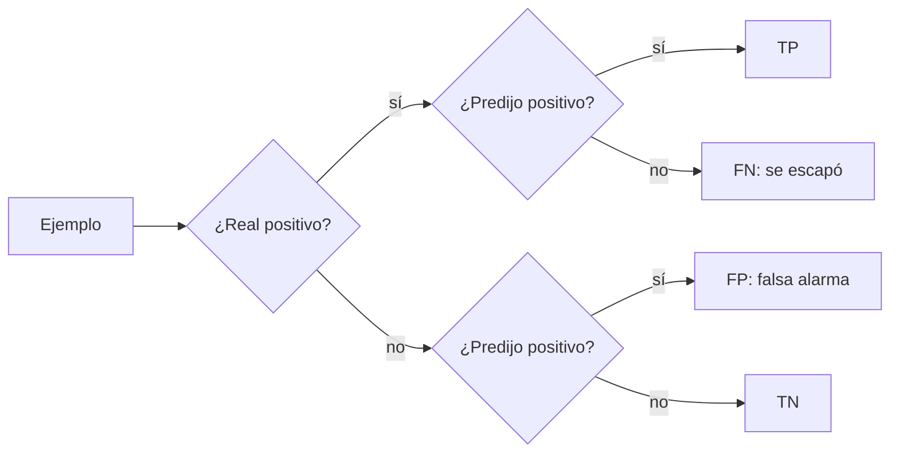

# Matriz de confusión

Parte de: [[Métricas de clasificación y regresión]]

> [!info] Cómo avanzar
> `progreso`: **pendiente** → **viendo** (estudiando) → **visto** (contestaste la autoevaluación sin abrir las respuestas) → **dominado** (hiciste el laboratorio o lo aplicaste de verdad).

## Contenido

### Qué es
La matriz de confusión es una tabla que cruza **la clase real** contra **la clase que predijo el modelo** y cuenta cuántos ejemplos caen en cada combinación. En clasificación binaria tiene cuatro celdas: verdaderos positivos (TP), falsos positivos (FP), falsos negativos (FN) y verdaderos negativos (TN). Es la vista más completa del desempeño de un clasificador porque **separa los tipos de error**: no es lo mismo una falsa alarma que un caso que se escapó. Todas las métricas de [[Precisión, recall y F1]] se calculan a partir de ella.

### Cómo funciona
**La convención de scikit-learn.** `confusion_matrix(y_true, y_pred)` pone **la clase real en las filas** y **la predicha en las columnas**, con las clases en orden ascendente (0 primero, luego 1). Para el caso binario queda:

|  | predijo 0 | predijo 1 |
|---|---|---|
| **real 0** | TN | FP |
| **real 1** | FN | TP |

Es decir, `[[TN, FP], [FN, TP]]`. Con `.ravel()` obtienes `tn, fp, fn, tp` en ese orden. Ojo: otros libros, herramientas o artículos ponen la predicción en filas, o la clase positiva primero. **Lee siempre las etiquetas de los ejes** antes de interpretar.

**Construirla a mano.** Real `[1, 0, 1, 1, 0, 0]`, predicho `[1, 0, 0, 1, 1, 0]`. Recorre posición por posición:
1. real 1, pred 1 → TP
2. real 0, pred 0 → TN
3. real 1, pred 0 → FN
4. real 1, pred 1 → TP
5. real 0, pred 1 → FP
6. real 0, pred 0 → TN

TP = 2, TN = 2, FP = 1, FN = 1 → matriz `[[2, 1], [1, 2]]`. Precisión = 2/(2+1) ≈ 0.667 y recall = 2/(2+1) ≈ 0.667.

**Leerla desde el problema.** Si hay 100 positivos reales y el modelo detecta 70, entonces TP = 70 y FN = 30 (los que se escaparon). Si además marcó 30 negativos como positivos, FP = 30. La suma de la fila "real 1" siempre da el total de positivos reales; la suma de la columna "predijo 1", el total de alertas que levantó el modelo.



**Multiclase.** Con k clases es una matriz `k × k`: la diagonal son aciertos y cada celda fuera de ella dice **qué clase se confunde con cuál** ("los tickets de Facturación se clasifican como Pagos"). Es oro para decidir qué datos o features agregar. Normalizar por filas (`normalize="true"`) muestra el recall de cada clase.

**Depende del umbral.** La matriz se calcula con clases ya decididas; si cambias el umbral de probabilidad, cambian todos los conteos. Por eso conviene revisarla en el umbral que realmente usarás en producción.

### Ejemplo

```python
import numpy as np
from sklearn.metrics import confusion_matrix, precision_score, recall_score, ConfusionMatrixDisplay

y_true = [1, 0, 1, 1, 0, 0]
y_pred = [1, 0, 0, 1, 1, 0]
cm = confusion_matrix(y_true, y_pred)
print(cm)                                   # [[2 1]
                                            #  [1 2]]
tn, fp, fn, tp = cm.ravel()
print(f"TN={tn} FP={fp} FN={fn} TP={tp}")
print(round(precision_score(y_true, y_pred), 3), round(recall_score(y_true, y_pred), 3))

# Del enunciado: 100 positivos reales, 70 detectados y 30 negativos marcados como positivos
tp, fn, fp = 70, 100 - 70, 30
print("precisión", tp / (tp + fp), "recall", tp / (tp + fn))     # 0.7 0.7

# Multiclase con etiquetas de texto y normalización por fila (recall por clase)
real = ["Pagos", "Facturación", "Pagos", "Acceso", "Facturación", "Facturación"]
pred = ["Pagos", "Pagos", "Pagos", "Acceso", "Facturación", "Pagos"]
etiquetas = ["Acceso", "Facturación", "Pagos"]
print(confusion_matrix(real, pred, labels=etiquetas))
print(confusion_matrix(real, pred, labels=etiquetas, normalize="true").round(2))
```

`ConfusionMatrixDisplay.from_predictions(y_true, y_pred)` la dibuja con los ejes rotulados (requiere matplotlib).

**En .NET.** En [[ML.NET]], `metrics.ConfusionMatrix` trae los conteos y `metrics.ConfusionMatrix.GetFormattedConfusionTable()` imprime la tabla con encabezados; revisa ahí qué eje es la predicción, porque la presentación no tiene por qué coincidir con la de scikit-learn.

### Cuándo usarlo y cuándo no
Revísala **siempre** junto con cualquier métrica resumida: un F1 de 0.7 puede esconder que el modelo nunca predice una clase. Es especialmente útil para explicar resultados a negocio ("de cada 100 fraudes detectamos 70 y generamos 30 falsas alarmas"). No sirve para comparar modelos a través de todos los umbrales; para eso está la [[Curva ROC y AUC]].

### Errores comunes
- **Leer los ejes al revés**: confundes FP con FN y sacas la conclusión contraria.
- **Asumir el orden de las clases**: con etiquetas de texto scikit-learn las ordena alfabéticamente; pásale `labels=`.
- **Ignorar el umbral** con el que se construyó.
- **Ver solo la diagonal** en multiclase y no las confusiones específicas.

### Para profundizar
- [scikit-learn: confusion_matrix](https://scikit-learn.org/stable/modules/generated/sklearn.metrics.confusion_matrix.html)
- [scikit-learn: ConfusionMatrixDisplay](https://scikit-learn.org/stable/modules/generated/sklearn.metrics.ConfusionMatrixDisplay.html)
- [Google ML Crash Course: umbrales y matriz de confusión](https://developers.google.com/machine-learning/crash-course/classification/thresholding)

## Ejercicios

Resuélvelos en papel o en la herramienta; la solución está plegada.

> [!question]- Real `[1,0,1,1,0,0]`, predicho `[1,0,0,1,1,0]`. Construye la matriz.
> TP = 2, FN = 1, FP = 1, TN = 2 → `[[2, 1], [1, 2]]` en orden `[[TN, FP], [FN, TP]]`.

> [!question]- Con esa matriz, ¿precisión y recall?
> Precisión `2/3 ≈ 0.667`; recall `2/3 ≈ 0.667`.

> [!question]- 100 positivos reales, el modelo detecta 70 y además marca 30 negativos como positivos. ¿TP, FN, FP?
> TP = 70, FN = 30, FP = 30.

## Autoevaluación

Contesta primero en voz alta o en papel; luego despliega la respuesta.

> [!question]- ¿Qué muestra?
> Una tabla de clases reales vs predichas: TP, FP, FN y TN en el caso binario. Todas las métricas de clasificación salen de ahí.

> [!question]- En scikit-learn, ¿qué orden tiene `confusion_matrix(y, ŷ)` binaria?
> Filas = real, columnas = predicho, con etiquetas ordenadas: `[[TN, FP], [FN, TP]]`.

> [!question]- Error común: leer la matriz con los ejes al revés.
> Confundes FP con FN y concluyes lo contrario. Revisa siempre qué eje es el real (usa `ConfusionMatrixDisplay` con etiquetas).

## Práctica

- [[Lab 2 - Regresión y clasificación con scikit-learn]]

