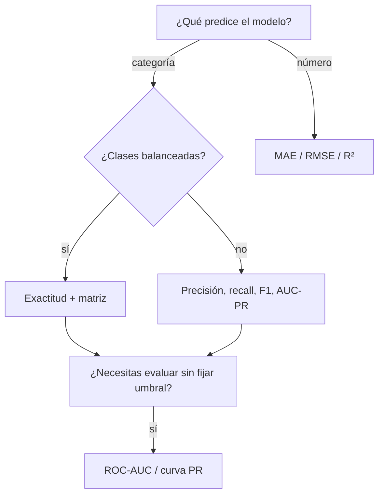

# Métricas de clasificación y regresión

Parte de: [[21-IA-Machine-Learning/03 Machine learning clásico/_Índice Machine learning clásico|Machine learning clásico]]

> [!info] Cómo avanzar
> `progreso`: **pendiente** → **viendo** (estudiando) → **visto** (contestaste la autoevaluación sin abrir las respuestas) → **dominado** (hiciste el laboratorio o lo aplicaste de verdad).

## Contenido

### Qué es
Una métrica convierte "¿qué tan bueno es el modelo?" en un número que puedes comparar. La elección de métrica **no es un detalle técnico**: define qué significa "bueno" para tu problema y, por tanto, qué modelo y qué umbral eliges. Un modelo de fraude con 99 % de exactitud puede ser inútil; uno de demanda con un RMSE bajo puede fallar justo en los días de mayor venta. Esta nota da el panorama; el detalle va en los subtemas:

- [[Matriz de confusión]]: la tabla base de la clasificación (aciertos y tipos de error).
- [[Precisión, recall y F1]]: métricas que se calculan de esa tabla y que importan cuando las clases están desbalanceadas.
- [[Curva ROC y AUC]]: evalúan el modelo en **todos los umbrales** a la vez, a partir de sus probabilidades.
- [[Métricas de regresión (MAE, RMSE y R²)]]: para cuando la salida es un número.

### Cómo funciona
**Clasificación.** Todo parte de cuatro conteos (con "positivo" = la clase que te interesa detectar):
- **TP** (verdaderos positivos): era positivo y lo detectaste.
- **FP** (falsos positivos): era negativo y dijiste positivo (falsa alarma).
- **FN** (falsos negativos): era positivo y se te escapó.
- **TN** (verdaderos negativos): era negativo y dijiste negativo.

De ahí: **exactitud** `(TP+TN)/total`, **precisión** `TP/(TP+FP)` ("de lo que marqué, cuánto era cierto"), **recall** `TP/(TP+FN)` ("de lo que existía, cuánto encontré") y **F1**, su media armónica. Con TP = 40, FP = 10, FN = 20, TN = 30: exactitud 0.70, precisión 0.80, recall ≈ 0.667 y F1 ≈ 0.727.

**Por qué la exactitud engaña con clases desbalanceadas.** Si solo el 1 % de las transacciones es fraude, un "modelo" que siempre dice "no es fraude" tiene **99 % de exactitud** y no detecta ni un caso. La exactitud la dominan los negativos. Con desbalance, mira precisión, recall, F1, AUC-PR y la matriz completa.

**¿Recall o precisión?** Depende de qué error cuesta más:
- **Prioriza recall** cuando un falso negativo es grave: detectar fraude, una enfermedad, una falla en un equipo, contenido peligroso. Prefieres revisar falsas alarmas que dejar pasar un caso.
- **Prioriza precisión** cuando un falso positivo es caro o molesto: bloquear la tarjeta de un cliente bueno, mandar a cobranza, marcar como spam un correo legítimo, una alerta que despierta a alguien de guardia.
Las dos se mueven en direcciones opuestas al cambiar el umbral; la decisión es de negocio.

**Regresión.** Los errores son distancias numéricas: **MAE** (error absoluto medio), **MSE** (error cuadrático medio), **RMSE** (raíz del MSE, en las unidades del objetivo) y **R²** (qué fracción de la variación explica el modelo). Para `y = [3, 5, 2]` y `ŷ = [2.5, 5, 4]`: errores 0.5, 0 y 2 → MAE ≈ 0.833, MSE ≈ 1.417, RMSE ≈ 1.190.

**¿MAE o RMSE?** El RMSE eleva los errores al cuadrado, así que **castiga fuerte los errores grandes**. Prefiere **MAE** cuando todos los errores pesan parecido y no quieres que unos cuantos outliers dominen (y es más fácil de explicar: "nos equivocamos 83 pesos en promedio"). Prefiere **RMSE** cuando un error grande es desproporcionadamente malo (quedarte sin inventario en un día pico).



### Ejemplo

```python
import numpy as np
from sklearn.metrics import (accuracy_score, precision_score, recall_score, f1_score,
                             mean_absolute_error, mean_squared_error, root_mean_squared_error)

# Reconstruimos etiquetas que den TP=40, FP=10, FN=20, TN=30
y_true = np.array([1] * 40 + [0] * 10 + [1] * 20 + [0] * 30)
y_pred = np.array([1] * 40 + [1] * 10 + [0] * 20 + [0] * 30)
print(accuracy_score(y_true, y_pred), precision_score(y_true, y_pred),
      round(recall_score(y_true, y_pred), 3), round(f1_score(y_true, y_pred), 3))   # 0.7 0.8 0.667 0.727

y, y_hat = [3, 5, 2], [2.5, 5, 4]
print(round(mean_absolute_error(y, y_hat), 3), round(mean_squared_error(y, y_hat), 3),
      round(root_mean_squared_error(y, y_hat), 3))                                   # 0.833 1.417 1.19

# La trampa de la exactitud: 1 % de positivos y un modelo que siempre dice 0
y_raro = np.array([1] * 10 + [0] * 990)
siempre_cero = np.zeros_like(y_raro)
print("exactitud", accuracy_score(y_raro, siempre_cero), "recall", recall_score(y_raro, siempre_cero))
```

`root_mean_squared_error` existe en versiones recientes de scikit-learn; en versiones viejas se usaba `mean_squared_error(..., squared=False)`.

**En .NET.** [[ML.NET]] devuelve todo esto con `Evaluate`: en clasificación binaria, `Accuracy`, `PositivePrecision`, `PositiveRecall`, `F1Score`, `AreaUnderRocCurve`, `AreaUnderPrecisionRecallCurve` y `ConfusionMatrix`; en regresión, `MeanAbsoluteError`, `MeanSquaredError`, `RootMeanSquaredError` y `RSquared`.

### Cuándo usarlo y cuándo no
Decide la métrica **antes** de entrenar, junto con negocio, y úsala para elegir modelo y umbral en validación. Usa una métrica principal y algunas secundarias de control (por ejemplo, optimizar recall con un piso de precisión). Evita reportar solo exactitud con clases desbalanceadas, o solo R² sin el error en unidades reales.

### Errores comunes
- **Exactitud con desbalance**: un modelo trivial se ve excelente.
- **Optimizar una métrica que no refleja el costo real** de los errores.
- **Comparar métricas calculadas en conjuntos distintos** (uno en train, otro en test).
- **Olvidar el umbral**: precisión, recall y F1 dependen de él; AUC no.

### Para profundizar
- [scikit-learn: métricas y evaluación de modelos](https://scikit-learn.org/stable/modules/model_evaluation.html)
- [Google ML Crash Course: exactitud, precisión y recall](https://developers.google.com/machine-learning/crash-course/classification/accuracy-precision-recall)
- [Microsoft Learn: métricas de ML.NET](https://learn.microsoft.com/es-mx/dotnet/machine-learning/resources/metrics)

## Subtemas

- [[Matriz de confusión]]
- [[Precisión, recall y F1]]
- [[Curva ROC y AUC]]
- [[Métricas de regresión (MAE, RMSE y R²)]]

## Ejercicios

Resuélvelos en papel o en la herramienta; la solución está plegada.

> [!question]- TP = 40, FP = 10, FN = 20, TN = 30. Calcula accuracy, precisión, recall y F1.
> Accuracy `70/100 = 0.70`; precisión `40/50 = 0.80`; recall `40/60 ≈ 0.667`; F1 `2·0.8·0.667/(0.8+0.667) ≈ 0.727`.

> [!question]- `y = [3, 5, 2]`, `ŷ = [2.5, 5, 4]`. Calcula MAE, MSE y RMSE.
> Errores `0.5, 0, -2`. MAE `≈ 0.833`; MSE `≈ 1.417`; RMSE `≈ 1.190`.

> [!question]- Verifícalo con scikit-learn.
> ```python
> from sklearn.metrics import mean_absolute_error, mean_squared_error
> mean_absolute_error([3,5,2],[2.5,5,4]), mean_squared_error([3,5,2],[2.5,5,4])
> ```

## Autoevaluación

Contesta primero en voz alta o en papel; luego despliega la respuesta.

> [!question]- ¿Por qué accuracy engaña con clases desbalanceadas?
> Con 99 % negativos, un modelo que siempre dice "negativo" logra 99 % de accuracy sin detectar nada. Usa precisión, recall, F1 o PR-AUC.

> [!question]- ¿Cuándo priorizas recall y cuándo precisión?
> Recall cuando perder un positivo es caro (detección de cáncer, fraude). Precisión cuando un falso positivo es caro (bloquear la cuenta de un cliente).

> [!question]- ¿Cuándo prefieres MAE sobre RMSE?
> MAE cuando todos los errores pesan igual y hay outliers; RMSE castiga más los errores grandes.

## Práctica

- [[Lab 2 - Regresión y clasificación con scikit-learn]]

## Progreso de los subtemas

```base
filters:
  and:
    - file.inFolder("21-IA-Machine-Learning/03 Machine learning clásico/Métricas de clasificación y regresión")
    - file.name != "Métricas de clasificación y regresión"
views:
  - type: table
    name: Progreso
    order:
      - file.name
      - progreso
      - nivel
```
