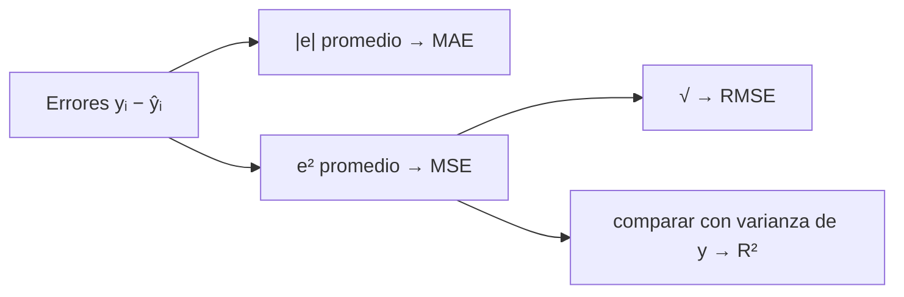

# Métricas de regresión (MAE, RMSE y R²)

Parte de: [[Métricas de clasificación y regresión]]

> [!info] Cómo avanzar
> `progreso`: **pendiente** → **viendo** (estudiando) → **visto** (contestaste la autoevaluación sin abrir las respuestas) → **dominado** (hiciste el laboratorio o lo aplicaste de verdad).

## Contenido

### Qué es
Cuando el modelo predice un número (precio, minutos, demanda), el error de cada predicción es la diferencia `yᵢ − ŷᵢ`. Las métricas de regresión resumen esos errores:

- **MAE** (error absoluto medio) = `(1/n) Σ |yᵢ − ŷᵢ|`: cuánto te equivocas en promedio, en las **unidades del objetivo** (pesos, minutos).
- **MSE** (error cuadrático medio) = `(1/n) Σ (yᵢ − ŷᵢ)²`: lo que optimiza la regresión lineal; está en unidades al cuadrado.
- **RMSE** = `√MSE`: vuelve a las unidades del objetivo, pero conserva el castigo extra a los errores grandes.
- **R²** (coeficiente de determinación) = `1 − SS_res / SS_tot`: qué fracción de la variación de `y` explica el modelo comparado con predecir siempre la media.

### Cómo funciona
**MAE vs RMSE con números.** Errores `[1, 1, 1, 9]`:
- MAE = (1+1+1+9)/4 = **3**.
- RMSE = √((1+1+1+81)/4) = √21 ≈ **4.58**.

El error de 9, al elevarse al cuadrado (81), domina el RMSE. Siempre se cumple `RMSE ≥ MAE`; cuanto más grande la brecha, más desiguales son los errores (hay algunos muy grandes). Por eso:
- **MAE** es robusto y fácil de explicar ("nos equivocamos 3 minutos en promedio"). Úsalo si los outliers no deben dominar o si el costo del error crece en línea recta.
- **RMSE** penaliza los errores grandes. Úsalo si un error de 10 es mucho peor que diez errores de 1 (quedarse sin inventario un día pico, un tiempo de entrega prometido muy lejos de la realidad).

**R² paso a paso.** `SS_tot = Σ (yᵢ − ȳ)²` es la variación total (el error de un modelo que siempre predice la media). `SS_res = Σ (yᵢ − ŷᵢ)²` es el error de tu modelo. Para `y = [3, 5, 2]`, `ŷ = [2.5, 5, 4]`: `ȳ ≈ 3.333`, `SS_tot ≈ 4.667`, `SS_res = 0.25 + 0 + 4 = 4.25`, así que `R² = 1 − 4.25/4.667 ≈ 0.089`. El modelo apenas mejora a la media.

**Cómo leer R².**
- **R² = 1**: predicciones perfectas.
- **R² = 0**: igual que predecir siempre la media. Si tu modelo predice siempre `ȳ`, obtiene exactamente 0.
- **R² < 0**: peor que la media (posible en datos de prueba con un modelo malo).
- No es "porcentaje de acierto" ni sirve solo: un R² de 0.6 puede ser excelente en ventas diarias y pésimo en una relación física.



**No compares RMSE entre problemas distintos.** RMSE y MAE están en las unidades del objetivo: un RMSE de 50 es buenísimo si predices precios de casas en pesos y terrible si predices temperatura en grados. Tampoco los compares entre datasets del mismo problema con escalas distintas (ventas de una tienda chica vs una grande). Para comparar, usa métricas relativas: R², el **MAPE** (error porcentual medio, cuidado cuando `y` está cerca de cero) o normaliza el RMSE dividiendo entre la media o el rango de `y`.

### Ejemplo

```python
import numpy as np
from sklearn.metrics import mean_absolute_error, mean_squared_error, root_mean_squared_error, r2_score
from sklearn.metrics import mean_absolute_percentage_error

y, y_hat = np.array([3, 5, 2]), np.array([2.5, 5, 4])
print(round(r2_score(y, y_hat), 3))                              # 0.089
print(r2_score(y, np.full(3, y.mean())))                         # 0.0: predecir la media

errores = np.array([1, 1, 1, 9])
print(np.mean(np.abs(errores)), round(np.sqrt(np.mean(errores**2)), 3))   # 3.0 4.583

# Mismo modelo "relativo", escalas distintas: el RMSE no es comparable, R² y MAPE sí
rng = np.random.default_rng(0)
base = rng.uniform(50, 150, 500)
for escala, nombre in ((1, "tienda chica"), (100, "tienda grande")):
    real = base * escala
    pred = real * (1 + rng.normal(0, 0.1, 500))                  # ~10 % de error relativo
    print(f"{nombre:13s} RMSE={root_mean_squared_error(real, pred):9.1f}  "
          f"R²={r2_score(real, pred):.2f}  MAPE={mean_absolute_percentage_error(real, pred):.3f}")
```

El RMSE de la tienda grande es unas 100 veces mayor aunque el modelo sea igual de bueno en términos relativos; R² y MAPE lo muestran.

**En .NET.** `mlContext.Regression.Evaluate(predicciones, labelColumnName: "Minutos")` de [[ML.NET]] devuelve `MeanAbsoluteError`, `MeanSquaredError`, `RootMeanSquaredError` y `RSquared`. Para un tablero en Wee.Reporteria, reporta MAE en unidades de negocio y R² como indicador relativo.

### Cuándo usarlo y cuándo no
Reporta al menos una métrica en unidades (MAE o RMSE) y una relativa (R² o MAPE). Elige MAE o RMSE según el costo real de los errores grandes y úsala para elegir el modelo. Si los errores por exceso y por defecto no cuestan lo mismo (sobrestimar inventario vs quedarte sin él), considera pérdidas asimétricas o regresión por cuantiles. Siempre compara contra una línea base (predecir la media o el valor de la semana pasada).

### Errores comunes
- **Comparar RMSE entre problemas o escalas distintas.**
- **Leer R² como "porcentaje de aciertos".**
- **Usar MAPE con valores reales cercanos a cero**: explota.
- **Evaluar en entrenamiento** y reportar un R² inflado.
- **Ignorar la distribución de errores**: un buen promedio puede esconder errores enormes en un segmento importante.

### Para profundizar
- [scikit-learn: métricas de regresión](https://scikit-learn.org/stable/modules/model_evaluation.html#regression-metrics)
- [Google ML Crash Course: pérdida en regresión lineal](https://developers.google.com/machine-learning/crash-course/linear-regression/loss)
- [Microsoft Learn: métricas de ML.NET](https://learn.microsoft.com/es-mx/dotnet/machine-learning/resources/metrics)

## Ejercicios

Resuélvelos en papel o en la herramienta; la solución está plegada.

> [!question]- `y = [3, 5, 2]`, `ŷ = [2.5, 5, 4]`. Calcula R².
> `ȳ = 3.333`; SS_tot = `0.111 + 2.778 + 1.778 = 4.667`; SS_res = `0.25 + 0 + 4 = 4.25`.
> `R² = 1 - 4.25/4.667 ≈ 0.089`.

> [!question]- Si un modelo predice siempre la media, ¿qué R² obtiene?
> 0.

> [!question]- Errores `[1, 1, 1, 9]`. ¿MAE y RMSE?
> MAE `= 3`; RMSE `= √((1+1+1+81)/4) = √21 ≈ 4.58` (el error de 9 pesa mucho más).

## Autoevaluación

Contesta primero en voz alta o en papel; luego despliega la respuesta.

> [!question]- ¿Qué indica R²?
> La proporción de la varianza de `y` que explica el modelo: 1 es perfecto, 0 equivale a predecir siempre la media, y puede ser negativo si es peor que eso.

> [!question]- ¿En qué unidades están MAE y RMSE?
> En las mismas unidades que la variable objetivo (pesos, minutos), lo que los hace fáciles de comunicar.

> [!question]- Error común: comparar RMSE entre problemas distintos.
> No es comparable entre variables con escalas distintas. Compara contra un modelo base (predecir la media) en el mismo problema.

## Práctica

- [[Lab 2 - Regresión y clasificación con scikit-learn]]

