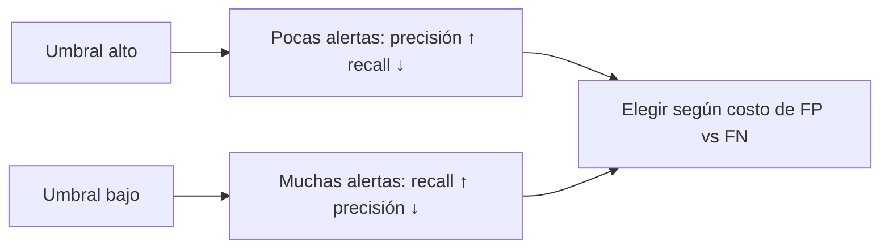

# Precisión, recall y F1

Parte de: [[Métricas de clasificación y regresión]]

> [!info] Cómo avanzar
> `progreso`: **pendiente** → **viendo** (estudiando) → **visto** (contestaste la autoevaluación sin abrir las respuestas) → **dominado** (hiciste el laboratorio o lo aplicaste de verdad).

## Contenido

### Qué es
Tres métricas de clasificación que se calculan de la [[Matriz de confusión]] y que importan sobre todo cuando las clases están desbalanceadas:

- **Precisión** = `TP / (TP + FP)`: de todo lo que el modelo marcó como positivo, ¿qué fracción realmente lo era? Mide **qué tan confiables son sus alertas**.
- **Recall** (sensibilidad, exhaustividad) = `TP / (TP + FN)`: de todos los positivos que existían, ¿qué fracción encontró? Mide **qué tanto se le escapa**.
- **F1** = `2·P·R / (P + R)`: la **media armónica** de las dos, un solo número que solo es alto si ambas lo son.

Ejemplo: TP = 8, FP = 2, FN = 8 → precisión 0.8 (sus alertas son buenas), recall 0.5 (se le escapa la mitad), F1 ≈ 0.615.

### Cómo funciona
**Intuición con una red de pesca.** El recall es qué parte de los peces del lago atrapaste; la precisión, qué parte de lo que sacaste son peces y no basura. Una red enorme (umbral bajo) atrapa casi todos los peces (recall alto) pero también mucha basura (precisión baja). Una red diminuta solo saca lo que seguro es pez (precisión alta) pero deja casi todo en el agua (recall bajo).

**Por qué media armónica y no promedio.** El promedio aritmético deja que una métrica alta tape a una pésima. Con precisión 1.0 y recall 0.1 (marcó un solo caso, correcto, de diez), el promedio daría 0.55, que suena aceptable; la media armónica da `2·1·0.1/1.1 ≈ 0.182`, que refleja que el modelo casi no sirve. La armónica **se acerca al menor de los dos valores**. Con precisión 0.9 y recall 0.5, F1 ≈ 0.643 (el promedio sería 0.7).

**El umbral las mueve en direcciones opuestas.** Un clasificador da probabilidades; el umbral decide a partir de cuánto llamas "positivo".
- **Bajar el umbral**: marcas más casos como positivos → encuentras más de los verdaderos (**recall sube**) pero también entran más falsas alarmas (**precisión suele bajar**).
- **Subir el umbral**: solo marcas los casos muy seguros → **precisión suele subir**, **recall baja**.

El recall nunca baja al bajar el umbral; la precisión casi siempre baja, aunque no de forma estrictamente monótona. La **curva precisión-recall** muestra el compromiso para todos los umbrales y su área (AUC-PR, o *average precision*) resume el modelo sin fijar umbral.



**Variantes útiles.**
- **F-beta**: `F_β` da más peso al recall si β > 1 (F2 es común en detección de fraude o enfermedades) o a la precisión si β < 1.
- **Multiclase**: se calcula por clase y se promedia. **Macro** (promedio simple, trata igual a todas las clases, sensible a clases raras), **weighted** (ponderado por soporte) o **micro** (suma global de TP, FP, FN). `classification_report` las muestra todas.

### Ejemplo

```python
import numpy as np
from sklearn.datasets import make_classification
from sklearn.model_selection import train_test_split
from sklearn.linear_model import LogisticRegression
from sklearn.metrics import precision_score, recall_score, f1_score, fbeta_score, classification_report

f1 = lambda p, r: 2 * p * r / (p + r)
print(round(f1(0.9, 0.5), 3), round(f1(1.0, 0.1), 3))     # 0.643 0.182
tp, fp, fn = 8, 2, 8
p, r = tp / (tp + fp), tp / (tp + fn)
print(p, r, round(f1(p, r), 3))                            # 0.8 0.5 0.615

X, y = make_classification(n_samples=5_000, weights=[0.93], class_sep=0.7, random_state=3)
X_tr, X_te, y_tr, y_te = train_test_split(X, y, test_size=0.3, stratify=y, random_state=3)
proba = LogisticRegression(max_iter=1000).fit(X_tr, y_tr).predict_proba(X_te)[:, 1]

for u in (0.7, 0.5, 0.3, 0.1):
    pred = (proba >= u).astype(int)
    print(f"umbral {u}: P={precision_score(y_te, pred):.2f} R={recall_score(y_te, pred):.2f} "
          f"F1={f1_score(y_te, pred):.2f} F2={fbeta_score(y_te, pred, beta=2):.2f}")

print(classification_report(y_te, (proba >= 0.3).astype(int), digits=2))
```

Observa en la salida cómo, al bajar el umbral, el recall sube y la precisión cae, y cómo F2 favorece umbrales más bajos que F1.

**En .NET.** En [[ML.NET]], `BinaryClassificationMetrics` trae `PositivePrecision`, `PositiveRecall` y `F1Score` calculados con el umbral por defecto. Para evaluar otro umbral, aplica la regla `Probability >= umbral` sobre las predicciones de validación y calcula las métricas tú mismo; luego usa ese umbral en tu endpoint (puede vivir en configuración, no en el código).

### Cuándo usarlo y cuándo no
Úsalas siempre que la clase positiva sea rara o los errores tengan costos distintos. Elige el umbral en **validación** según la métrica que refleja el negocio: máximo F1 si ambos errores pesan parecido, F2 o "recall ≥ X con la mejor precisión posible" si se te puede escapar poco, o "precisión ≥ X" si cada alerta cuesta. Si las clases están balanceadas y los errores cuestan igual, la exactitud basta como resumen.

### Errores comunes
- **Confundir precisión con exactitud** (*accuracy*): en español se parecen, pero son métricas distintas.
- **Reportar F1 sin precisión y recall**: el mismo F1 puede venir de combinaciones muy diferentes.
- **Elegir el umbral en el conjunto de prueba**: hazlo en validación.
- **Usar promedio macro sin saberlo** en multiclase y sorprenderte porque una clase rara baja todo.

### Para profundizar
- [scikit-learn: precisión, recall y F-measures](https://scikit-learn.org/stable/modules/model_evaluation.html#precision-recall-and-f-measures)
- [scikit-learn: ajustar el umbral de decisión](https://scikit-learn.org/stable/modules/classification_threshold.html)
- [Google ML Crash Course: exactitud, precisión y recall](https://developers.google.com/machine-learning/crash-course/classification/accuracy-precision-recall)

## Ejercicios

Resuélvelos en papel o en la herramienta; la solución está plegada.

> [!question]- Precisión 0.9 y recall 0.5. ¿F1?
> `2·0.9·0.5/1.4 ≈ 0.643`

> [!question]- Precisión 1.0 y recall 0.1. ¿F1?
> `2·1·0.1/1.1 ≈ 0.182` (la media aritmética daría 0.55, engañosa).

> [!question]- TP = 8, FP = 2, FN = 8. Calcula las tres.
> Precisión `0.8`, recall `0.5`, F1 `≈ 0.615`.

## Autoevaluación

Contesta primero en voz alta o en papel; luego despliega la respuesta.

> [!question]- Define precisión y recall.
> Precisión `TP/(TP+FP)`: de lo que marqué positivo, cuánto era cierto. Recall `TP/(TP+FN)`: de los positivos reales, cuántos encontré.

> [!question]- ¿Por qué F1 usa media armónica?
> Para que un valor muy bajo en cualquiera de las dos arrastre el resultado; no se puede "compensar" un recall pésimo con precisión perfecta.

> [!question]- ¿Qué pasa con precisión y recall al bajar el umbral?
> Normalmente sube el recall (más positivos detectados) y baja la precisión (más falsos positivos).

## Práctica

- [[Lab 2 - Regresión y clasificación con scikit-learn]]

