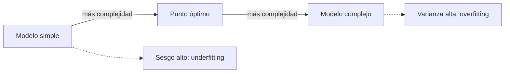

# Overfitting, underfitting y sesgo-varianza

Parte de: [[21-IA-Machine-Learning/03 Machine learning clásico/_Índice Machine learning clásico|Machine learning clásico]]

> [!info] Cómo avanzar
> `progreso`: **pendiente** → **viendo** (estudiando) → **visto** (contestaste la autoevaluación sin abrir las respuestas) → **dominado** (hiciste el laboratorio o lo aplicaste de verdad).

## Contenido

### Qué es
Son los dos modos en que un modelo falla al **generalizar**:

- **Underfitting (subajuste)**: el modelo es **demasiado simple** para el patrón. Le va mal en entrenamiento y en validación. Ejemplo: una recta para datos con forma de parábola.
- **Overfitting (sobreajuste)**: el modelo es **demasiado flexible** y aprende también el ruido. Le va excelente en entrenamiento y mal en validación. Ejemplo: un árbol sin límite que memoriza cada fila.

El **compromiso sesgo-varianza** es la forma teórica de entender ambos: el error de un modelo en datos nuevos se descompone en **sesgo²** (error por suposiciones demasiado rígidas), **varianza** (error por ser demasiado sensible a la muestra de entrenamiento) y **ruido irreducible**.

### Cómo funciona
**Cómo reconocerlos** comparando el error de entrenamiento con el de validación:

| Síntoma | Diagnóstico |
|---|---|
| Error alto en train y en validación, parecidos | Underfitting (sesgo alto) |
| Error bajo en train, mucho más alto en validación | Overfitting (varianza alta) |
| Ambos bajos y cercanos | Bien ajustado |

**Sesgo vs varianza, en intuición.** Imagina entrenar el mismo tipo de modelo con 100 muestras distintas del mismo fenómeno:
- Un modelo de **sesgo alto** da casi la misma predicción con todas las muestras, pero sistemáticamente lejos de la verdad (una recta nunca captará la curva).
- Un modelo de **varianza alta** da predicciones muy distintas según la muestra; en promedio quizá acierta, pero cada modelo individual está lleno de ruido.

Al aumentar la complejidad (más profundidad, más features, menos regularización), el sesgo baja y la varianza sube. El punto óptimo está en medio: la curva de error de validación tiene forma de **U**.



**Remedios para overfitting:**
1. **Más datos** (o aumento de datos en imágenes): la medicina más efectiva.
2. **Regularización**: L2/L1 en modelos lineales (`C`, `alpha`), dropout y weight decay en redes ([[Regularización y dropout]]).
3. **Simplificar el modelo**: limitar `max_depth`, `min_samples_leaf`, menos features.
4. **Ensambles** que promedian varianza (random forest) y **early stopping** en boosting y redes.
5. **Selección de features**: quitar las ruidosas o redundantes.

**Remedios para underfitting:** un modelo más flexible, mejores features ([[Feature engineering]]), menos regularización, entrenar más tiempo.

**¿Más features siempre ayudan?** No. Cada feature irrelevante añade ruido que el modelo puede usar para "explicar" casualidades del entrenamiento; con pocas filas y muchas columnas el sobreajuste es casi seguro. Además, en métodos basados en distancia, muchas dimensiones hacen que todo parezca igual de lejos (maldición de la dimensionalidad). Una feature solo ayuda si aporta información real y estará disponible al predecir.

### Ejemplo
Regresión polinomial de distintos grados sobre datos con ruido:

```python
import numpy as np
from sklearn.pipeline import make_pipeline
from sklearn.preprocessing import PolynomialFeatures, StandardScaler
from sklearn.linear_model import LinearRegression, Ridge
from sklearn.metrics import mean_squared_error
from sklearn.model_selection import train_test_split

rng = np.random.default_rng(1)
X = rng.uniform(0, 1, (30, 1))                       # pocos datos: terreno fértil para sobreajustar
y = np.sin(2 * np.pi * X[:, 0]) + rng.normal(0, 0.25, 30)
X_tr, X_va, y_tr, y_va = train_test_split(X, y, test_size=0.5, random_state=0)

def evalua(modelo, nombre):
    modelo.fit(X_tr, y_tr)
    e_tr = mean_squared_error(y_tr, modelo.predict(X_tr))
    e_va = mean_squared_error(y_va, modelo.predict(X_va))
    print(f"{nombre:22s} train {e_tr:.3f}   validación {e_va:.3f}")

for g in (1, 4, 15):
    evalua(make_pipeline(PolynomialFeatures(g), StandardScaler(), LinearRegression()), f"grado {g}")
evalua(make_pipeline(PolynomialFeatures(15), StandardScaler(), Ridge(alpha=0.01)), "grado 15 + Ridge")
```

Grado 1: ambos errores altos (underfitting). Grado 4: ambos bajos. Grado 15: el error de entrenamiento es el más bajo de todos, pero el de validación se cuadruplica respecto al grado 4 (overfitting). Con un poco de regularización Ridge, el mismo grado 15 vuelve a un error de validación cercano al del grado 4.

**En .NET.** En [[ML.NET]] verás el mismo diagnóstico comparando métricas de `Evaluate` sobre el conjunto de entrenamiento y el de prueba. Los trainers lineales exponen regularización (`l2Regularization`, `l1Regularization` en SDCA), y los de árboles, `numberOfLeaves` y `minimumExampleCountPerLeaf`.

### Cuándo usarlo y cuándo no
Este diagnóstico se hace **siempre**, en cada experimento: reporta las métricas de train y de validación lado a lado. Las **curvas de aprendizaje** (error contra tamaño del entrenamiento, `learning_curve` en scikit-learn) te dicen si conseguir más datos ayudará: si las curvas ya convergieron en un error alto, más datos no sirven y necesitas un modelo más rico; si hay un hueco grande entre ellas, más datos o regularización sí.

### Errores comunes
- **Mirar solo la métrica de entrenamiento** y celebrar.
- **Diagnosticar con el conjunto de prueba** repetidamente: termina sobreajustado a prueba.
- **Agregar features "por si acaso"**: más ruido, más varianza.
- **Combatir underfitting con regularización** (o overfitting quitándola): es al revés.

### Para profundizar
- [scikit-learn: curvas de validación y de aprendizaje](https://scikit-learn.org/stable/modules/learning_curve.html)
- [Google ML Crash Course: overfitting](https://developers.google.com/machine-learning/crash-course/overfitting)
- [scikit-learn: underfitting vs overfitting (ejemplo)](https://scikit-learn.org/stable/auto_examples/model_selection/plot_underfitting_overfitting.html)

## Autoevaluación

Contesta primero en voz alta o en papel; luego despliega la respuesta.

> [!question]- ¿Cómo reconoces overfitting y underfitting?
> Overfitting: error bajo en entrenamiento y alto en validación. Underfitting: error alto en ambos.

> [!question]- ¿Qué es el compromiso sesgo-varianza?
> Modelos simples tienen sesgo alto (no captan el patrón); modelos muy flexibles tienen varianza alta (cambian mucho con los datos). Se busca el punto que minimiza el error en datos nuevos.

> [!question]- Tu modelo sobreajusta. Da tres remedios.
> Más datos, regularización (L1/L2, dropout), modelo más simple, *early stopping*, menos features.

> [!question]- Error común: ¿más features siempre mejoran?
> No: features irrelevantes o con fugas aumentan la varianza y el riesgo de leakage.

