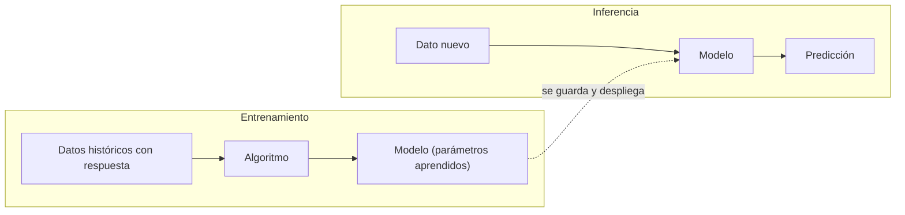

# Qué es el machine learning

Parte de: [[21-IA-Machine-Learning/03 Machine learning clásico/_Índice Machine learning clásico|Machine learning clásico]]

> [!info] Cómo avanzar
> `progreso`: **pendiente** → **viendo** (estudiando) → **visto** (contestaste la autoevaluación sin abrir las respuestas) → **dominado** (hiciste el laboratorio o lo aplicaste de verdad).

## Contenido

### Qué es
El machine learning (aprendizaje automático) es una forma de construir software en la que **no escribes las reglas: las aprende un algoritmo a partir de ejemplos**. En programación tradicional tú codificas `si monto > 50,000 y país ≠ MX entonces revisar`. En ML le das miles de transacciones etiquetadas como "fraude" o "legítima" y el algoritmo ajusta un **modelo** (una función con parámetros) que reproduce ese patrón y, lo importante, **generaliza** a transacciones que nunca vio. Sirve cuando las reglas son demasiadas, cambian con el tiempo o nadie sabe escribirlas (reconocer una cara, estimar la demanda de mañana, clasificar tickets de soporte).

### Cómo funciona
El ciclo de vida de un modelo tiene dos fases muy distintas:



1. **Entrenamiento**: el algoritmo recorre los datos y ajusta los parámetros para minimizar una función de pérdida (por ejemplo, el error cuadrático). Es costoso, se hace de vez en cuando (diario, semanal) y suele correr fuera de tu API, en un notebook, un job o un pipeline.
2. **Inferencia (predicción)**: el modelo ya entrenado recibe un dato nuevo y devuelve una respuesta. Es barato y rápido; es lo que corre dentro de tu API en cada petición.

Esta separación se parece a compilar y ejecutar: entrenar "produce el binario" (un archivo `.pkl`, `.onnx` o `.zip` de ML.NET) y la inferencia lo usa.

**Piezas del vocabulario:**
- **Features (características)**: las entradas (edad, monto, hora).
- **Etiqueta (label, target)**: lo que quieres predecir.
- **Modelo**: la función aprendida.
- **Generalizar**: funcionar bien con datos nuevos, no solo con los de entrenamiento. Medirlo bien es la mitad del oficio: lo ves en [[Datos de entrenamiento, validación y prueba]] y [[Overfitting, underfitting y sesgo-varianza]].

**Tipos de problema.** Según haya o no etiquetas y cómo llega la retroalimentación se habla de aprendizaje supervisado, no supervisado y por refuerzo ([[Aprendizaje supervisado, no supervisado y por refuerzo]]). El "ML clásico" de esta sección (regresiones, árboles, boosting, k-means) funciona muy bien con datos tabulares; las redes neuronales dominan en imágenes, audio y texto.

### Ejemplo
Un modelo que aprende la regla "aprobar si ingreso alto y deuda baja" sin que se la escribamos:

```python
import numpy as np
from sklearn.model_selection import train_test_split
from sklearn.tree import DecisionTreeClassifier, export_text

rng = np.random.default_rng(0)
ingreso = rng.uniform(5_000, 80_000, 1_000)
deuda = rng.uniform(0, 1, 1_000)                  # proporción de deuda sobre ingreso
aprobado = ((ingreso > 30_000) & (deuda < 0.4)).astype(int)   # la "regla oculta"
X = np.column_stack([ingreso, deuda])

X_tr, X_te, y_tr, y_te = train_test_split(X, aprobado, test_size=0.2, random_state=0)
modelo = DecisionTreeClassifier(max_depth=2).fit(X_tr, y_tr)     # ENTRENAR
print(export_text(modelo, feature_names=["ingreso", "deuda"]))
print("exactitud en datos nuevos:", modelo.score(X_te, y_te))

nuevo = [[45_000, 0.2], [12_000, 0.1]]
print(modelo.predict(nuevo))                                     # INFERIR -> [1 0]
```

El árbol descubre umbrales cercanos a 30,000 y 0.4 por sí solo. En datos reales la regla no es tan limpia y hay ruido, pero la idea es la misma.

**En .NET.** Con [[ML.NET]] el ciclo es idéntico: `pipeline.Fit(datos)` entrena, `mlContext.Model.Save(...)` guarda un `.zip`, y en ASP.NET Core usas `PredictionEnginePool` (paquete `Microsoft.Extensions.ML`) para inferir en cada petición sin recrear el motor. Model Builder en Visual Studio genera ese código a partir de un CSV o una tabla de SQL Server.

### Cuándo usarlo y cuándo no
Conviene ML cuando: hay un patrón real pero difícil de expresar en reglas, tienes **suficientes datos históricos de calidad** con la respuesta conocida, toleras cierto margen de error y el patrón se mantiene relativamente estable.

**No** conviene cuando:
- La regla es simple y conocida (calcular IVA, validar un RFC): un `if` es más barato, exacto y auditable.
- Necesitas 100 % de exactitud o explicaciones legales de cada decisión y el modelo no las puede dar.
- No hay datos, o los datos no tienen la respuesta.
- El costo de mantener el modelo (reentrenar, monitorear [[Monitoreo de modelos y drift]]) supera el beneficio.

Un buen primer paso siempre es una **línea base** sencilla (la regla actual, o predecir el promedio) para saber si el ML realmente aporta.

### Errores comunes
- **Empezar por el algoritmo y no por el problema**: define antes qué decisión mejorará y cómo la medirás.
- **Evaluar con los mismos datos de entrenamiento**: el modelo parece perfecto y falla en producción.
- **Creer que más complejidad es mejor**: un modelo lineal bien hecho suele ganarle a uno complejo mal validado.
- **Olvidar la inferencia**: un modelo excelente que no se puede servir a tiempo o con los datos disponibles al momento de predecir no sirve.

### Para profundizar
- [Google: Machine Learning Crash Course](https://developers.google.com/machine-learning/crash-course)
- [scikit-learn: introducción al machine learning](https://scikit-learn.org/stable/getting_started.html)
- [Microsoft Learn: ¿Qué es ML.NET?](https://learn.microsoft.com/es-mx/dotnet/machine-learning/how-does-mldotnet-work)

## Autoevaluación

Contesta primero en voz alta o en papel; luego despliega la respuesta.

> [!question]- ¿Qué es el machine learning?
> Hacer que un programa aprenda patrones a partir de datos en lugar de programar las reglas a mano. Se entrena con ejemplos y luego se usa para predecir en datos nuevos.

> [!question]- ¿Cuándo NO conviene usar ML?
> Cuando las reglas son claras y estables (calcular IVA), no hay datos suficientes o etiquetados, o el error no es tolerable y no se puede explicar.

> [!question]- ¿Qué diferencia hay entre entrenar e inferir?
> Entrenar ajusta los parámetros del modelo con datos (costoso, se hace pocas veces); inferir usa el modelo ya entrenado para predecir (rápido, en producción).

