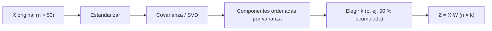

# Reducción de dimensionalidad (PCA)

Parte de: [[21-IA-Machine-Learning/03 Machine learning clásico/_Índice Machine learning clásico|Machine learning clásico]]

> [!info] Cómo avanzar
> `progreso`: **pendiente** → **viendo** (estudiando) → **visto** (contestaste la autoevaluación sin abrir las respuestas) → **dominado** (hiciste el laboratorio o lo aplicaste de verdad).

## Contenido

### Qué es
PCA (*análisis de componentes principales*) transforma muchas features correlacionadas en **pocas features nuevas, independientes entre sí**, llamadas **componentes principales**, ordenadas de la que **más varianza explica** a la que menos. Si tienes 50 columnas y las primeras 5 componentes conservan el 90 % de la variación, puedes trabajar con 5 en lugar de 50 perdiendo poca información. Es [[Aprendizaje no supervisado]]: no usa la etiqueta.

### Cómo funciona
**Intuición.** Imagina una nube de puntos en 2D con forma de elipse inclinada. La **primera componente** es la dirección del eje largo de la elipse: la dirección en la que los datos se dispersan más. La **segunda** es perpendicular a la primera y captura lo que sobra. Proyectar los puntos sobre la primera componente es "aplastar" la nube en una línea perdiendo lo menos posible.

**Mecánica mínima.**
1. **Centra** los datos (resta la media de cada feature) y normalmente **estandariza**.
2. Calcula la **matriz de covarianza** (cómo varían juntas las features).
3. Obtén sus **vectores propios** (las direcciones, es decir, las componentes) y **valores propios** (cuánta varianza hay en cada dirección). En la práctica se calcula con SVD, que es más estable.
4. Ordena por valor propio, quédate con las primeras `k` y proyecta: `Z = X · W_k` (un producto matricial, ver [[Álgebra lineal para ML (vectores, matrices y producto punto)]]).

**Varianza explicada.** Cada componente explica `valor_propio / suma de valores propios`. Con valores propios `[4, 1]`, la primera explica `4/5 = 80 %`. Con `[5, 3, 1, 1]` (suma 10), la primera explica 50 % y las dos primeras 80 %, así que necesitas **2 componentes** para llegar a ≥ 80 %. En scikit-learn lo ves en `explained_variance_ratio_` y su suma acumulada; también puedes pedir `PCA(n_components=0.8)` y que elija k solo.



**Por qué estandarizar antes.** PCA busca direcciones de **máxima varianza**, y la varianza depende de las unidades. Si una feature es "ingreso en pesos" (varianza de millones) y otra "edad" (varianza de decenas), la primera componente será básicamente "ingreso", no porque sea más importante sino porque sus números son más grandes. Estandarizar (media 0, desviación 1) pone a todas en igualdad.

**Para qué se usa.**
- **Visualizar** datos de muchas dimensiones en 2D o 3D (por ejemplo, embeddings o segmentos de clientes).
- **Reducir ruido y features correlacionadas** antes de un modelo lineal o de k-means.
- **Acelerar** modelos lentos con muchas columnas.
- **Compresión** (imágenes, señales) y detección de anomalías (puntos que se reconstruyen mal).

Limitaciones: las componentes son combinaciones lineales de todas las features y **cuestan interpretarse** ("0.4·ingreso − 0.3·edad + …"); además, PCA solo captura estructura **lineal**. Para visualizar estructuras no lineales se usan t-SNE o UMAP (solo para ver, no como features).

### Ejemplo

```python
import numpy as np
from sklearn.datasets import load_digits
from sklearn.decomposition import PCA
from sklearn.preprocessing import StandardScaler
from sklearn.pipeline import make_pipeline
from sklearn.linear_model import LogisticRegression
from sklearn.model_selection import cross_val_score

# Varianza explicada a partir de valores propios
for vp in ([4, 1], [5, 3, 1, 1]):
    acum = np.cumsum(vp) / np.sum(vp)
    print(vp, "acumulada:", acum.round(2), "-> k para 80 %:", int(np.argmax(acum >= 0.8) + 1))

# Dígitos escritos a mano: 64 features (8x8 píxeles)
X, y = load_digits(return_X_y=True)
pca = PCA().fit(StandardScaler().fit_transform(X))
acum = np.cumsum(pca.explained_variance_ratio_)
print("componentes para 90 %:", int(np.argmax(acum >= 0.9) + 1), "de", X.shape[1])

# ¿Cuánto se pierde al modelar con menos dimensiones?
for k in (10, 30, None):
    pasos = [StandardScaler()] + ([PCA(n_components=k)] if k else []) + [LogisticRegression(max_iter=2000)]
    s = cross_val_score(make_pipeline(*pasos), X, y, cv=5).mean()
    print(f"{'todas' if k is None else k:>5} componentes -> exactitud {s:.3f}")
```

PCA va **dentro del pipeline**: así se ajusta solo con los datos de entrenamiento de cada fold y no hay fuga.

**En .NET.** [[ML.NET]] ofrece `mlContext.Transforms.ProjectToPrincipalComponents(outputColumnName, inputColumnName, rank: k)` como paso de pipeline, y `mlContext.AnomalyDetection.Trainers.RandomizedPca` para detectar anomalías con la misma idea.

### Cuándo usarlo y cuándo no
Úsalo cuando tienes muchas features numéricas correlacionadas, para visualizar, o para acelerar y estabilizar modelos lineales y basados en distancia. No lo necesitas con árboles o boosting, que ya manejan bien muchas columnas, y evítalo si la interpretabilidad de cada feature es clave (por ejemplo, explicar un rechazo de crédito). Si las features no son numéricas o la estructura es muy no lineal, PCA aporta poco.

### Errores comunes
- **No estandarizar**: la componente principal termina siendo "la feature con números más grandes".
- **Ajustar PCA con todo el dataset** antes de dividir: fuga; ponlo en el pipeline.
- **Elegir k a ojo**: usa la varianza acumulada o validación cruzada del modelo final.
- **Interpretar t-SNE/UMAP como PCA**: las distancias globales en esas gráficas no significan lo mismo.

### Para profundizar
- [scikit-learn: PCA y descomposición](https://scikit-learn.org/stable/modules/decomposition.html#pca)
- [Mathematics for Machine Learning (cap. de PCA)](https://mml-book.github.io/)
- [Microsoft Learn: transformaciones de ML.NET](https://learn.microsoft.com/es-mx/dotnet/machine-learning/resources/transforms)

## Ejercicios

Resuélvelos en papel o en la herramienta; la solución está plegada.

> [!question]- Los valores propios de la covarianza son `[4, 1]`. ¿Qué porcentaje de varianza explica el primer componente?
> `4 / (4 + 1) = 80 %`

> [!question]- Valores propios `[5, 3, 1, 1]`. ¿Cuántos componentes necesitas para ≥ 80 %?
> Total 10. Uno: 50 %; dos: 80 % → **2 componentes**.

> [!question]- ¿Cómo lo ves en scikit-learn?
> ```python
> from sklearn.decomposition import PCA
> pca = PCA().fit(X_estandarizado)
> pca.explained_variance_ratio_.cumsum()
> ```

## Autoevaluación

Contesta primero en voz alta o en papel; luego despliega la respuesta.

> [!question]- ¿Qué hace PCA?
> Encuentra direcciones (componentes) ortogonales que capturan la mayor varianza y proyecta los datos en las primeras, reduciendo dimensiones con poca pérdida.

> [!question]- ¿Por qué hay que estandarizar antes?
> PCA busca varianza; una variable en unidades grandes dominaría los componentes solo por su escala.

> [!question]- ¿Para qué la usarías?
> Visualizar en 2D/3D, quitar ruido, acelerar modelos o reducir colinealidad. Los componentes son difíciles de interpretar.

