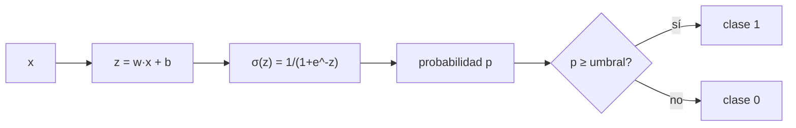

# Regresión logística

Parte de: [[21-IA-Machine-Learning/03 Machine learning clásico/_Índice Machine learning clásico|Machine learning clásico]]

> [!info] Cómo avanzar
> `progreso`: **pendiente** → **viendo** (estudiando) → **visto** (contestaste la autoevaluación sin abrir las respuestas) → **dominado** (hiciste el laboratorio o lo aplicaste de verdad).

## Contenido

### Qué es
La regresión logística es el modelo base para **clasificación binaria**: ¿el cliente cancelará?, ¿la transacción es fraude?, ¿el correo es spam? Calcula una combinación lineal de las entradas, igual que la [[Regresión lineal]], pero la pasa por la función **sigmoide** para convertirla en una **probabilidad** entre 0 y 1. Luego un **umbral** (por defecto 0.5) decide la clase. Se llama "regresión" porque lo que modela es un número continuo (la probabilidad, o más exactamente su log-odds), aunque la usemos para clasificar.

### Cómo funciona
1. **Puntaje lineal**: `z = w·x + b`. Puede ser cualquier número.
2. **Sigmoide**: `p = σ(z) = 1 / (1 + e⁻ᶻ)`. Si `z` es muy positivo, `p → 1`; muy negativo, `p → 0`; si `z = 0`, `p = 0.5` exacto. Ejemplo: con `w = 2`, `b = −1`, `x = 1` → `z = 1` → `p ≈ 0.731`.
3. **Decisión**: clase 1 si `p ≥ umbral`.



**Interpretación.** `z` es el **log-odds**: `ln(p / (1 − p))`. Cada unidad de `x_j` suma `w_j` al log-odds, o sea, multiplica las probabilidades a favor ("odds") por `e^{w_j}`. Un `w = 0.7` en "quejas del último mes" significa que cada queja multiplica los odds de cancelar por `e^0.7 ≈ 2`.

**Pérdida: log loss (entropía cruzada binaria).** No se usa MSE, sino:

`L = −[ y·ln(p) + (1 − y)·ln(1 − p) ]`

Premia la confianza correcta y **castiga muchísimo la confianza equivocada**. Si `y = 1` y el modelo dijo `p = 0.8`, la pérdida es `−ln 0.8 ≈ 0.223`; si dijo `p = 0.1`, es `−ln 0.1 ≈ 2.303`, diez veces más. Esta pérdida es convexa para la logística, así que el entrenamiento llega al mínimo global (con regularización L2 por defecto en scikit-learn, controlada por `C`: menor `C` = más regularización).

**Mover el umbral.** 0.5 es arbitrario. Bájalo cuando un falso negativo cuesta más que un falso positivo (detectar fraude o una enfermedad: prefieres revisar de más). Súbelo cuando cada positivo dispara una acción costosa o molesta (bloquear una cuenta, llamar a un cliente). También ayuda con clases desbalanceadas: si solo el 2 % es positivo, el modelo rara vez llega a 0.5. Elige el umbral con datos de **validación** según la métrica que importa ([[Precisión, recall y F1]], [[Curva ROC y AUC]]).

**Multiclase.** Con más de dos clases se usa la versión *softmax* (multinomial), que generaliza la sigmoide; scikit-learn lo maneja solo.

### Ejemplo

```python
import numpy as np
from sklearn.datasets import make_classification
from sklearn.model_selection import train_test_split
from sklearn.linear_model import LogisticRegression
from sklearn.metrics import log_loss, precision_score, recall_score

sig = lambda z: 1 / (1 + np.exp(-z))
print(round(sig(2 * 1 - 1), 3), sig(0))                     # 0.731 0.5
print(round(-np.log(0.8), 3), round(-np.log(0.1), 3))       # 0.223 2.303

X, y = make_classification(n_samples=3_000, weights=[0.9], class_sep=0.8, random_state=1)
X_tr, X_te, y_tr, y_te = train_test_split(X, y, test_size=0.3, stratify=y, random_state=1)
clf = LogisticRegression(max_iter=1000).fit(X_tr, y_tr)
p = clf.predict_proba(X_te)[:, 1]
print("log loss:", round(log_loss(y_te, p), 3))

for umbral in (0.5, 0.3, 0.15):
    pred = (p >= umbral).astype(int)
    print(f"umbral {umbral}: precisión {precision_score(y_te, pred):.2f}  recall {recall_score(y_te, pred):.2f}")
```

Al bajar el umbral sube el recall (detectas más positivos) y baja la precisión (más falsas alarmas).

**En .NET con ML.NET.** El trainer equivalente es `SdcaLogisticRegression` (también `LbfgsLogisticRegression`). La predicción trae la probabilidad, así que el umbral lo decides en tu código:

```csharp
// Paquete Microsoft.ML
var ml = new MLContext(seed: 0);
IDataView datos = ml.Data.LoadFromTextFile<Cliente>("clientes.csv", hasHeader: true, separatorChar: ',');
var split = ml.Data.TrainTestSplit(datos, testFraction: 0.2);

var pipeline = ml.Transforms.Concatenate("Features", nameof(Cliente.Antiguedad), nameof(Cliente.Quejas))
    .Append(ml.Transforms.NormalizeMeanVariance("Features"))
    .Append(ml.BinaryClassification.Trainers.SdcaLogisticRegression(labelColumnName: nameof(Cliente.Cancelo)));

var modelo = pipeline.Fit(split.TrainSet);
var m = ml.BinaryClassification.Evaluate(modelo.Transform(split.TestSet), labelColumnName: nameof(Cliente.Cancelo));
Console.WriteLine($"AUC {m.AreaUnderRocCurve:F3}  LogLoss {m.LogLoss:F3}");

public class Cliente
{
    [LoadColumn(0)] public float Antiguedad { get; set; }
    [LoadColumn(1)] public float Quejas { get; set; }
    [LoadColumn(2)] public bool Cancelo { get; set; }
}
```

### Cuándo usarlo y cuándo no
Es la línea base obligada en clasificación: rápida, estable, con probabilidades razonablemente calibradas y coeficientes interpretables (útil cuando hay que explicar decisiones). Si las relaciones son muy no lineales o hay interacciones complejas entre variables, prueba árboles o boosting, que suelen ganar en datos tabulares. Escala las features para que la regularización trate parejo a todas.

### Errores comunes
- **Dejar el umbral en 0.5 por inercia** con clases desbalanceadas o costos asimétricos.
- **No escalar** con regularización: penaliza injustamente a variables con números pequeños.
- **Interpretar coeficientes como probabilidades directas**: afectan log-odds, no `p` de forma lineal.
- **Usar exactitud como única métrica** en problemas desbalanceados.

### Para profundizar
- [scikit-learn: regresión logística](https://scikit-learn.org/stable/modules/linear_model.html#logistic-regression)
- [Google ML Crash Course: regresión logística](https://developers.google.com/machine-learning/crash-course/logistic-regression)
- [Microsoft Learn: tutorial de clasificación binaria con ML.NET](https://learn.microsoft.com/es-mx/dotnet/machine-learning/tutorials/sentiment-analysis)

## Ejercicios

Resuélvelos en papel o en la herramienta; la solución está plegada.

> [!question]- Con `w = 2`, `b = -1`, `x = 1`, ¿qué probabilidad da?
> `z = 1` → `σ(1) = 1/(1+e⁻¹) ≈ 0.731`

> [!question]- ¿Qué probabilidad da cuando `z = 0`?
> `0.5`: el punto de decisión con umbral 0.5.

> [!question]- Calcula la log loss para `y = 1`, `p = 0.8` y para `y = 1`, `p = 0.1`.
> `-ln 0.8 ≈ 0.223`; `-ln 0.1 ≈ 2.303` (estar seguro y equivocado cuesta 10 veces más).

## Autoevaluación

Contesta primero en voz alta o en papel; luego despliega la respuesta.

> [!question]- ¿Por qué se llama regresión si clasifica?
> Calcula una combinación lineal `z = w·x + b` y la pasa por la sigmoide para obtener una probabilidad; luego se aplica un umbral para decidir la clase.

> [!question]- ¿Qué pérdida usa?
> Entropía cruzada binaria (log loss): `-[y·ln p + (1-y)·ln(1-p)]`. Castiga mucho estar muy seguro y equivocado.

> [!question]- ¿Cuándo moverías el umbral de 0.5?
> Cuando los errores cuestan distinto: en detección de fraude lo bajas para capturar más casos (más recall), aceptando más falsos positivos.

## Práctica

- [[Lab 2 - Regresión y clasificación con scikit-learn]]

