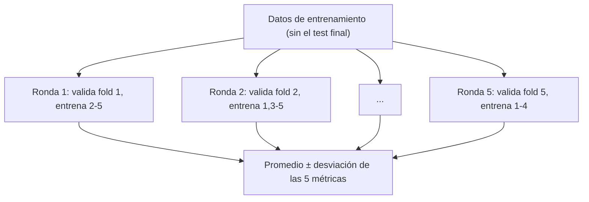

# Validación cruzada

Parte de: [[21-IA-Machine-Learning/03 Machine learning clásico/_Índice Machine learning clásico|Machine learning clásico]]

> [!info] Cómo avanzar
> `progreso`: **pendiente** → **viendo** (estudiando) → **visto** (contestaste la autoevaluación sin abrir las respuestas) → **dominado** (hiciste el laboratorio o lo aplicaste de verdad).

## Contenido

### Qué es
La validación cruzada (*cross-validation*) estima qué tan bien generaliza un modelo **reutilizando los datos varias veces**, en lugar de depender de una sola división train/validación. En **k-fold**, divides los datos en `k` partes iguales (folds); entrenas `k` veces, cada vez dejando un fold distinto como validación y entrenando con los otros `k − 1`. Al final promedias las `k` métricas. Obtienes una estimación más estable y, además, una idea de su **variabilidad**.

### Cómo funciona
Con 1,000 filas y 5 folds: cada fold tiene 200 filas. En cada ronda entrenas con 800 y validas con 200; son **5 entrenamientos** y cada fila se usa exactamente una vez para validar.



Si los resultados por fold son `[0.80, 0.82, 0.78, 0.81, 0.79]`, la media es **0.80** y la desviación estándar ≈ 0.014. Reportar "0.80 ± 0.01" es más honesto que un solo número, y te dice si la diferencia entre dos modelos (0.80 vs 0.805) es real o ruido.

**Variantes según tus datos:**
- **`KFold`**: divisiones al azar; para regresión o clases balanceadas.
- **`StratifiedKFold`**: mantiene la proporción de clases en cada fold. Es lo que usa scikit-learn por defecto en clasificación cuando pasas `cv=5`. Indispensable con clases desbalanceadas.
- **`TimeSeriesSplit`**: para datos temporales. Cada ronda entrena con el pasado y valida con el bloque siguiente, **nunca al revés**; el tamaño del entrenamiento va creciendo. Mezclar al azar haría que el modelo vea el futuro.
- **`GroupKFold`**: cuando hay varias filas por entidad (cliente, paciente, dispositivo); todas las filas de un grupo caen en el mismo fold.

**Dónde encaja.** La validación cruzada se hace **sobre el conjunto de entrenamiento**; el conjunto de prueba se sigue apartando para la evaluación final ([[Datos de entrenamiento, validación y prueba]]). Es la base de la búsqueda de hiperparámetros: `GridSearchCV` y `RandomizedSearchCV` corren un k-fold completo por cada combinación.

**El error clásico: preprocesar antes del k-fold.** Si escalas, imputas o **seleccionas features** con todo el dataset y después haces k-fold, cada fold de validación ya "contaminó" esas transformaciones (la media del escalador o la elección de features usaron sus filas). La métrica sale optimista; con selección de features sobre datos de ruido puro puedes obtener exactitudes muy por encima del azar. La solución es meter todo en un **`Pipeline`**: así cada transformación se ajusta solo con los folds de entrenamiento en cada ronda.

### Ejemplo

```python
import numpy as np
from sklearn.datasets import make_classification
from sklearn.model_selection import cross_val_score, StratifiedKFold, TimeSeriesSplit
from sklearn.pipeline import make_pipeline
from sklearn.preprocessing import StandardScaler
from sklearn.feature_selection import SelectKBest, f_classif
from sklearn.linear_model import LogisticRegression

print(np.mean([0.80, 0.82, 0.78, 0.81, 0.79]).round(3))     # 0.8

X, y = make_classification(n_samples=1_000, n_features=20, random_state=0)
pipe = make_pipeline(StandardScaler(), LogisticRegression(max_iter=1000))
cv = StratifiedKFold(n_splits=5, shuffle=True, random_state=0)
scores = cross_val_score(pipe, X, y, cv=cv, scoring="accuracy")
print(scores.round(3), f"media {scores.mean():.3f} ± {scores.std():.3f}")

# Fuga por selección de features ANTES del k-fold, en datos de puro ruido
rng = np.random.default_rng(0)
Xr, yr = rng.normal(size=(100, 5_000)), rng.integers(0, 2, 100)
X_sel = SelectKBest(f_classif, k=20).fit_transform(Xr, yr)            # mal: usa todas las filas
mal = cross_val_score(LogisticRegression(max_iter=1000), X_sel, yr, cv=5).mean()
bien = cross_val_score(make_pipeline(SelectKBest(f_classif, k=20), LogisticRegression(max_iter=1000)),
                       Xr, yr, cv=5).mean()
print(f"con fuga {mal:.2f} vs correcto {bien:.2f} (el azar es ~0.50)")

# Series de tiempo: los índices de validación siempre van después de los de entrenamiento
for tr, va in TimeSeriesSplit(n_splits=3).split(np.arange(12)):
    print("train", tr, "valida", va)
```

**En .NET.** [[ML.NET]] tiene `mlContext.BinaryClassification.CrossValidate(datos, pipeline, numberOfFolds: 5, labelColumnName: "Cancelo")` (y equivalentes para regresión y multiclase). Devuelve las métricas y el modelo de cada fold; como el pipeline completo se reentrena en cada fold, las transformaciones no generan fuga.

### Cuándo usarlo y cuándo no
Úsala para comparar modelos y elegir hiperparámetros, sobre todo con datasets pequeños o medianos (cientos a cientos de miles de filas). Con datasets enormes o modelos muy costosos (redes profundas), una sola división de validación grande suele bastar porque la estimación ya es estable y k entrenamientos serían caros. Valores típicos: k = 5 o 10.

### Errores comunes
- **Preprocesar o seleccionar features antes del k-fold**: usa pipelines.
- **K-fold aleatorio en series de tiempo**: usa `TimeSeriesSplit`.
- **Ignorar grupos** (mismo cliente en train y validación): usa `GroupKFold`.
- **Usar la media de CV como métrica final** después de haber elegido hiperparámetros con ella: confirma con el conjunto de prueba.
- **Reportar solo la media** sin la desviación entre folds.

### Para profundizar
- [scikit-learn: validación cruzada](https://scikit-learn.org/stable/modules/cross_validation.html)
- [scikit-learn: búsqueda de hiperparámetros](https://scikit-learn.org/stable/modules/grid_search.html)
- [Microsoft Learn: validación cruzada en ML.NET](https://learn.microsoft.com/es-mx/dotnet/machine-learning/how-to-guides/train-machine-learning-model-cross-validation-ml-net)

## Ejercicios

Resuélvelos en papel o en la herramienta; la solución está plegada.

> [!question]- 1 000 filas con 5-fold. ¿Cuántas filas de entrenamiento y validación por fold y cuántos entrenamientos?
> 800 entrenamiento y 200 validación por fold; 5 entrenamientos.

> [!question]- Escribe una validación cruzada de 5 folds con un pipeline escalador + logística.
> ```python
> from sklearn.pipeline import make_pipeline
> from sklearn.preprocessing import StandardScaler
> from sklearn.linear_model import LogisticRegression
> from sklearn.model_selection import cross_val_score
> pipe = make_pipeline(StandardScaler(), LogisticRegression(max_iter=1000))
> scores = cross_val_score(pipe, X, y, cv=5, scoring='f1')
> scores.mean(), scores.std()
> ```

> [!question]- Fold scores `[0.80, 0.82, 0.78, 0.81, 0.79]`. ¿Media?
> `4.00 / 5 = 0.80`

## Autoevaluación

Contesta primero en voz alta o en papel; luego despliega la respuesta.

> [!question]- ¿Qué es k-fold?
> Divide los datos en *k* partes; entrena *k* veces usando *k-1* partes y valida en la restante. El promedio (y la desviación) da una estimación más estable.

> [!question]- ¿Cuándo usas `StratifiedKFold` o `TimeSeriesSplit`?
> Stratified para clasificación desbalanceada; TimeSeriesSplit para datos temporales (valida siempre con datos posteriores).

> [!question]- Error común: hacer escalado o selección de features antes del k-fold.
> Fuga entre folds. Mete todo el preprocesamiento en un `Pipeline` y pásalo a `cross_val_score`.

## Práctica

- [[Lab 2 - Regresión y clasificación con scikit-learn]]

