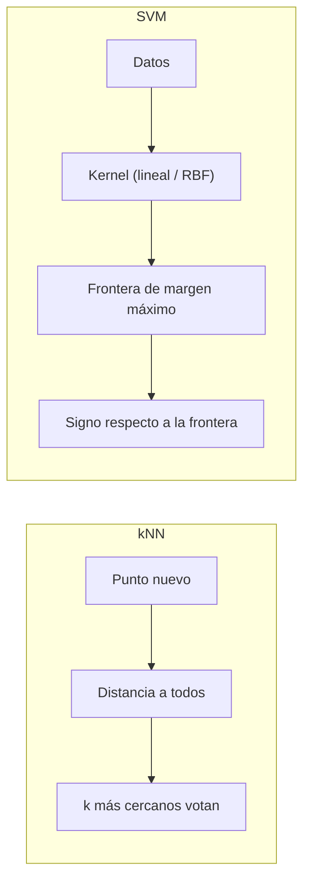

# k-NN y SVM

Parte de: [[21-IA-Machine-Learning/03 Machine learning clásico/_Índice Machine learning clásico|Machine learning clásico]]

> [!info] Cómo avanzar
> `progreso`: **pendiente** → **viendo** (estudiando) → **visto** (contestaste la autoevaluación sin abrir las respuestas) → **dominado** (hiciste el laboratorio o lo aplicaste de verdad).

## Contenido

### Qué es
Dos clasificadores clásicos que piensan en términos de **geometría**: cada ejemplo es un punto en un espacio de features.

- **k-NN (k vecinos más cercanos)**: no "aprende" parámetros; guarda todos los ejemplos y, para predecir uno nuevo, busca los **k más cercanos** y hace que voten (o promedia su valor, en regresión). "Dime con quién andas y te diré quién eres."
- **SVM (máquina de vectores de soporte)**: busca la **frontera que separa las clases con el mayor margen posible**, es decir, la línea (o hiperplano) que queda lo más lejos posible de los puntos más cercanos de cada clase. Con el **truco del kernel** puede trazar fronteras curvas.

### Cómo funciona
**k-NN paso a paso.**
1. Guardas el conjunto de entrenamiento (eso es todo el "entrenamiento").
2. Para un punto nuevo calculas la distancia (normalmente euclidiana) a **todos** los puntos guardados.
3. Tomas los `k` más cercanos y votas la clase mayoritaria (puedes ponderar por cercanía).

`k` pequeño (1, 3) → frontera muy irregular, sensible al ruido (sobreajuste). `k` grande → frontera suave, puede ignorar patrones locales (subajuste). Se elige con [[Validación cruzada]]; un número impar evita empates en binaria.

**SVM paso a paso.**
1. Entre todas las fronteras que separan las clases, elige la de **margen máximo**. Solo importan los puntos que tocan el margen: los **vectores de soporte**.
2. Como los datos reales no son perfectamente separables, el parámetro `C` regula cuánto tolera puntos del lado equivocado: `C` grande = margen estrecho y pocas violaciones (riesgo de sobreajuste); `C` chico = margen amplio y más tolerante.
3. **Kernel**: en lugar de una frontera recta, el kernel RBF (gaussiano) o el polinomial calculan similitudes que equivalen a trabajar en un espacio de más dimensiones, donde una frontera plana se ve curva en el espacio original. `gamma` controla qué tan "local" es la influencia de cada punto.



**Escalar es indispensable para ambos.** Los dos dependen de distancias. Si una feature es "sueldo" (decenas de miles) y otra "años de experiencia" (0–40), la distancia la decide el sueldo y la experiencia prácticamente no cuenta. Estandariza siempre (`StandardScaler`) dentro de un pipeline.

**Por qué k-NN puede ser lento en producción.** El costo se paga **al predecir**: cada predicción compara contra todo el conjunto de entrenamiento y hay que tener todo en memoria. Con millones de filas y muchas dimensiones se vuelve lento. Se mitiga con estructuras como KD-tree o Ball tree (útiles en pocas dimensiones) o con **búsqueda aproximada de vecinos** (índices tipo HNSW), que es justamente lo que usan las bases vectoriales en RAG ([[Embeddings y bases vectoriales (pgvector y Azure AI Search)]]). La SVM, en cambio, predice rápido (solo usa los vectores de soporte), pero **entrenar** con kernel crece mal con el número de filas: más allá de decenas de miles se vuelve pesado.

### Ejemplo

```python
from sklearn.datasets import make_moons
from sklearn.model_selection import train_test_split, cross_val_score
from sklearn.neighbors import KNeighborsClassifier
from sklearn.svm import SVC
from sklearn.pipeline import make_pipeline
from sklearn.preprocessing import StandardScaler
import numpy as np

X, y = make_moons(n_samples=1_000, noise=0.25, random_state=0)
X[:, 1] = X[:, 1] * 1_000          # una feature en escala mucho mayor
X_tr, X_te, y_tr, y_te = train_test_split(X, y, test_size=0.3, random_state=0)

knn_crudo = KNeighborsClassifier(n_neighbors=15).fit(X_tr, y_tr)
knn = make_pipeline(StandardScaler(), KNeighborsClassifier(n_neighbors=15)).fit(X_tr, y_tr)
svm_lineal = make_pipeline(StandardScaler(), SVC(kernel="linear")).fit(X_tr, y_tr)
svm_rbf = make_pipeline(StandardScaler(), SVC(kernel="rbf", C=1, gamma="scale")).fit(X_tr, y_tr)

print("k-NN sin escalar :", round(knn_crudo.score(X_te, y_te), 3))
print("k-NN escalado    :", round(knn.score(X_te, y_te), 3))
print("SVM lineal       :", round(svm_lineal.score(X_te, y_te), 3))
print("SVM RBF          :", round(svm_rbf.score(X_te, y_te), 3))
print("vectores de soporte:", svm_rbf[-1].n_support_.sum(), "de", len(X_tr))

for k in (1, 15, 101):
    s = cross_val_score(make_pipeline(StandardScaler(), KNeighborsClassifier(n_neighbors=k)), X_tr, y_tr, cv=5)
    print(f"k={k:3d}: {np.mean(s):.3f}")
```

Los datos con forma de "lunas" no se separan con una recta: la SVM lineal se queda corta y la RBF los separa bien. Sin escalar, k-NN pierde exactitud porque la segunda feature domina las distancias.

**En .NET.** [[ML.NET]] incluye `LinearSvm` en `mlContext.BinaryClassification.Trainers` (SVM lineal) y no trae un k-NN clásico. Para "vecinos más cercanos" sobre embeddings en una API .NET, lo práctico es un índice vectorial (pgvector en Postgres, Azure AI Search) o calcular similitud coseno con `TensorPrimitives` si son pocos miles.

### Cuándo usarlo y cuándo no
**k-NN**: excelente línea base y para datasets pequeños o medianos con pocas dimensiones; útil para recomendaciones "productos parecidos" y en búsqueda semántica (con índices aproximados). Sufre con muchas dimensiones (todas las distancias se parecen: la "maldición de la dimensionalidad").
**SVM**: muy buena con datasets pequeños o medianos y muchas features (texto con TF-IDF, con kernel lineal). Para datos tabulares grandes, el boosting suele ser mejor y más rápido.

### Errores comunes
- **No escalar**: el error número uno en ambos.
- **`k = 1`** por defecto mental: memoriza el ruido.
- **SVM con kernel RBF sobre cientos de miles de filas**: el entrenamiento se dispara; usa lineal o cambia de modelo.
- **Esperar probabilidades de `SVC`** sin `probability=True` (y aun así se calibran aparte, con costo extra).

### Para profundizar
- [scikit-learn: vecinos más cercanos](https://scikit-learn.org/stable/modules/neighbors.html)
- [scikit-learn: máquinas de vectores de soporte](https://scikit-learn.org/stable/modules/svm.html)
- [scikit-learn: comparación de clasificadores](https://scikit-learn.org/stable/auto_examples/classification/plot_classifier_comparison.html)

## Autoevaluación

Contesta primero en voz alta o en papel; luego despliega la respuesta.

> [!question]- ¿Cómo predice k-NN?
> Busca los *k* ejemplos de entrenamiento más cercanos y vota (clasificación) o promedia (regresión). No "entrena": guarda los datos.

> [!question]- ¿Qué busca una SVM?
> El hiperplano que separa las clases con el mayor margen; con *kernels* (RBF) puede separar datos no lineales.

> [!question]- ¿Qué pasa si usas k-NN sin escalar variables?
> La variable de mayor rango domina la distancia. Escala con `StandardScaler` antes.

> [!question]- ¿Por qué k-NN puede ser lento en producción?
> Cada predicción compara contra todos los ejemplos guardados; con muchos datos se usan índices aproximados.

