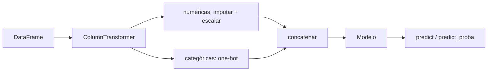

# scikit-learn

Parte de: [[21-IA-Machine-Learning/03 Machine learning clásico/_Índice Machine learning clásico|Machine learning clásico]]

> [!info] Cómo avanzar
> `progreso`: **pendiente** → **viendo** (estudiando) → **visto** (contestaste la autoevaluación sin abrir las respuestas) → **dominado** (hiciste el laboratorio o lo aplicaste de verdad).

## Contenido

### Qué es
scikit-learn es la librería estándar de **machine learning clásico** en Python: regresiones, árboles, ensambles, SVM, k-NN, clustering, PCA, preprocesamiento, métricas, validación cruzada y búsqueda de hiperparámetros, todo con **una API uniforme**. No hace deep learning (para eso está PyTorch) ni usa GPU, pero para datos tabulares es lo primero que se usa. Su diseño consistente es su mayor virtud: aprendes un patrón y lo aplicas a cualquier modelo.

### Cómo funciona
**La interfaz común de los estimadores.** Todo objeto de scikit-learn sigue el mismo contrato (equivalente a implementar una interfaz en C#):
- **`fit(X, y)`**: aprende de los datos de entrenamiento (en no supervisado, solo `X`). Devuelve el propio objeto.
- **`predict(X)`**: predice con lo aprendido (modelos). Los clasificadores suelen tener además `predict_proba`.
- **`transform(X)`**: transforma los datos (escaladores, codificadores, PCA). `fit_transform` hace ambos pasos sobre el mismo conjunto.
- **`score(X, y)`**: una métrica por defecto (exactitud en clasificación, R² en regresión).
- Hiperparámetros en el constructor (`RandomForestClassifier(n_estimators=300)`) y parámetros aprendidos con guion bajo al final (`coef_`, `feature_importances_`).

`X` es una matriz (array de NumPy o DataFrame de pandas) de forma `(n_muestras, n_features)` y `y` un vector.

**Pipeline y ColumnTransformer.**
- **`Pipeline`** encadena pasos (preprocesamiento + modelo) en un solo estimador. Al llamar `fit`, cada transformador se ajusta **solo con los datos que recibe**; al llamar `predict`, aplica las transformaciones ya aprendidas. Esto evita la fuga de datos, simplifica la validación cruzada y te da **un solo objeto** para guardar y desplegar.
- **`ColumnTransformer`** aplica transformaciones distintas por columna: imputar y escalar las numéricas, one-hot a las categóricas, y concatenar el resultado.



**Búsqueda de hiperparámetros.** `GridSearchCV` prueba todas las combinaciones de una rejilla; `RandomizedSearchCV` prueba un número fijo de combinaciones al azar (más eficiente con muchos parámetros). Ambos usan [[Validación cruzada]] internamente y, al final, reentrenan el mejor con todo el conjunto (`best_estimator_`). Sobre un pipeline, los parámetros se nombran `paso__parametro` (doble guion bajo).

**El error clásico: `fit_transform` sobre prueba.** Si llamas `scaler.fit_transform(X_test)`, el escalador **recalcula** media y desviación con los datos de prueba: estás usando información de test y, además, transformando test de forma distinta a como se transformó train. Lo correcto es `fit` (o `fit_transform`) solo con entrenamiento y `transform` con prueba y producción. Con un pipeline no tienes que acordarte: `pipeline.predict(X_test)` solo llama `transform`.

### Ejemplo

```python
import numpy as np
import pandas as pd
from sklearn.compose import ColumnTransformer
from sklearn.pipeline import Pipeline
from sklearn.impute import SimpleImputer
from sklearn.preprocessing import StandardScaler, OneHotEncoder
from sklearn.linear_model import LogisticRegression
from sklearn.ensemble import RandomForestClassifier
from sklearn.model_selection import train_test_split, GridSearchCV
import joblib

rng = np.random.default_rng(0)
n = 1_500
df = pd.DataFrame({
    "antiguedad": rng.integers(0, 60, n).astype(float),
    "quejas": rng.poisson(1.0, n).astype(float),
    "plan": rng.choice(["basico", "plus", "pro"], n),
})
df.loc[rng.random(n) < 0.05, "antiguedad"] = np.nan                 # algunos nulos
logit = -1 + 0.8 * df["quejas"] - 0.04 * df["antiguedad"].fillna(30) + (df["plan"] == "basico") * 0.7
df["cancelo"] = (rng.random(n) < 1 / (1 + np.exp(-logit))).astype(int)

X, y = df.drop(columns="cancelo"), df["cancelo"]
X_tr, X_te, y_tr, y_te = train_test_split(X, y, test_size=0.2, stratify=y, random_state=0)

prep = ColumnTransformer([
    ("num", Pipeline([("imp", SimpleImputer(strategy="median")), ("esc", StandardScaler())]), ["antiguedad", "quejas"]),
    ("cat", OneHotEncoder(handle_unknown="ignore"), ["plan"]),
])
pipe = Pipeline([("prep", prep), ("modelo", LogisticRegression(max_iter=1000))])

busqueda = GridSearchCV(
    pipe,
    param_grid=[
        {"modelo": [LogisticRegression(max_iter=1000)], "modelo__C": [0.1, 1, 10]},
        {"modelo": [RandomForestClassifier(random_state=0)], "modelo__max_depth": [3, 6]},
    ],
    cv=5, scoring="roc_auc", n_jobs=-1,
).fit(X_tr, y_tr)

print("mejor:", busqueda.best_params_)
print("AUC en CV:", round(busqueda.best_score_, 3))
print("AUC en test:", round(busqueda.score(X_te, y_te), 3))    # score usa el mismo scoring (roc_auc)

joblib.dump(busqueda.best_estimator_, "modelo_churn.joblib")        # un solo artefacto con todo el pipeline
nuevo = pd.DataFrame({"antiguedad": [3.0], "quejas": [4.0], "plan": ["basico"]})
print("P(cancelar):", joblib.load("modelo_churn.joblib").predict_proba(nuevo)[0, 1].round(2))
```

El artefacto guardado incluye imputación, escalado, codificación y modelo: en producción solo le pasas el DataFrame crudo.

**En .NET.** [[ML.NET]] tiene la misma filosofía con otros nombres: un `MLContext`, un `IEstimator` que se encadena con `.Append(...)` (el pipeline), `Fit` que devuelve un `ITransformer` (el modelo entrenado), `Transform` para aplicar, y `mlContext.Model.Save` para guardar un `.zip`. Si prefieres entrenar en scikit-learn y servir en C#, el paquete `skl2onnx` convierte muchos pipelines a ONNX para usarlos con [[ONNX Runtime]] en tu API.

### Cuándo usarlo y cuándo no
Úsalo para cualquier problema de ML clásico con datos tabulares que quepan en memoria: es la herramienta de prototipado y, muchas veces, también de producción. Para deep learning o GPU, usa PyTorch. Para datasets que no caben en memoria, considera Spark MLlib u otras herramientas distribuidas. Para boosting de máximo rendimiento puedes combinarlo con XGBoost o LightGBM, que exponen una API compatible.

### Errores comunes
- **`fit_transform` sobre prueba o producción**: fuga e inconsistencia; usa `transform` o un pipeline.
- **Preprocesar fuera del pipeline** y luego hacer validación cruzada.
- **Guardar solo el modelo** sin el preprocesamiento: en producción las features llegan sin escalar.
- **Olvidar `random_state`**: resultados no reproducibles.
- **Cargar con `joblib` o `pickle` archivos de origen desconocido**: pueden ejecutar código arbitrario; solo carga artefactos propios.

### Para profundizar
- [scikit-learn: guía de inicio](https://scikit-learn.org/stable/getting_started.html)
- [scikit-learn: pipelines y estimadores compuestos](https://scikit-learn.org/stable/modules/compose.html)
- [scikit-learn: persistencia de modelos](https://scikit-learn.org/stable/model_persistence.html)

## Autoevaluación

Contesta primero en voz alta o en papel; luego despliega la respuesta.

> [!question]- ¿Qué tienen en común todos los estimadores?
> La misma API: `fit(X, y)`, `predict(X)` (o `predict_proba`), y los transformadores `fit`/`transform`. Eso permite cambiar de modelo con una línea.

> [!question]- ¿Para qué sirve `Pipeline` y `ColumnTransformer`?
> Encadenan preprocesamiento y modelo en un solo objeto que se ajusta solo con entrenamiento (sin fugas) y se guarda/despliega entero.

> [!question]- ¿Cómo buscas hiperparámetros?
> `GridSearchCV` o `RandomizedSearchCV` con validación cruzada; los nombres llevan el prefijo del paso: `modelo__C`.

> [!question]- Error común: `fit_transform` sobre el conjunto de prueba.
> Reajusta el escalador con datos de prueba. Sobre prueba solo se usa `transform` (o `predict` del pipeline).

## Práctica

- [[Lab 2 - Regresión y clasificación con scikit-learn]]

