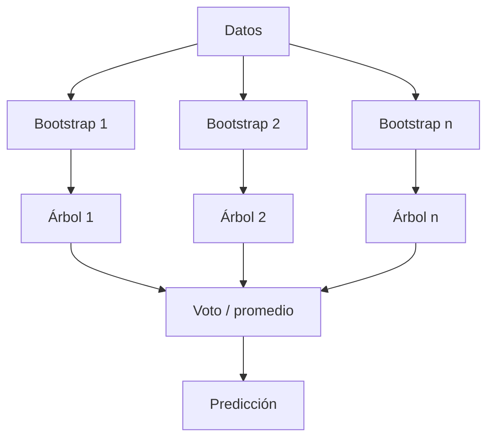

# Árboles de decisión y random forest

Parte de: [[21-IA-Machine-Learning/03 Machine learning clásico/_Índice Machine learning clásico|Machine learning clásico]]

> [!info] Cómo avanzar
> `progreso`: **pendiente** → **viendo** (estudiando) → **visto** (contestaste la autoevaluación sin abrir las respuestas) → **dominado** (hiciste el laboratorio o lo aplicaste de verdad).

## Contenido

### Qué es
Un **árbol de decisión** predice haciendo una serie de preguntas sí/no sobre las features, como un diagrama de flujo: "¿antigüedad < 6 meses? → ¿quejas > 2? → cancela". Cada hoja final da una clase (o un número, en regresión). Es muy intuitivo y fácil de explicar, pero un árbol solo tiende a memorizar los datos. Un **random forest** (bosque aleatorio) entrena **cientos de árboles distintos** y combina sus votos; el resultado es mucho más estable y preciso. Junto con el boosting, son de los modelos más fuertes para datos tabulares.

### Cómo funciona
**Cómo decide un árbol.** Empieza con todos los datos en la raíz y busca **la pregunta que mejor separa** las clases: prueba cada feature y cada umbral posible, y elige el que deja los grupos resultantes más "puros". La pureza se mide con la **impureza de Gini** (`1 − Σ pₖ²`; vale 0 si el grupo es todo de una clase) o con la **entropía**; en regresión, con la reducción del error cuadrático. Repite el proceso en cada rama (de forma "codiciosa", sin volver atrás) hasta que se cumple un criterio de paro.

**Sin límite de profundidad, sobreajusta.** Si lo dejas crecer, el árbol sigue partiendo hasta que cada hoja tiene uno o muy pocos ejemplos: exactitud perfecta en entrenamiento, pero ha aprendido el ruido y generaliza mal (alta varianza; ver [[Overfitting, underfitting y sesgo-varianza]]). Se controla con `max_depth`, `min_samples_leaf`, `min_samples_split` o con poda (`ccp_alpha`).

**Random forest = bagging + aleatoriedad en features.**
1. Cada árbol se entrena con una **muestra bootstrap** (filas elegidas al azar con reemplazo).
2. En cada división, el árbol solo puede elegir entre un **subconjunto aleatorio de features** (`max_features`), lo que obliga a los árboles a ser distintos entre sí.
3. Para predecir, **vota** (clasificación) o **promedia** (regresión).

Cada árbol individual comete errores, pero como son errores diferentes y poco correlacionados, al promediarlos se cancelan: la varianza baja mucho sin aumentar casi el sesgo. Bonus: las filas que no entraron en el bootstrap de un árbol (*out-of-bag*) sirven como validación gratis (`oob_score=True`).



**¿Hay que escalar?** **No.** Los árboles comparan cada feature contra un umbral (`ingreso <= 29,836`); multiplicar la feature por 1,000 solo cambia el umbral, no la división. Por eso tampoco les afectan mucho los outliers en las features. Sí necesitas convertir categorías a números (one-hot u ordinal), según la implementación.

**Importancia de features.** Los bosques reportan cuánto contribuye cada feature a reducir impureza (`feature_importances_`). Es útil, pero sesgada hacia variables con muchos valores distintos; la **importancia por permutación** (`permutation_importance`) sobre datos de validación es más confiable.

### Ejemplo

```python
from sklearn.datasets import make_classification
from sklearn.model_selection import train_test_split
from sklearn.tree import DecisionTreeClassifier
from sklearn.ensemble import RandomForestClassifier

X, y = make_classification(n_samples=2_000, n_features=20, n_informative=6,
                           flip_y=0.08, random_state=0)
X_tr, X_te, y_tr, y_te = train_test_split(X, y, test_size=0.3, random_state=0)

for nombre, m in [
    ("árbol sin límite", DecisionTreeClassifier(random_state=0)),
    ("árbol max_depth=5", DecisionTreeClassifier(max_depth=5, random_state=0)),
    ("random forest 300", RandomForestClassifier(n_estimators=300, oob_score=True, n_jobs=-1, random_state=0)),
]:
    m.fit(X_tr, y_tr)
    print(f"{nombre:18s} train {m.score(X_tr, y_tr):.3f}  test {m.score(X_te, y_te):.3f}")

print("profundidad del árbol libre:", DecisionTreeClassifier(random_state=0).fit(X_tr, y_tr).get_depth())
print("OOB score del bosque:", round(m.oob_score_, 3))
```

El árbol libre llega a 1.000 en entrenamiento y cae en prueba; el bosque mantiene una exactitud de prueba claramente mayor.

**En .NET.** [[ML.NET]] trae `FastTree` (árboles con boosting) y `FastForest` (random forest) en `mlContext.BinaryClassification.Trainers`, `Regression.Trainers` y otros catálogos. Son una buena primera opción cuando entrenas directamente en C# con datos de SQL Server.

### Cuándo usarlo y cuándo no
Un árbol corto sirve cuando la **explicación** importa más que la última décima de exactitud (reglas que negocio puede leer). Random forest es una excelente opción por defecto para datos tabulares: funciona bien sin mucho ajuste, tolera features irrelevantes, no necesita escalado y da importancias. El [[Gradient boosting (XGBoost y LightGBM)]] suele ganarle un poco con ajuste fino. Evítalos para extrapolar (un árbol no predice valores fuera del rango visto) y en datos muy dispersos de alta dimensión como texto crudo, donde los modelos lineales rinden mejor.

### Errores comunes
- **Árbol sin límite de profundidad**: memoriza; limita profundidad u hojas mínimas.
- **Escalar por costumbre**: no estorba, pero no aporta nada a los árboles.
- **Confiar ciegamente en `feature_importances_`**: verifica con importancia por permutación.
- **Pocos árboles en el bosque**: con 10 árboles el resultado es inestable; cientos es lo habitual (más árboles no sobreajustan, solo cuestan más tiempo).

### Para profundizar
- [scikit-learn: árboles de decisión](https://scikit-learn.org/stable/modules/tree.html)
- [scikit-learn: métodos de ensamble (random forest)](https://scikit-learn.org/stable/modules/ensemble.html)
- [scikit-learn: importancia por permutación](https://scikit-learn.org/stable/modules/permutation_importance.html)

## Autoevaluación

Contesta primero en voz alta o en papel; luego despliega la respuesta.

> [!question]- ¿Cómo decide un árbol de decisión?
> Hace preguntas sobre las variables (`edad < 30?`) eligiendo en cada nodo la división que más reduce la impureza (Gini, entropía) o el error.

> [!question]- ¿Por qué un random forest generaliza mejor que un solo árbol?
> Promedia muchos árboles entrenados con muestras y subconjuntos de variables al azar; eso reduce la varianza sin aumentar mucho el sesgo.

> [!question]- ¿Qué pasa con un árbol sin límite de profundidad?
> Memoriza el entrenamiento (overfitting). Se controla con `max_depth`, `min_samples_leaf` o poda.

> [!question]- ¿Hace falta escalar variables para árboles?
> No: las divisiones dependen del orden de los valores, no de su escala.

## Práctica

- [[Lab 2 - Regresión y clasificación con scikit-learn]]

