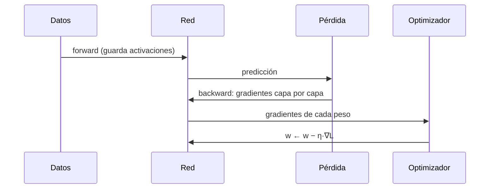

# Descenso de gradiente y backpropagation

Parte de: [[21-IA-Machine-Learning/04 Redes neuronales y deep learning/_Índice Redes neuronales y deep learning|Redes neuronales y deep learning]]

> [!info] Cómo avanzar
> `progreso`: **pendiente** → **viendo** (estudiando) → **visto** (contestaste la autoevaluación sin abrir las respuestas) → **dominado** (hiciste el laboratorio o lo aplicaste de verdad).

## Contenido

### Qué es
El **descenso de gradiente** es el algoritmo que ajusta los pesos de un modelo para reducir la [[Función de pérdida]]: calcula hacia dónde sube la pérdida y da un paso en la dirección contraria. **Backpropagation** es la técnica que calcula ese gradiente de manera eficiente en una red de muchas capas, aplicando la regla de la cadena desde la salida hacia la entrada. Juntos son el motor de entrenamiento de todo el deep learning.

### Cómo funciona
**Descenso de gradiente**
1. Calcula la pérdida `L` con los pesos actuales.
2. Calcula el gradiente `∂L/∂w`: cuánto cambia la pérdida si mueves cada peso un poquito (repasa [[Cálculo para ML (derivadas y gradiente)]]).
3. Actualiza: `w ← w − η · ∂L/∂w`, donde `η` es la **tasa de aprendizaje**.
4. Repite hasta que la pérdida deje de bajar.

Ejemplo numérico con un solo peso: `L = (w·x − y)²` con `x = 3`, `y = 6`, `w = 1`, `η = 0.02`. La derivada es `∂L/∂w = 2·(w·x − y)·x = 2·(3 − 6)·3 = −18`. El nuevo peso es `1 − 0.02·(−18) = 1.36`. El gradiente negativo indica que subir `w` baja la pérdida, y el paso lo acerca al óptimo `w = 2`. Si `η` es muy grande, el paso se pasa del mínimo y puede oscilar o divergir; si es muy chico, avanza lentísimo.

**Backpropagation**
Una red es una composición de funciones: `L = pérdida(f₃(f₂(f₁(x))))`. La regla de la cadena dice que `∂L/∂w₁ = ∂L/∂f₃ · ∂f₃/∂f₂ · ∂f₂/∂f₁ · ∂f₁/∂w₁`. Backprop hace:
1. **Forward**: calcula y guarda los valores intermedios de cada capa.
2. **Backward**: empieza con `∂L/∂salida` y, capa por capa hacia atrás, multiplica por la derivada local. Cada capa reutiliza el gradiente que le llega, así que el costo total es comparable al de un forward pass.



**Batch, mini-batch y estocástico**
- **Batch completo**: el gradiente usa *todos* los ejemplos. Exacto pero lento y no cabe en memoria con datos grandes.
- **Estocástico (SGD puro)**: un ejemplo por paso. Muy ruidoso pero barato.
- **Mini-batch**: un grupo (32, 64, 256…). Es el estándar: aprovecha el paralelismo de la GPU y el ruido moderado ayuda a escapar de malos puntos. En tu GTX 1660 Ti de 6 GB el tamaño de lote suele estar limitado por la VRAM ([[GPUs y por qué importan]]).

En la práctica no usas solo `w − η·∇L`, sino optimizadores como SGD con momentum o Adam ([[Optimizadores (SGD y Adam)]]).

### Ejemplo
Autograd de [[PyTorch]] hace backprop por ti. Aquí el mismo ejemplo de un peso, a mano y con un ciclo de entrenamiento:

```python
import torch

x, y = torch.tensor(3.0), torch.tensor(6.0)
w = torch.tensor(1.0, requires_grad=True)
eta = 0.02

for paso in range(5):
    perdida = (w * x - y) ** 2
    perdida.backward()                 # calcula dL/dw y lo acumula en w.grad
    with torch.no_grad():
        w -= eta * w.grad              # paso de descenso de gradiente
    print(f"paso {paso}: grad={w.grad.item():.3f} w={w.item():.4f} pérdida={perdida.item():.4f}")
    w.grad.zero_()                     # ¡limpiar! si no, el siguiente gradiente se suma a este

# Con un optimizador el patrón es el mismo:
modelo = torch.nn.Linear(1, 1)
opt = torch.optim.SGD(modelo.parameters(), lr=0.01)
X = torch.tensor([[1.0], [2.0], [3.0]]); Y = 2 * X
for _ in range(100):
    opt.zero_grad()                    # 1. limpiar gradientes
    loss = ((modelo(X) - Y) ** 2).mean()
    loss.backward()                    # 2. backprop
    opt.step()                         # 3. actualizar pesos
print(modelo.weight.item(), modelo.bias.item())
```

### Cuándo usarlo y cuándo no
- **Úsalo** para cualquier modelo derivable: redes neuronales, regresiones, embeddings.
- **No hace falta** para modelos con solución cerrada pequeña (regresión lineal con pocos datos) ni para árboles, que se entrenan con otros algoritmos.
- Si la pérdida es muy irregular, combina mini-batch con un *scheduler* de tasa de aprendizaje.

### Errores comunes
- **Olvidar `optimizer.zero_grad()`**: PyTorch **acumula** gradientes por diseño; sin limpiarlos, cada paso suma los gradientes de todos los anteriores y las actualizaciones se vuelven enormes y erráticas.
- **Tasa de aprendizaje mal elegida**: pérdida que explota (`nan`) o que casi no baja. Prueba valores en escala logarítmica (0.1, 0.01, 0.001).
- **Actualizar pesos sin `torch.no_grad()`** cuando lo haces a mano: autograd registra la operación y rompe el grafo.
- **Gradientes que desaparecen o explotan** en redes profundas: usa activaciones adecuadas ([[Funciones de activación]]), normalización y *gradient clipping*.

### Para profundizar
- [CS231n: backpropagation, intuiciones](https://cs231n.github.io/optimization-2/)
- [Tutorial de autograd de PyTorch](https://docs.pytorch.org/tutorials/beginner/basics/autogradqs_tutorial.html)
- [Deep Learning, capítulo 6.5: back-propagation](https://www.deeplearningbook.org/contents/mlp.html)

## Ejercicios

Resuélvelos en papel o en la herramienta; la solución está plegada.

> [!question]- `L = (w·x - y)²` con `x = 2`, `y = 4`, `w = 1`, `η = 0.05`. Calcula un paso.
> `dL/dw = 2(wx - y)·x = 2(2 - 4)·2 = -8` → `w = 1 - 0.05·(-8) = 1.4`

> [!question]- Repite un segundo paso desde `w = 1.4`.
> `wx = 2.8`; `dL/dw = 2(2.8 - 4)·2 = -4.8` → `w = 1.4 + 0.24 = 1.64` (tiende a 2).

## Autoevaluación

Contesta primero en voz alta o en papel; luego despliega la respuesta.

> [!question]- ¿Qué hace el descenso de gradiente?
> Actualiza los parámetros en dirección contraria al gradiente de la pérdida: `w ← w - η·∂L/∂w`.

> [!question]- ¿Qué hace backpropagation?
> Calcula eficientemente todos los gradientes aplicando la regla de la cadena desde la salida hacia la entrada, reutilizando resultados intermedios.

> [!question]- ¿Qué diferencia hay entre batch, mini-batch y estocástico?
> Batch usa todos los datos por paso (estable, lento); estocástico un ejemplo (ruidoso); mini-batch un grupo (32–512 típico), el balance habitual en GPU.

> [!question]- Error común en PyTorch: olvidar `optimizer.zero_grad()`.
> Los gradientes se acumulan entre iteraciones y los pasos salen incorrectos.

## Práctica

- [[Lab 3 - Red neuronal pequeña en PyTorch]]

