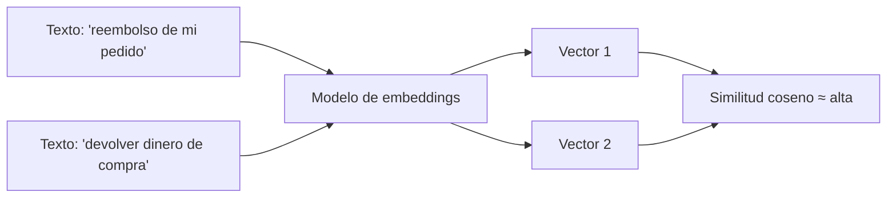

# Embeddings

Parte de: [[21-IA-Machine-Learning/04 Redes neuronales y deep learning/_Índice Redes neuronales y deep learning|Redes neuronales y deep learning]]

> [!info] Cómo avanzar
> `progreso`: **pendiente** → **viendo** (estudiando) → **visto** (contestaste la autoevaluación sin abrir las respuestas) → **dominado** (hiciste el laboratorio o lo aplicaste de verdad).

## Contenido

### Qué es
Un **embedding** es un vector de números reales que representa algo (una palabra, una frase, un producto, un usuario, una imagen) de forma que **cosas parecidas queden cerca** en ese espacio. Es la manera en que las redes convierten datos discretos o complejos en algo con lo que pueden hacer álgebra. Son la base de la búsqueda semántica, la recomendación, el agrupamiento de textos y el RAG ([[Embeddings y bases vectoriales (pgvector y Azure AI Search)]]).

### Cómo funciona
**Por qué no basta con IDs**: si codificas "perro" = 1, "gato" = 2, "auto" = 3, el modelo cree que gato está entre perro y auto. Con *one-hot* (un vector con un solo 1) todas las palabras quedan igual de lejos y no hay noción de parecido. Un embedding resuelve ambos problemas con un vector denso de, por ejemplo, 384 o 768 dimensiones.

**Cómo se aprenden**:
- **Capa de embedding**: una tabla de `vocabulario × dimensión` (en PyTorch, `nn.Embedding`) cuyos valores se entrenan junto con el resto de la red. Es lo que usan los LLMs para convertir cada token en un vector al entrar ([[Cómo funciona un LLM (tokens, contexto y predicción)]]).
- **Modelos de embeddings de texto**: redes tipo [[Transformers|transformer]] entrenadas para que frases con el mismo significado produzcan vectores cercanos (por ejemplo, la familia *sentence-transformers*, o los endpoints de embeddings de los proveedores de LLM).
- **Otros dominios**: hay embeddings de imágenes, audio, y modelos que ponen texto e imágenes en el mismo espacio.

**Cómo se comparan**: con la **similitud coseno**, que mide el ángulo entre los vectores:
`cos(a, b) = (a·b) / (‖a‖·‖b‖)`
- 1: misma dirección (muy parecidos).
- 0: perpendiculares (sin relación).
- −1: opuestos.
Ejemplo: `a = [1, 2]`, `b = [2, 1]` → `a·b = 4`, `‖a‖ = ‖b‖ = √5`, coseno = `4/5 = 0.8`. Escalar un vector no cambia el coseno: `[3, 3]` y `[1, 1]` dan 1. Si los vectores están normalizados (norma 1), el coseno es simplemente el producto punto, que es más barato. Repasa [[Álgebra lineal para ML (vectores, matrices y producto punto)]].



### Ejemplo
Embeddings de frases con *sentence-transformers* (corre en CPU o en tu GPU sin problema; el modelo multilingüe sirve para español):

```python
# pip install sentence-transformers
from sentence_transformers import SentenceTransformer
import numpy as np

modelo = SentenceTransformer("paraphrase-multilingual-MiniLM-L12-v2")
frases = [
    "¿Cómo solicito el reembolso de mi pedido?",
    "Quiero que me devuelvan el dinero de una compra",
    "El token JWT expiró y la API responde 401",
]
vectores = modelo.encode(frases, normalize_embeddings=True)   # norma 1
print(vectores.shape)                                        # (3, dimensión)

sim = vectores @ vectores.T                                  # coseno = producto punto
print(np.round(sim, 2))

# Capa de embedding entrenable en PyTorch
import torch
tabla = torch.nn.Embedding(num_embeddings=10_000, embedding_dim=64)
ids = torch.tensor([[12, 845, 3]])                           # 3 tokens
print(tabla(ids).shape)                                      # 1 × 3 × 64
```

Las dos primeras frases salen mucho más parecidas entre sí que con la tercera, aunque casi no comparten palabras. Lo practicas a fondo en [[Lab 4 - Embeddings y búsqueda por similitud]].

### Cuándo usarlo y cuándo no
- **Úsalos** para búsqueda por significado, recomendaciones ("productos parecidos"), detección de duplicados, agrupamiento y como entrada a otros modelos.
- **No los uses solos** cuando importa la coincidencia exacta (números de factura, códigos de error, nombres propios raros): combina con búsqueda por palabras clave (búsqueda híbrida).
- **Para datos tabulares** con pocas categorías, un one-hot o codificación de categorías puede ser suficiente.

### Errores comunes
- **Comparar embeddings de modelos distintos**: cada modelo define su propio espacio; las dimensiones no significan lo mismo y a veces ni coinciden en tamaño. La similitud entre ellos no tiene sentido. Usa el mismo modelo (y versión) para indexar y para consultar, y reindexa si lo cambias.
- **No normalizar y usar producto punto como si fuera coseno**: los vectores más largos parecen "más similares".
- **Usar un modelo entrenado solo en inglés** para textos en español sin evaluarlo.
- **Tomar el umbral de similitud de otro proyecto**: el valor que significa "parecido" depende del modelo; calíbralo con tus datos.

### Para profundizar
- [Documentación de Sentence Transformers](https://sbert.net/)
- [torch.nn.Embedding](https://docs.pytorch.org/docs/stable/generated/torch.nn.Embedding.html)
- [MTEB: tabla comparativa de modelos de embeddings (Hugging Face)](https://huggingface.co/spaces/mteb/leaderboard)

## Ejercicios

Resuélvelos en papel o en la herramienta; la solución está plegada.

> [!question]- Coseno entre `[1, 0, 1]` y `[1, 1, 0]`.
> Producto punto 1; normas `√2` y `√2` → `1/2 = 0.5`

> [!question]- Coseno entre `[2, 2]` y `[1, 1]`.
> `1.0`: misma dirección (la magnitud no importa).

> [!question]- Coseno entre `[1, 0]` y `[-1, 0]`.
> `-1`: direcciones opuestas.

## Autoevaluación

Contesta primero en voz alta o en papel; luego despliega la respuesta.

> [!question]- ¿Qué es un embedding?
> Un vector denso que representa un objeto (palabra, texto, producto) de modo que objetos parecidos queden cerca en el espacio.

> [!question]- ¿Cómo se comparan dos embeddings?
> Normalmente con similitud coseno; si están normalizados, equivale al producto punto.

> [!question]- Error común: comparar embeddings de modelos distintos.
> Cada modelo tiene su propio espacio; los vectores no son comparables. Indexa y consulta con el mismo modelo.

## Práctica

- [[Lab 4 - Embeddings y búsqueda por similitud]]

