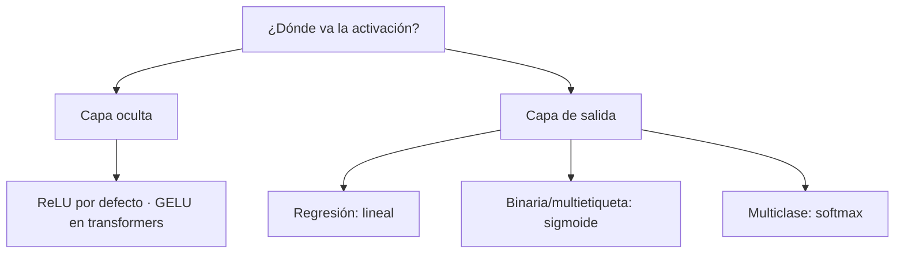

# Funciones de activación

Parte de: [[21-IA-Machine-Learning/04 Redes neuronales y deep learning/_Índice Redes neuronales y deep learning|Redes neuronales y deep learning]]

> [!info] Cómo avanzar
> `progreso`: **pendiente** → **viendo** (estudiando) → **visto** (contestaste la autoevaluación sin abrir las respuestas) → **dominado** (hiciste el laboratorio o lo aplicaste de verdad).

## Contenido

### Qué es
Una **función de activación** es la operación no lineal que cada neurona aplica a su suma ponderada `z = w·x + b`. Sin ella, cualquier red, por profunda que sea, se reduce a una sola transformación lineal y no podría aprender fronteras curvas, imágenes ni lenguaje. Elegir bien la activación afecta qué tan rápido entrena la red, qué tan estable es y qué representa su salida.

### Cómo funciona
Las activaciones se usan en dos lugares con objetivos distintos:

1. **Capas ocultas**: necesitan ser no lineales, baratas y con gradientes que no se apaguen. Hoy el estándar es la familia ReLU (ReLU, Leaky ReLU, GELU), detallada en [[ReLU y sus variantes]].
2. **Capa de salida**: su trabajo es darle a la salida la forma que pide el problema:
   - **Regresión**: ninguna (salida lineal), para que el valor pueda ser cualquier número.
   - **Clasificación binaria o multietiqueta**: sigmoide, que lleva cada salida a una probabilidad entre 0 y 1 ([[Sigmoide y tanh]]).
   - **Clasificación multiclase excluyente**: [[Softmax]], que convierte un vector de puntajes en una distribución que suma 1.



**Valores de referencia** que conviene saber de memoria:
- `ReLU(z) = max(0, z)`: negativo da 0, positivo pasa igual.
- `σ(z) = 1 / (1 + e^(−z))`: en `z = 0` vale 0.5; tiende a 0 o a 1 en los extremos.
- `tanh(z)`: en `z = 0` vale 0; su rango es (−1, 1).
- `softmax(z)ᵢ = e^(zᵢ) / Σⱼ e^(zⱼ)`: el puntaje más alto se lleva la mayor probabilidad, pero no toda.

**Desvanecimiento del gradiente**: durante [[Descenso de gradiente y backpropagation|backpropagation]] el gradiente se multiplica por la derivada de la activación en cada capa. La derivada máxima de la sigmoide es 0.25; si encadenas diez capas, el gradiente que llega a las primeras puede ser del orden de `0.25¹⁰`, prácticamente cero, y esas capas dejan de aprender. ReLU tiene derivada 1 para valores positivos, lo que deja pasar el gradiente sin encogerlo; por eso desplazó a sigmoide y tanh en capas ocultas. El problema contrario, la **explosión** del gradiente, se mitiga con buena inicialización, normalización y *gradient clipping*.

### Ejemplo
Compara las activaciones y sus gradientes con autograd de [[PyTorch]]:

```python
import torch
import torch.nn.functional as F

z = torch.tensor([-3.0, -1.0, 0.0, 1.0, 3.0], requires_grad=True)

for nombre, fn in [("relu", torch.relu), ("sigmoide", torch.sigmoid),
                   ("tanh", torch.tanh), ("gelu", F.gelu)]:
    y = fn(z)
    (grad,) = torch.autograd.grad(y.sum(), z)
    print(f"{nombre:9s} salida={y.detach().numpy().round(3)} gradiente={grad.numpy().round(3)}")

logits = torch.tensor([0.5, 1.5, -1.0])
print("softmax:", F.softmax(logits, dim=0).numpy().round(3))   # suma 1
```

Observa que el gradiente de la sigmoide en `z = ±3` ya es muy chico, mientras que el de ReLU es exactamente 1 para cualquier positivo.

### Cuándo usarlo y cuándo no
- **ReLU** como opción por defecto en capas ocultas de MLPs y CNNs.
- **GELU** (o variantes similares) en transformers, porque es lo que usan las arquitecturas de referencia.
- **Sigmoide y tanh** en salidas, compuertas de LSTM ([[Redes recurrentes (RNN y LSTM)]]) y casos donde necesitas un rango acotado; evítalas en capas ocultas profundas.
- **Softmax** solo en la salida multiclase (o dentro de la [[Mecanismo de atención|atención]]), nunca como activación oculta.

### Errores comunes
- **Aplicar softmax o sigmoide antes de una pérdida que ya la incluye**: `nn.CrossEntropyLoss` y `nn.BCEWithLogitsLoss` esperan *logits* crudos.
- **Usar sigmoide en todas las capas ocultas**: entrenamiento lento por desvanecimiento del gradiente.
- **Usar softmax para multietiqueta**: si una imagen puede tener "perro" y "pasto" a la vez, cada clase necesita su propia sigmoide.
- **Poner ReLU en la salida de una regresión**: la red nunca podrá predecir valores negativos.

### Para profundizar
- [Activaciones no lineales en torch.nn](https://docs.pytorch.org/docs/stable/nn.html#non-linear-activations-weighted-sum-nonlinearity)
- [CS231n: funciones de activación](https://cs231n.github.io/neural-networks-1/#actfun)
- [Deep Learning, capítulo 6.3: unidades ocultas](https://www.deeplearningbook.org/contents/mlp.html)

## Subtemas

- [[ReLU y sus variantes]]
- [[Sigmoide y tanh]]
- [[Softmax]]

## Ejercicios

Resuélvelos en papel o en la herramienta; la solución está plegada.

> [!question]- Calcula `ReLU(-2)`, `ReLU(3)`, `σ(0)` y `tanh(0)`.
> `0`, `3`, `0.5`, `0`.

> [!question]- Calcula softmax de `[1, 2, 3]` (3 decimales).
> `[0.090, 0.245, 0.665]`

## Autoevaluación

Contesta primero en voz alta o en papel; luego despliega la respuesta.

> [!question]- ¿Por qué se necesitan activaciones no lineales?
> Sin ellas, apilar capas lineales equivale a una sola capa lineal: la red no podría aprender relaciones complejas.

> [!question]- ¿Qué activación usas en la salida según el problema?
> Regresión: ninguna (lineal). Binaria: sigmoide. Multiclase: softmax. Capas ocultas: ReLU o variantes (GELU en transformers).

> [!question]- ¿Qué es el desvanecimiento del gradiente?
> Con sigmoide/tanh, en zonas saturadas la derivada es casi 0 y el gradiente se hace diminuto al multiplicarse por muchas capas; las primeras capas casi no aprenden. ReLU lo reduce.

## Progreso de los subtemas

```base
filters:
  and:
    - file.inFolder("21-IA-Machine-Learning/04 Redes neuronales y deep learning/Funciones de activación")
    - file.name != "Funciones de activación"
views:
  - type: table
    name: Progreso
    order:
      - file.name
      - progreso
      - nivel
```
