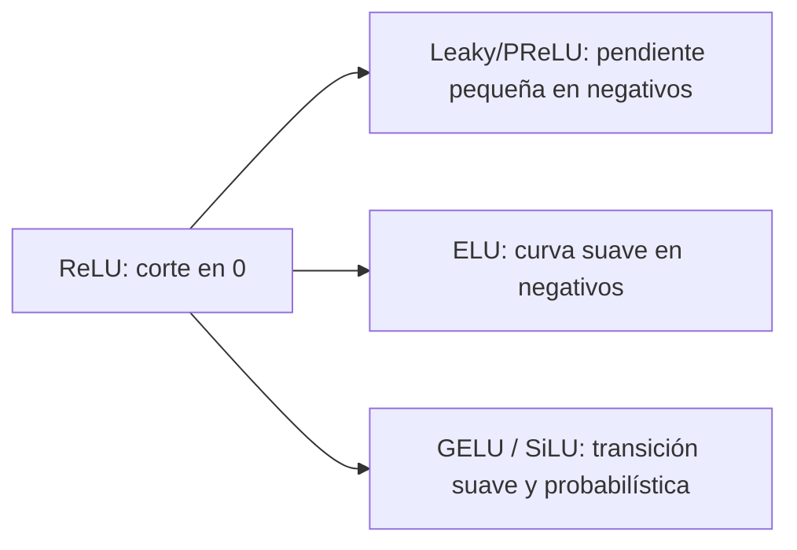

# ReLU y sus variantes

Parte de: [[Funciones de activación]]

> [!info] Cómo avanzar
> `progreso`: **pendiente** → **viendo** (estudiando) → **visto** (contestaste la autoevaluación sin abrir las respuestas) → **dominado** (hiciste el laboratorio o lo aplicaste de verdad).

## Contenido

### Qué es
**ReLU** (*Rectified Linear Unit*) es la activación `ReLU(z) = max(0, z)`: deja pasar los valores positivos tal cual y convierte los negativos en cero. Es la opción por defecto para capas ocultas en redes densas y convolucionales porque es barata de calcular y su gradiente no se encoge para valores positivos. Sus **variantes** (Leaky ReLU, ELU, GELU, SiLU) corrigen algunos de sus defectos y son parte del panorama de [[Funciones de activación]].

### Cómo funciona
**ReLU**
- Salida: `0` si `z ≤ 0`, `z` si `z > 0`.
- Derivada: `0` para negativos y `1` para positivos (en `z = 0` se toma 0 por convención).
- Ventaja: a diferencia de [[Sigmoide y tanh]], no se satura para valores positivos, así que el gradiente fluye sin atenuarse capa tras capa. Además produce **activaciones dispersas** (muchas neuronas en cero), lo que es eficiente.

**El problema de la neurona muerta**: si por una tasa de aprendizaje alta o una mala inicialización el sesgo de una neurona se vuelve muy negativo, su `z` puede quedar negativa para *todas* las entradas. Entonces su salida siempre es 0 y su gradiente también es 0: los pesos ya no se actualizan y la neurona queda "muerta" para siempre. Si le pasa a una fracción grande de la red, la capacidad efectiva se reduce.

**Variantes**
- **Leaky ReLU**: `z` si es positiva y `α·z` si es negativa, con `α` pequeño (por defecto 0.01 en PyTorch). El gradiente negativo nunca es exactamente cero, así que la neurona puede "revivir".
- **PReLU**: igual que Leaky, pero `α` se aprende durante el entrenamiento.
- **ELU**: para negativos usa una curva exponencial suave que tiende a un valor negativo; las salidas quedan más centradas en cero.
- **GELU** (*Gaussian Error Linear Unit*): `GELU(z) = z · Φ(z)`, donde `Φ` es la función de distribución acumulada de la normal estándar. En lugar de cortar en seco, **pondera** la entrada por la probabilidad de que una variable normal sea menor que ella: valores muy positivos pasan casi completos, valores muy negativos se anulan y cerca de cero hay una transición suave (incluso con una pequeña parte negativa). Es la activación de muchas arquitecturas tipo [[Transformers]], como BERT y la familia GPT.
- **SiLU / Swish**: `z · σ(z)`; parecida a GELU y común en modelos de visión y en variantes de transformers.



### Ejemplo
Detecta neuronas muertas en una capa: cuenta cuántas nunca se activan en un lote de datos.

```python
import torch
from torch import nn

torch.manual_seed(0)
capa = nn.Linear(20, 64)
with torch.no_grad():
    capa.bias.fill_(-5.0)          # sesgo muy negativo para provocar neuronas muertas

x = torch.randn(512, 20)           # lote de 512 ejemplos
activ = torch.relu(capa(x))
muertas = (activ.max(dim=0).values == 0).sum().item()
print(f"neuronas muertas con ReLU: {muertas} de 64")

leaky = nn.LeakyReLU(0.01)(capa(x))
print("¿Leaky deja gradiente en negativos?", (leaky < 0).any().item())

z = torch.linspace(-3, 3, 7)
print("GELU:", nn.GELU()(z).numpy().round(3))
print("ReLU:", torch.relu(z).numpy().round(3))
```

En un modelo real puedes registrar un *hook* en cada capa durante el entrenamiento y vigilar ese porcentaje; si crece, baja la tasa de aprendizaje o cambia a Leaky ReLU o GELU.

### Cuándo usarlo y cuándo no
- **ReLU**: punto de partida en MLPs y CNNs; simple y rápida.
- **Leaky ReLU / PReLU**: cuando observas muchas neuronas muertas.
- **GELU / SiLU**: en transformers y modelos modernos; si haces [[Transfer learning y fine-tuning|fine-tuning]], conserva la activación con la que se preentrenó el modelo.
- **No uses ReLU en la salida** de regresión con valores negativos ni como sustituto de sigmoide o softmax.

### Errores comunes
- **Tasa de aprendizaje demasiado alta con ReLU**: empuja sesgos a valores negativos y mata neuronas.
- **Cambiar la activación de un modelo preentrenado**: rompe lo aprendido; los pesos se ajustaron a esa función.
- **Pensar que GELU siempre es mejor**: en redes pequeñas la diferencia suele ser mínima; mide antes de complicarte.

### Para profundizar
- [torch.nn.ReLU](https://docs.pytorch.org/docs/stable/generated/torch.nn.ReLU.html)
- [torch.nn.GELU](https://docs.pytorch.org/docs/stable/generated/torch.nn.GELU.html)
- [Artículo original de GELU (Hendrycks y Gimpel)](https://arxiv.org/abs/1606.08415)

## Autoevaluación

Contesta primero en voz alta o en papel; luego despliega la respuesta.

> [!question]- ¿Qué es ReLU?
> `f(z) = max(0, z)`. Barata de calcular y con gradiente 1 para valores positivos.

> [!question]- ¿Qué es una "neurona muerta"?
> Una neurona con ReLU cuya entrada queda siempre negativa: su gradiente es 0 y deja de aprender. Leaky ReLU (`0.01z` para negativos) lo evita.

> [!question]- ¿Qué es GELU?
> Una variante suave de ReLU muy usada en transformers; deja pasar parcialmente valores negativos pequeños.

