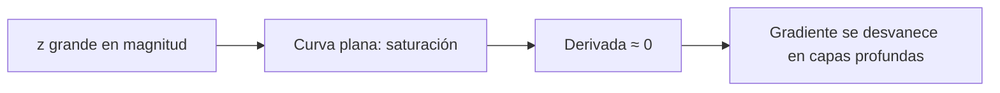

# Sigmoide y tanh

Parte de: [[Funciones de activación]]

> [!info] Cómo avanzar
> `progreso`: **pendiente** → **viendo** (estudiando) → **visto** (contestaste la autoevaluación sin abrir las respuestas) → **dominado** (hiciste el laboratorio o lo aplicaste de verdad).

## Contenido

### Qué es
La **sigmoide** y la **tangente hiperbólica (tanh)** son activaciones en forma de "S" que comprimen cualquier número real a un rango acotado. Fueron las activaciones estándar de las primeras redes neuronales y hoy se usan sobre todo en **salidas** (para producir probabilidades) y en **compuertas** de redes recurrentes. Son parte del mapa general de [[Funciones de activación]].

### Cómo funciona
**Sigmoide (función logística)**
- Fórmula: `σ(z) = 1 / (1 + e^(−z))`.
- Rango: **(0, 1)**, nunca toca los extremos. `σ(0) = 0.5`.
- Derivada: `σ(z)·(1 − σ(z))`, con máximo 0.25 en `z = 0`.
- Interpretación: convierte un puntaje (*logit*) en una probabilidad. Es exactamente la función de la [[Regresión logística]].

**Tanh**
- Fórmula: `tanh(z) = (e^z − e^(−z)) / (e^z + e^(−z))`, equivalente a `2·σ(2z) − 1`.
- Rango: **(−1, 1)**, con `tanh(0) = 0`.
- Derivada: `1 − tanh²(z)`, con máximo 1 en `z = 0`.
- Ventaja sobre la sigmoide: sus salidas están **centradas en cero**, lo que hace que las capas siguientes reciban entradas con media cercana a cero y el entrenamiento sea un poco más fluido.

**Saturación y desvanecimiento del gradiente**: cuando `|z|` es grande, ambas curvas se aplanan y su derivada se acerca a cero. Durante [[Descenso de gradiente y backpropagation|backpropagation]] el gradiente se multiplica por esas derivadas capa tras capa; con la sigmoide, cada capa lo multiplica *como mucho* por 0.25. En una red de muchas capas, las primeras reciben un gradiente casi nulo y prácticamente no aprenden. Por eso en capas ocultas profundas se prefieren [[ReLU y sus variantes]].



**Dónde se siguen usando**
- **Salida binaria o multietiqueta**: una sigmoide por clase da la probabilidad de que esa etiqueta esté presente, de forma independiente a las demás.
- **Compuertas de LSTM y GRU**: la sigmoide decide "cuánto dejar pasar" (0 = nada, 1 = todo) y tanh produce los valores candidatos en rango (−1, 1). Ver [[Redes recurrentes (RNN y LSTM)]].
- **Mecanismos de compuerta** en arquitecturas modernas (por ejemplo, la variante SiLU = `z·σ(z)` o capas con *gating*).
- **Salidas acotadas**: tanh es útil cuando el objetivo vive en (−1, 1), por ejemplo acciones normalizadas en control o píxeles escalados en algunos generadores.

### Ejemplo
Observa la saturación numéricamente y el uso correcto en una salida binaria:

```python
import torch
from torch import nn

z = torch.tensor([-6.0, -2.0, 0.0, 2.0, 6.0], requires_grad=True)
s = torch.sigmoid(z)
(g,) = torch.autograd.grad(s.sum(), z)
print("sigmoide:", s.detach().numpy().round(4))
print("derivada:", g.numpy().round(4))          # máximo 0.25 en z = 0

t = torch.tanh(z.detach())
print("tanh:", t.numpy().round(4))

# Clasificación binaria: la red produce logits; la pérdida aplica la sigmoide internamente
logits = torch.tensor([2.3, -0.7, 0.1])
etiquetas = torch.tensor([1.0, 0.0, 1.0])
perdida = nn.BCEWithLogitsLoss()(logits, etiquetas)
probabilidades = torch.sigmoid(logits)          # solo para mostrar o decidir con un umbral
print("pérdida:", round(perdida.item(), 4), "probabilidades:", probabilidades.numpy().round(3))
```

`BCEWithLogitsLoss` combina sigmoide y entropía cruzada binaria de forma numéricamente estable; por eso le pasas logits y no probabilidades.

### Cuándo usarlo y cuándo no
- **Sigmoide**: salida de clasificación binaria o multietiqueta; compuertas.
- **Tanh**: estados ocultos de RNN, salidas acotadas simétricas.
- **Evítalas** en capas ocultas de redes profundas (MLP, CNN) por la saturación; usa ReLU o GELU.
- **No uses sigmoide para multiclase excluyente**: ahí va [[Softmax]].

### Errores comunes
- **Aplicar sigmoide antes de `BCEWithLogitsLoss`**: la aplicas dos veces y el modelo aprende mal.
- **Inicializar pesos grandes**: empuja las neuronas a la zona saturada desde el inicio.
- **Interpretar la salida de una sigmoide como probabilidad calibrada sin verificarlo**: un modelo puede ser bueno ordenando y aun así estar mal calibrado.
- **Usar umbral 0.5 por costumbre**: el umbral óptimo depende del costo de falsos positivos y negativos.

### Para profundizar
- [torch.nn.Sigmoid](https://docs.pytorch.org/docs/stable/generated/torch.nn.Sigmoid.html)
- [torch.nn.BCEWithLogitsLoss](https://docs.pytorch.org/docs/stable/generated/torch.nn.BCEWithLogitsLoss.html)
- [Understanding LSTM Networks (Christopher Olah)](https://colah.github.io/posts/2015-08-Understanding-LSTMs/)

## Autoevaluación

Contesta primero en voz alta o en papel; luego despliega la respuesta.

> [!question]- ¿Qué rangos tienen?
> Sigmoide: (0, 1). tanh: (-1, 1), centrada en cero.

> [!question]- ¿Dónde se siguen usando?
> Sigmoide en salidas binarias y en compuertas de LSTM; tanh en estados de RNN/LSTM.

> [!question]- ¿Por qué se evitan en capas ocultas profundas?
> Se saturan: su derivada es pequeña (máx. 0.25 para la sigmoide), lo que provoca desvanecimiento del gradiente.

