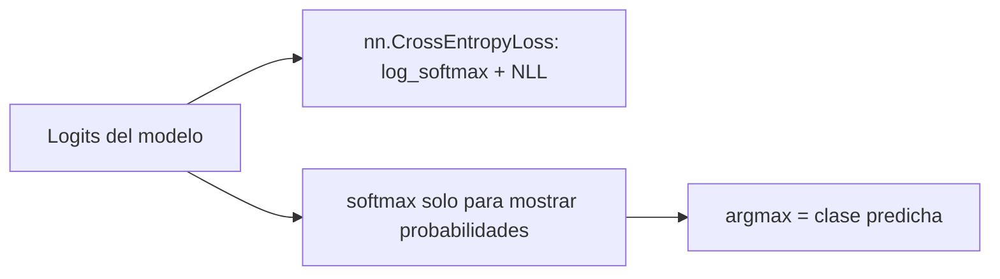

# Softmax

Parte de: [[Funciones de activación]]

> [!info] Cómo avanzar
> `progreso`: **pendiente** → **viendo** (estudiando) → **visto** (contestaste la autoevaluación sin abrir las respuestas) → **dominado** (hiciste el laboratorio o lo aplicaste de verdad).

## Contenido

### Qué es
**Softmax** convierte un vector de números arbitrarios (los **logits**) en una **distribución de probabilidad**: todos los valores quedan entre 0 y 1 y suman exactamente 1. Se usa en la salida de clasificadores multiclase (una sola clase correcta), dentro del [[Mecanismo de atención]] para repartir "atención" entre posiciones y en los LLMs para obtener la probabilidad del siguiente token. Es la tercera pieza del panorama de [[Funciones de activación]].

### Cómo funciona
Para un vector `z = [z₁, …, zₖ]`:

`softmax(z)ᵢ = e^(zᵢ) / Σⱼ e^(zⱼ)`

Pasos:
1. Exponencia cada logit: así todo se vuelve positivo y las diferencias se **amplifican** (un logit 1 punto mayor recibe unas 2.7 veces más peso).
2. Divide entre la suma para normalizar.

Propiedades útiles:
- **Solo importan las diferencias**: sumar la misma constante a todos los logits no cambia el resultado. `softmax([5, 4, 3])` es igual a `softmax([2, 1, 0])`.
- **Conserva el orden**: el logit más alto siempre tiene la probabilidad más alta, pero no se queda con todo (por eso es una versión "suave" de argmax).
- **Temperatura**: dividir los logits entre `T` antes de softmax la hace más "picuda" (`T < 1`) o más plana (`T > 1`). Es justo lo que controlan los [[Parámetros de generación (temperatura y top-p)]] de un LLM.

**Estabilidad numérica**: `e^1000` desborda (`inf`) en punto flotante y el cociente resulta en `nan`. Como restar una constante no cambia el resultado, se calcula con `z − max(z)`: el mayor exponente pasa a ser `e^0 = 1` y nada desborda. Con logits enormes como `[1002, 1001, 1000]` obtienes la misma distribución que con `[2, 1, 0]`.

**Relación con la pérdida**: en clasificación multiclase la [[Función de pérdida]] es la entropía cruzada, `−log(p_clase_correcta)`. En PyTorch, `nn.CrossEntropyLoss` recibe **logits** y aplica internamente `log_softmax` (de forma estable) y la entropía cruzada.



### Ejemplo
Implementación a mano, estable, y comparación con PyTorch:

```python
import numpy as np
import torch
from torch import nn

def softmax_estable(z):
    z = np.asarray(z, dtype=np.float64)
    e = np.exp(z - z.max())        # restar el máximo evita desbordes
    return e / e.sum()

print(softmax_estable([3.0, 1.0, 0.2]).round(3))
print(softmax_estable([1000.0, 999.0]).round(3))     # sin overflow

# Versión ingenua: desborda
with np.errstate(over="ignore", invalid="ignore"):
    z = np.array([1000.0, 999.0])
    print("ingenua:", np.exp(z) / np.exp(z).sum())   # [nan nan]

# Uso correcto en PyTorch
logits = torch.tensor([[2.0, 0.5, -1.0]])
objetivo = torch.tensor([0])
bien = nn.CrossEntropyLoss()(logits, objetivo)
mal = nn.CrossEntropyLoss()(torch.softmax(logits, dim=1), objetivo)   # softmax doble
print(f"pérdida correcta {bien.item():.4f} vs. con softmax doble {mal.item():.4f}")
```

La versión "mal" aplica softmax dos veces: aplana las probabilidades, da gradientes más débiles y el modelo aprende más lento o peor.

### Cuándo usarlo y cuándo no
- **Úsalo** en la salida de clasificación con clases mutuamente excluyentes, para muestrear tokens en un LLM y dentro de la atención.
- **No lo uses** en multietiqueta (varias clases pueden ser verdaderas a la vez): ahí va una sigmoide por clase ([[Sigmoide y tanh]]).
- **No lo uses** como activación de capas ocultas.
- Si solo necesitas la clase predicha, `argmax` sobre los logits basta; softmax no cambia cuál es el mayor.

### Errores comunes
- **Aplicar softmax antes de `nn.CrossEntropyLoss`**: la pérdida ya lo hace. Pasa logits crudos.
- **Implementarlo sin restar el máximo**: `nan` en cuanto un logit es grande.
- **Olvidar `dim`**: `torch.softmax(x, dim=1)` normaliza por fila (por ejemplo); el eje equivocado reparte probabilidades entre ejemplos del lote.
- **Leer las probabilidades como certeza real**: las redes modernas suelen estar sobreconfiadas; calibra si vas a tomar decisiones con esos números.

### Para profundizar
- [torch.nn.Softmax](https://docs.pytorch.org/docs/stable/generated/torch.nn.Softmax.html)
- [torch.nn.CrossEntropyLoss](https://docs.pytorch.org/docs/stable/generated/torch.nn.CrossEntropyLoss.html)
- [CS231n: clasificador softmax](https://cs231n.github.io/linear-classify/#softmax)

## Ejercicios

Resuélvelos en papel o en la herramienta; la solución está plegada.

> [!question]- Softmax de `[2, 1, 0]`.
> `[0.665, 0.245, 0.090]`

> [!question]- ¿Softmax de `[1002, 1001, 1000]`?
> La misma: `[0.665, 0.245, 0.090]` (restar 1000 no cambia nada).

## Autoevaluación

Contesta primero en voz alta o en papel; luego despliega la respuesta.

> [!question]- ¿Qué hace softmax?
> Convierte un vector de puntajes (logits) en probabilidades positivas que suman 1: `softmax(zᵢ) = e^{zᵢ} / Σ e^{zⱼ}`.

> [!question]- ¿Por qué se resta el máximo antes de calcular?
> Por estabilidad numérica: `e^{1000}` desborda. Restar una constante no cambia el resultado.

> [!question]- Error común en PyTorch: aplicar softmax antes de `nn.CrossEntropyLoss`.
> `CrossEntropyLoss` ya incluye log-softmax; espera logits crudos. Aplicarlo dos veces empeora el entrenamiento.

## Práctica

- [[Lab 3 - Red neuronal pequeña en PyTorch]]

