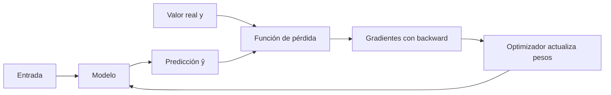

# Función de pérdida

Parte de: [[21-IA-Machine-Learning/04 Redes neuronales y deep learning/_Índice Redes neuronales y deep learning|Redes neuronales y deep learning]]

> [!info] Cómo avanzar
> `progreso`: **pendiente** → **viendo** (estudiando) → **visto** (contestaste la autoevaluación sin abrir las respuestas) → **dominado** (hiciste el laboratorio o lo aplicaste de verdad).

## Contenido

### Qué es
La **función de pérdida** (*loss*) es un número que mide **qué tan mal** predice el modelo en un ejemplo o en un lote. El entrenamiento consiste en ajustar los pesos para que ese número baje. Es el "objetivo" que el [[Descenso de gradiente y backpropagation|descenso de gradiente]] optimiza, así que elegirla bien es decidir qué significa "hacerlo bien" para tu modelo.

### Cómo funciona
Una pérdida útil debe ser **derivable** (para calcular gradientes) y crecer cuando la predicción se aleja de la verdad. Las más usadas:

**Regresión**
- **MSE** (error cuadrático medio): promedio de `(y − ŷ)²`. Castiga mucho los errores grandes. Ejemplo: con `y = [3, 5]` y `ŷ = [2, 5]`, MSE = `(1² + 0²)/2 = 0.5`.
- **MAE** (error absoluto medio): promedio de `|y − ŷ|`. Más robusta a valores atípicos.
- **Huber**: cuadrática para errores pequeños y lineal para grandes; un punto medio.

**Clasificación**
- **Entropía cruzada** (multiclase): `−log(p)`, donde `p` es la probabilidad que el modelo asignó a la **clase correcta** (después de [[Softmax]]). Si `p = 1`, la pérdida es 0; si `p = 0.5`, es `−ln 0.5 ≈ 0.693`; si `p` se acerca a 0, crece sin límite. Castiga con fuerza las predicciones seguras y equivocadas.
- **Entropía cruzada binaria**: la misma idea con una sola probabilidad de [[Sigmoide y tanh|sigmoide]].

En PyTorch: `nn.MSELoss`, `nn.L1Loss`, `nn.HuberLoss`, `nn.CrossEntropyLoss` (recibe logits) y `nn.BCEWithLogitsLoss` (recibe logits).



**Pérdida vs. métrica**: la pérdida es lo que el modelo optimiza; la **métrica** es lo que a ti te importa (exactitud, F1, error en pesos, dinero ahorrado). No siempre coinciden. Un modelo de fraude puede bajar la entropía cruzada mejorando en la clase mayoritaria mientras el recall de fraudes no mejora. Por eso siempre monitoreas ambas en validación.

**Regularización**: a la pérdida se le pueden sumar términos que penalizan pesos grandes (L2); ver [[Regularización y dropout]].

### Ejemplo
Calcula las pérdidas a mano y con PyTorch, y observa cómo la entropía cruzada castiga la sobreconfianza:

```python
import math
import torch
from torch import nn

# Regresión
y = torch.tensor([3.0, 5.0, 2.0])
y_hat = torch.tensor([2.5, 5.0, 4.0])
print("MSE:", nn.MSELoss()(y_hat, y).item())    # (0.25 + 0 + 4)/3
print("MAE:", nn.L1Loss()(y_hat, y).item())     # (0.5 + 0 + 2)/3

# Clasificación: probabilidad asignada a la clase correcta vs. pérdida
for p in [0.99, 0.9, 0.5, 0.1, 0.01]:
    print(f"p={p:<5} pérdida={-math.log(p):.3f}")

# En PyTorch se pasan logits; la pérdida aplica log_softmax por dentro
logits = torch.tensor([[1.2, 0.3, -0.8], [0.1, 2.0, 0.4]])
clases = torch.tensor([0, 1])
print("entropía cruzada:", nn.CrossEntropyLoss()(logits, clases).item())

# Clases desbalanceadas: dar más peso a la clase rara
pesos = torch.tensor([1.0, 5.0, 1.0])
print("ponderada:", nn.CrossEntropyLoss(weight=pesos)(logits, clases).item())
```

Si entrenas en Google Colab o en tu GTX 1660 Ti, la pérdida se calcula igual; solo asegúrate de que logits y etiquetas estén en el mismo dispositivo.

### Cuándo usarlo y cuándo no
- **MSE** cuando los errores grandes son especialmente graves y los datos no tienen atípicos fuertes.
- **MAE o Huber** con atípicos (por ejemplo, tiempos de entrega con retrasos extremos).
- **Entropía cruzada** para clasificación; con desbalance, usa `weight` o técnicas de muestreo.
- **Evita** usar la exactitud directamente como pérdida: no es derivable y no da gradiente útil.

### Errores comunes
- **La pérdida baja pero la métrica de negocio no mejora**: optimizas algo distinto de lo que importa. Elige una pérdida más alineada (ponderada, focal, etc.), ajusta el umbral de decisión y evalúa con la métrica real en validación.
- **Pasar probabilidades a una pérdida que espera logits**: softmax o sigmoide aplicadas dos veces.
- **Formato de etiquetas incorrecto**: `CrossEntropyLoss` espera índices enteros de clase (`long`), no one-hot (salvo que uses probabilidades como objetivo a propósito).
- **Comparar pérdidas entre modelos con funciones distintas**: los números no son comparables; compara métricas.

### Para profundizar
- [Funciones de pérdida en torch.nn](https://docs.pytorch.org/docs/stable/nn.html#loss-functions)
- [torch.nn.CrossEntropyLoss](https://docs.pytorch.org/docs/stable/generated/torch.nn.CrossEntropyLoss.html)
- [Deep Learning, capítulo 6.2: funciones de costo](https://www.deeplearningbook.org/contents/mlp.html)

## Ejercicios

Resuélvelos en papel o en la herramienta; la solución está plegada.

> [!question]- Entropía cruzada si la clase correcta recibe probabilidad 0.7.
> `-ln 0.7 ≈ 0.357`

> [!question]- MSE de `y = [1, 2]` con `ŷ = [1.5, 1]`.
> `(0.25 + 1)/2 = 0.625`

## Autoevaluación

Contesta primero en voz alta o en papel; luego despliega la respuesta.

> [!question]- ¿Qué es una función de pérdida?
> Un número que mide qué tan mal predice el modelo en un ejemplo o lote; el entrenamiento la minimiza.

> [!question]- ¿Qué pérdida usas en regresión y en clasificación?
> Regresión: MSE o MAE (Huber si hay outliers). Clasificación: entropía cruzada (binaria o categórica).

> [!question]- Error común: la pérdida baja pero la métrica de negocio no mejora.
> La pérdida es un sustituto; revisa métricas en validación (F1, MAE) y que la pérdida refleje el costo real de los errores.

## Práctica

- [[Lab 3 - Red neuronal pequeña en PyTorch]]

