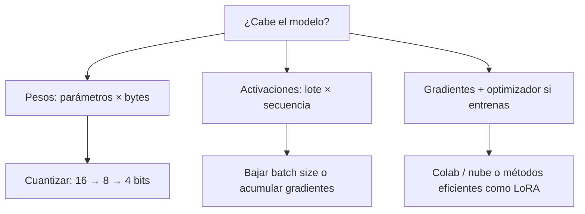

# GPUs y por qué importan

Parte de: [[21-IA-Machine-Learning/04 Redes neuronales y deep learning/_Índice Redes neuronales y deep learning|Redes neuronales y deep learning]]

> [!info] Cómo avanzar
> `progreso`: **pendiente** → **viendo** (estudiando) → **visto** (contestaste la autoevaluación sin abrir las respuestas) → **dominado** (hiciste el laboratorio o lo aplicaste de verdad).

## Contenido

### Qué es
Una **GPU** es un procesador con miles de núcleos sencillos pensados para hacer la misma operación sobre muchos datos a la vez. El deep learning es, en su mayoría, **multiplicación de matrices** (cada capa densa, cada convolución, cada [[Mecanismo de atención|atención]]), una tarea que se paraleliza casi perfecto. Por eso entrenar en GPU puede ser decenas de veces más rápido que en CPU. Saber cuánta memoria necesitas te dice si un modelo corre en tu equipo o si conviene ir a la nube.

### Cómo funciona
**Paralelismo**: una CPU tiene pocos núcleos muy potentes optimizados para lógica secuencial; una GPU, miles de núcleos que ejecutan la misma instrucción en paralelo. Multiplicar una matriz de 4096×4096 son millones de productos independientes: perfecto para la GPU. Algunas GPUs tienen además **Tensor Cores**, unidades especializadas en multiplicación de matrices en precisión reducida (fp16, bf16, int8).

**El límite real suele ser la memoria (VRAM)**. Todo lo que la GPU procesa debe caber en ella:
- **Pesos**: número de parámetros × bytes por parámetro. En fp32 son 4 bytes; en fp16/bf16, 2; en int8, 1; en 4 bits, 0.5. Un modelo de 3 000 millones de parámetros en fp16 ocupa `3e9 × 2 = 6e9 bytes ≈ 6 GB` solo en pesos.
- **Activaciones**: lo que se guarda en el forward para hacer backprop; crece con el tamaño de lote y la longitud de la secuencia.
- **Gradientes**: otro tanto del tamaño de los pesos.
- **Estado del optimizador**: Adam guarda dos valores más por parámetro.
Regla práctica: **entrenar** un modelo completo con Adam en fp32 necesita varias veces la memoria de sus pesos; **inferencia** necesita los pesos más un margen (en LLMs, la caché KV que crece con el contexto).

**Cuantizar** un modelo es guardar sus pesos con menos bits (8 o 4 en vez de 16 o 32). Reduce la memoria de forma proporcional y a menudo acelera la inferencia, a cambio de una pequeña pérdida de calidad. Es lo que permite correr LLMs medianos en GPUs de consumo con herramientas como Ollama o llama.cpp, y entrenar con QLoRA ([[LoRA y ajuste eficiente]]).



**Tu equipo: GTX 1660 Ti (6 GB)**. Es una GPU Turing compatible con CUDA y PyTorch, buena para aprender, entrenar MLPs y CNNs pequeñas y hacer inferencia con modelos cuantizados de unos pocos miles de millones de parámetros. Sus límites: 6 GB de VRAM y **no tiene Tensor Cores**, así que la precisión mixta no te dará la aceleración que se ve en GPUs más nuevas; trabaja en fp32 por defecto. Para entrenar o afinar modelos más grandes usa **Google Colab** (en el plan gratuito la GPU asignada y el tiempo de sesión no están garantizados; Google no publica los límites exactos) o Kaggle Notebooks.

### Ejemplo
Calcula memoria y revisa tu GPU desde PyTorch:

```python
import torch

def memoria_pesos_gb(parametros, bits):
    return parametros * bits / 8 / 1e9

for bits in (32, 16, 8, 4):
    print(f"3B parámetros a {bits:>2} bits: {memoria_pesos_gb(3e9, bits):.1f} GB")

if torch.cuda.is_available():
    props = torch.cuda.get_device_properties(0)
    print(props.name, f"{props.total_memory / 1e9:.1f} GB", "capacidad", f"{props.major}.{props.minor}")
    x = torch.randn(4096, 4096, device="cuda")
    torch.cuda.synchronize()
    y = x @ x                                   # multiplicación grande en la GPU
    torch.cuda.synchronize()
    print("memoria usada:", round(torch.cuda.memory_allocated() / 1e9, 2), "GB")
else:
    print("Sin GPU: usa Google Colab (Entorno de ejecución → GPU)")
```

En la terminal de Windows, `nvidia-smi` te muestra la VRAM en uso por proceso; útil para ver si un modelo cabe antes de que salga `CUDA out of memory`.

### Cuándo usarlo y cuándo no
- **GPU local** para experimentos pequeños, inferencia con modelos cuantizados y aprender sin depender de cuotas.
- **Colab o nube** para entrenar CNNs grandes, afinar transformers o cualquier cosa que no quepa en 6 GB.
- **CPU basta** para ML clásico, redes diminutas o inferencia de modelos pequeños con ONNX Runtime.
- **API de un proveedor** cuando solo necesitas usar un LLM grande sin entrenarlo.

### Errores comunes
- **Calcular solo los pesos al entrenar**: olvidas gradientes, optimizador y activaciones, y no cabe.
- **Asumir que fp16 siempre acelera**: sin Tensor Cores la ganancia es mucho menor, y fp16 puede dar problemas numéricos (desbordes) si no usas escalado de pérdida.
- **Mover datos a la GPU uno por uno en un ciclo**: la transferencia CPU↔GPU es lenta; mueve lotes completos y usa `DataLoader` con `pin_memory=True`.
- **No sincronizar al medir tiempos**: las operaciones CUDA son asíncronas; sin `torch.cuda.synchronize()` las mediciones engañan.

### Para profundizar
- [PyTorch: semántica de CUDA](https://docs.pytorch.org/docs/stable/notes/cuda.html)
- [PyTorch: precisión mixta automática (AMP)](https://docs.pytorch.org/docs/stable/amp.html)
- [Hugging Face: cuantización con bitsandbytes](https://huggingface.co/docs/bitsandbytes/index)
- [Preguntas frecuentes de Google Colab](https://research.google.com/colaboratory/faq.html)

## Ejercicios

Resuélvelos en papel o en la herramienta; la solución está plegada.

> [!question]- ¿Cuánta memoria ocupan solo los pesos de un modelo de 7 000 millones de parámetros en fp16 (2 bytes)?
> `7e9 · 2 = 14e9 bytes ≈ 14 GB`

> [!question]- ¿Y cuantizado a 4 bits?
> `7e9 · 0.5 = 3.5 GB` (más un poco de sobrecarga).

## Autoevaluación

Contesta primero en voz alta o en papel; luego despliega la respuesta.

> [!question]- ¿Por qué las GPUs aceleran el deep learning?
> Tienen miles de núcleos para operaciones en paralelo, ideales para multiplicaciones de matrices, que dominan el cómputo de las redes.

> [!question]- ¿Qué suele limitar correr un modelo en una GPU?
> La memoria (VRAM): los pesos, activaciones y, en entrenamiento, gradientes y estados del optimizador deben caber.

> [!question]- ¿Qué es cuantizar un modelo?
> Guardar los pesos con menos bits (8 o 4 en vez de 16/32) para reducir memoria y acelerar, con una pequeña pérdida de calidad.

## Práctica

- [[Lab 3 - Red neuronal pequeña en PyTorch]]

