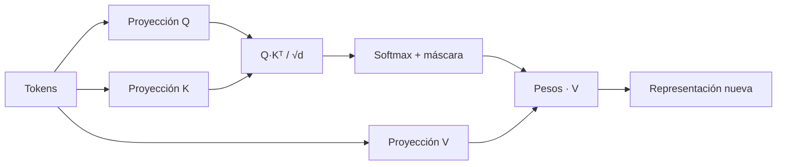

# Mecanismo de atención

Parte de: [[21-IA-Machine-Learning/04 Redes neuronales y deep learning/_Índice Redes neuronales y deep learning|Redes neuronales y deep learning]]

> [!info] Cómo avanzar
> `progreso`: **pendiente** → **viendo** (estudiando) → **visto** (contestaste la autoevaluación sin abrir las respuestas) → **dominado** (hiciste el laboratorio o lo aplicaste de verdad).

## Contenido

### Qué es
La **atención** es un mecanismo que permite que cada elemento de una secuencia (por ejemplo, cada token de una frase) **mire a todos los demás** y decida cuánto le importa cada uno para construir su nueva representación. Es el corazón de los [[Transformers]] y, por lo tanto, de los LLMs. Resuelve el problema de las [[Redes recurrentes (RNN y LSTM)|RNN]]: en lugar de pasar información paso a paso, cualquier posición accede directamente a cualquier otra.

### Cómo funciona
Cada token se proyecta en tres vectores mediante matrices aprendidas:
- **Query (Q)**: "qué estoy buscando".
- **Key (K)**: "qué ofrezco para ser encontrado".
- **Value (V)**: "qué información entrego si me eligen".

Analogía: una búsqueda en una base de datos *suave*. La query se compara con todas las keys; en vez de devolver un solo registro, devuelve un **promedio ponderado** de todos los values, donde el peso depende de qué tan bien coincide cada key.

**Atención escalada por producto punto**:

`Atención(Q, K, V) = softmax(Q·Kᵀ / √d) · V`

Paso a paso:
1. `Q·Kᵀ`: producto punto entre cada query y cada key → una matriz de puntajes (qué tanto se relaciona cada par de tokens).
2. Dividir entre `√d` (con `d` la dimensión de las keys).
3. [[Softmax]] por fila → pesos que suman 1.
4. Multiplicar por `V` → cada token obtiene una mezcla de los values, ponderada por relevancia.

**Por qué `√d`**: si las componentes de q y k tienen varianza 1, su producto punto tiene varianza `d`. Con `d = 64` o más, los puntajes se vuelven grandes, softmax se satura (casi todo el peso en un token) y sus gradientes se hacen casi cero. Dividir entre `√d` regresa la varianza a 1 y mantiene el entrenamiento estable.

**Ejemplo numérico**: `q = [0, 2]`, `k₁ = [1, 0]`, `k₂ = [0, 1]`, `d = 2`. Puntajes: `q·k₁ = 0`, `q·k₂ = 2`; escalados: `0` y `2/√2 ≈ 1.414`. Softmax de `[0, 1.414]` ≈ `[0.196, 0.804]`. Con `v₁ = [4, 0]` y `v₂ = [0, 4]`, la salida es `0.196·[4, 0] + 0.804·[0, 4] ≈ [0.79, 3.22]`: el token "atiende" sobre todo al segundo.

**Atención multi-cabeza**: en vez de una sola atención, se hacen `h` en paralelo, cada una con sus propias proyecciones Q, K, V de menor dimensión. Cada cabeza puede especializarse en un tipo de relación (concordancia gramatical, a qué se refiere un pronombre, cercanía). Sus salidas se concatenan y se proyectan de nuevo.

**Máscara causal**: en modelos que generan texto, cada token solo puede atender a los anteriores (no puede "ver el futuro"); los puntajes de posiciones futuras se ponen en −∞ antes del softmax.



**Costo**: la matriz de puntajes es `n × n` (con `n` tokens), así que memoria y cómputo crecen cuadráticamente con la longitud del contexto.

### Ejemplo
Atención a mano y con la función optimizada de PyTorch:

```python
import math
import torch
import torch.nn.functional as F

def atencion(Q, K, V, causal=False):
    d = Q.shape[-1]
    puntajes = Q @ K.transpose(-2, -1) / math.sqrt(d)
    if causal:
        n = puntajes.shape[-1]
        mascara = torch.triu(torch.ones(n, n, dtype=torch.bool), diagonal=1)
        puntajes = puntajes.masked_fill(mascara, float("-inf"))
    pesos = torch.softmax(puntajes, dim=-1)
    return pesos @ V, pesos

Q = torch.tensor([[0.0, 2.0]])
K = torch.tensor([[1.0, 0.0], [0.0, 1.0]])
V = torch.tensor([[4.0, 0.0], [0.0, 4.0]])
salida, pesos = atencion(Q, K, V)
print("pesos:", pesos.numpy().round(3), "salida:", salida.numpy().round(2))

# Equivalente optimizado (usa kernels eficientes cuando están disponibles)
print(F.scaled_dot_product_attention(Q, K, V).numpy().round(2))

# Multi-cabeza lista para usar
mha = torch.nn.MultiheadAttention(embed_dim=64, num_heads=8, batch_first=True)
x = torch.randn(2, 10, 64)                       # lote 2, 10 tokens, dimensión 64
y, w = mha(x, x, x)                              # autoatención
print(y.shape, w.shape)                          # 2×10×64 y 2×10×10
```

### Cuándo usarlo y cuándo no
- **Úsala** (normalmente dentro de un transformer) cuando las relaciones entre elementos lejanos importan: texto, código, series largas, imágenes divididas en parches.
- **Considera alternativas** cuando las secuencias son extremadamente largas y la memoria es el límite: variantes de atención eficiente, ventanas locales o modelos de espacio de estados.
- **Para datos tabulares simples** o señales cortas, suele ser excesiva.

### Errores comunes
- **Olvidar el escalado `√d`**: el entrenamiento se vuelve inestable.
- **No aplicar la máscara causal** en un modelo generativo: el modelo "hace trampa" viendo el token que debe predecir y luego falla en inferencia.
- **Ignorar las máscaras de *padding***: los tokens de relleno reciben atención y contaminan el resultado.
- **Subestimar el costo cuadrático**: duplicar el contexto multiplica por cuatro la matriz de atención.

### Para profundizar
- [Attention Is All You Need (Vaswani et al.)](https://arxiv.org/abs/1706.03762)
- [The Illustrated Transformer (Jay Alammar)](https://jalammar.github.io/illustrated-transformer/)
- [torch.nn.functional.scaled_dot_product_attention](https://docs.pytorch.org/docs/stable/generated/torch.nn.functional.scaled_dot_product_attention.html)

## Ejercicios

Resuélvelos en papel o en la herramienta; la solución está plegada.

> [!question]- `q = [1, 0]`, `k₁ = [1, 0]`, `k₂ = [0, 1]`, `d = 2`. Calcula los pesos de atención.
> Puntajes `[1/√2, 0] ≈ [0.707, 0]` → softmax `≈ [0.67, 0.33]`.

> [!question]- Con `v₁ = [10, 0]` y `v₂ = [0, 10]`, ¿qué salida da?
> `0.67·[10,0] + 0.33·[0,10] ≈ [6.7, 3.3]`

## Autoevaluación

Contesta primero en voz alta o en papel; luego despliega la respuesta.

> [!question]- ¿Qué hace la atención?
> Para cada posición, calcula qué tanto debe "mirar" a cada otra (puntajes entre consultas Q y claves K), y con esos pesos mezcla los valores V.

> [!question]- Escribe la fórmula de atención escalada.
> `Attention(Q, K, V) = softmax(Q·Kᵀ / √d) · V`

> [!question]- ¿Por qué se divide entre √d?
> Con dimensiones grandes los productos punto crecen y softmax se satura; escalar mantiene gradientes útiles.

> [!question]- ¿Qué es la atención multi-cabeza?
> Varias atenciones en paralelo con proyecciones distintas; cada cabeza puede captar un tipo de relación.

