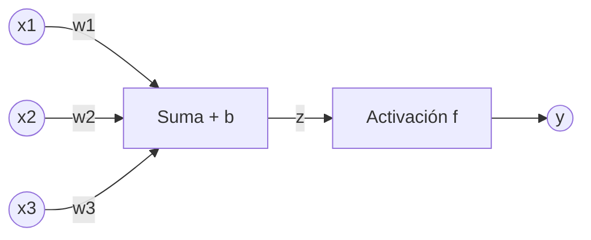

# Neurona artificial y perceptrón

Parte de: [[21-IA-Machine-Learning/04 Redes neuronales y deep learning/_Índice Redes neuronales y deep learning|Redes neuronales y deep learning]]

> [!info] Cómo avanzar
> `progreso`: **pendiente** → **viendo** (estudiando) → **visto** (contestaste la autoevaluación sin abrir las respuestas) → **dominado** (hiciste el laboratorio o lo aplicaste de verdad).

## Contenido

### Qué es
Una **neurona artificial** es la pieza mínima de una red neuronal: recibe varios números de entrada, los multiplica por unos **pesos**, suma todo junto con un **sesgo** y pasa el resultado por una **función de activación**. El **perceptrón** (Rosenblatt, 1958) es la versión más simple: una sola neurona con activación escalón que devuelve 0 o 1, o sea, un clasificador binario lineal. Entenderlo bien es la base para todo lo demás: una red profunda no es otra cosa que miles de estas neuronas conectadas en capas.

### Cómo funciona
El cálculo tiene dos partes:

1. **Combinación lineal**: `z = w₁·x₁ + w₂·x₂ + … + wₙ·xₙ + b`, que en notación vectorial es el producto punto `z = w·x + b` (repasa [[Álgebra lineal para ML (vectores, matrices y producto punto)]]).
2. **Activación**: `y = f(z)`. En el perceptrón clásico, `f(z) = 1` si `z > 0` y `0` en otro caso.

Geométricamente, `w·x + b = 0` es una **recta** (en 2D), un plano (en 3D) o un hiperplano en general. Todo lo que cae de un lado se clasifica como 1 y lo del otro lado como 0. El vector `w` define la orientación de esa frontera y el **sesgo `b` la desplaza**: sin sesgo, la frontera estaría obligada a pasar por el origen, lo que limita mucho lo que puede separar. Puedes pensar en `b` como un umbral: la neurona "se enciende" cuando la suma ponderada supera `-b`.



**Regla de aprendizaje del perceptrón**: para cada ejemplo, si la predicción es correcta no cambias nada; si se equivoca, ajustas `w ← w + η·(y_real − y_pred)·x` y `b ← b + η·(y_real − y_pred)`. Si los datos son linealmente separables, este proceso converge. Las redes modernas sustituyen el escalón por activaciones derivables (ver [[Funciones de activación]]) para poder entrenar con gradientes ([[Descenso de gradiente y backpropagation]]).

**La gran limitación**: un perceptrón de una capa solo dibuja **una** frontera recta. Las compuertas lógicas AND y OR son separables con una recta, pero **XOR no**: los puntos (0,1) y (1,0) deben dar 1 y (0,0) y (1,1) deben dar 0, y ninguna recta deja a los dos primeros de un lado y a los otros del otro. Este resultado (Minsky y Papert, 1969) frenó el área durante años y se resolvió apilando capas: eso es una [[Redes neuronales multicapa|red multicapa]].

### Ejemplo
Un perceptrón en Python puro para ver cómo aprende la compuerta NAND (también separable), y luego cómo falla con XOR:

```python
import numpy as np

def escalon(z):
    return (z > 0).astype(int)

def entrenar(X, y, eta=0.1, epocas=20):
    w = np.zeros(X.shape[1]); b = 0.0
    for _ in range(epocas):
        for xi, yi in zip(X, y):
            pred = escalon(np.dot(w, xi) + b)
            error = yi - pred          # 0 si acierta, ±1 si falla
            w += eta * error * xi
            b += eta * error
    return w, b

X = np.array([[0, 0], [0, 1], [1, 0], [1, 1]])
nand = np.array([1, 1, 1, 0])
xor  = np.array([0, 1, 1, 0])

for nombre, y in [("NAND", nand), ("XOR", xor)]:
    w, b = entrenar(X, y)
    print(nombre, "pesos:", w, "sesgo:", b, "predicción:", escalon(X @ w + b), "real:", y)
```

Con NAND la predicción coincide con la real; con XOR nunca llega a acertar las cuatro, sin importar cuántas épocas le des. Para diseñar pesos "a mano" piensa así: elige `w` y luego un `b` negativo que funcione como umbral. Por ejemplo, con `w = [1, 1]` la suma vale 0, 1 o 2; un umbral entre 1 y 2 hace que solo `[1,1]` active la neurona, y un umbral entre 0 y 1 hace que cualquier entrada con un 1 la active.

En PyTorch, una neurona es simplemente `torch.nn.Linear(n_entradas, 1)` seguida de una activación; la verás en [[PyTorch]].

### Cuándo usarlo y cuándo no
- **Úsalo** para entender el mecanismo, como base de clasificadores lineales o como pieza de una red más grande.
- **No lo uses solo** cuando el problema no es linealmente separable (casi todos los problemas reales). En ese caso usa una MLP, o un modelo clásico como [[Regresión logística]] (que es, en esencia, una neurona con activación sigmoide y una pérdida probabilística) o árboles.

### Errores comunes
- **Olvidar el sesgo**: sin `b` la frontera pasa por el origen y casos tan simples como AND dejan de tener solución.
- **No escalar las entradas**: si una característica va de 0 a 1 y otra de 0 a 100 000, la segunda domina el producto punto y el aprendizaje se vuelve inestable.
- **Esperar que un perceptrón aprenda XOR**: no es cuestión de más épocas; es una limitación estructural.
- **Confundir la neurona artificial con una biológica**: la analogía inspira, pero el modelo es solo álgebra y una función.

### Para profundizar
- [Deep Learning (Goodfellow, Bengio y Courville), libro en línea](https://www.deeplearningbook.org/)
- [CS231n: notas sobre redes neuronales (Stanford)](https://cs231n.github.io/neural-networks-1/)
- [torch.nn.Linear en la documentación de PyTorch](https://docs.pytorch.org/docs/stable/generated/torch.nn.Linear.html)

## Ejercicios

Resuélvelos en papel o en la herramienta; la solución está plegada.

> [!question]- `w = [0.5, -1]`, `b = 0.2`, `x = [2, 1]` y activación escalón (1 si z > 0). ¿Salida?
> `z = 1 - 1 + 0.2 = 0.2 > 0` → `1`

> [!question]- Encuentra pesos para AND con entradas 0/1 y escalón.
> `w = [1, 1]`, `b = -1.5`: solo `(1,1)` da `z = 0.5 > 0`.

> [!question]- ¿Y para OR?
> `w = [1, 1]`, `b = -0.5`: cualquier entrada en 1 da `z ≥ 0.5`.

## Autoevaluación

Contesta primero en voz alta o en papel; luego despliega la respuesta.

> [!question]- ¿Qué calcula una neurona artificial?
> Una suma ponderada más un sesgo, `z = w·x + b`, y aplica una función de activación `a = f(z)`.

> [!question]- ¿Qué limitación tiene un perceptrón de una capa?
> Solo separa clases linealmente: no puede aprender XOR. Se resuelve con capas ocultas y activaciones no lineales.

> [!question]- ¿Para qué sirve el sesgo `b`?
> Desplaza la frontera de decisión; sin él, la frontera tendría que pasar por el origen.

