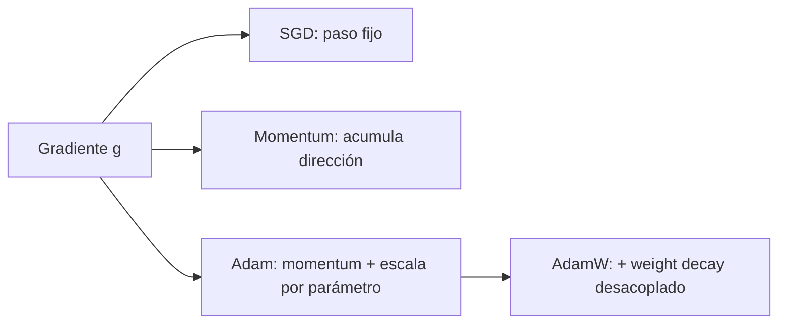

# Optimizadores (SGD y Adam)

Parte de: [[21-IA-Machine-Learning/04 Redes neuronales y deep learning/_Índice Redes neuronales y deep learning|Redes neuronales y deep learning]]

> [!info] Cómo avanzar
> `progreso`: **pendiente** → **viendo** (estudiando) → **visto** (contestaste la autoevaluación sin abrir las respuestas) → **dominado** (hiciste el laboratorio o lo aplicaste de verdad).

## Contenido

### Qué es
Un **optimizador** es el algoritmo que decide **cómo** usar los gradientes para actualizar los pesos. El [[Descenso de gradiente y backpropagation|descenso de gradiente]] básico da pasos de tamaño fijo en la dirección contraria al gradiente; los optimizadores modernos añaden memoria de pasos anteriores (momentum) y tasas de aprendizaje adaptativas por parámetro. En PyTorch viven en `torch.optim`, y los dos que más vas a usar son **SGD** (con momentum) y **Adam/AdamW**.

### Cómo funciona
**SGD (descenso de gradiente estocástico)**
`w ← w − η · g`, donde `g` es el gradiente del mini-batch. Simple y predecible, pero en valles alargados zigzaguea y avanza lento.

**SGD con momentum**
Mantiene una "velocidad" `v` que acumula gradientes pasados:
`v ← μ·v + g` y luego `w ← w − η·v` (con `μ` típico de 0.9).
Es como una pelota rodando cuesta abajo: en direcciones donde el gradiente apunta siempre igual, acelera; en direcciones donde cambia de signo (el zigzag), las contribuciones se cancelan. Resultado: menos oscilación y convergencia más rápida.

**Adam** (*Adaptive Moment Estimation*)
Lleva dos promedios móviles por cada parámetro:
- `m`: promedio del gradiente (el momentum, primer momento).
- `v`: promedio del gradiente **al cuadrado** (segundo momento, mide qué tan grande y ruidoso es).
El paso es aproximadamente `η · m / (√v + ε)`, con una corrección de sesgo en los primeros pasos. Así, cada parámetro tiene su propia tasa efectiva: los que reciben gradientes grandes dan pasos más cortos y los que reciben gradientes pequeños, más largos. Funciona bien "de fábrica" en muchos problemas, por eso es el punto de partida habitual.

**AdamW** separa el *weight decay* (regularización L2) de la actualización adaptativa; es la variante recomendada cuando regularizas y la usual para transformers ([[Regularización y dropout]]).



**Schedulers de tasa de aprendizaje**: la tasa ideal cambia durante el entrenamiento. Al principio conviene explorar y al final hacer pasos finos. Piensa en un *scheduler* cuando:
- La pérdida se estanca en una meseta (usa `ReduceLROnPlateau`).
- Entrenas muchas épocas y quieres bajar la tasa gradualmente (`CosineAnnealingLR`, `StepLR`).
- Haces [[Transfer learning y fine-tuning|fine-tuning]] de modelos grandes, donde un **warmup** (subir la tasa poco a poco al inicio) evita romper los pesos preentrenados.

### Ejemplo
Compara SGD, SGD con momentum y Adam en el mismo problema, con un scheduler:

```python
import torch
from torch import nn

torch.manual_seed(0)
X = torch.randn(1000, 10)
w_real = torch.randn(10, 1)
y = X @ w_real + 0.1 * torch.randn(1000, 1)

def entrenar(nombre, fabrica_opt, epocas=50):
    modelo = nn.Linear(10, 1)
    opt = fabrica_opt(modelo.parameters())
    sched = torch.optim.lr_scheduler.StepLR(opt, step_size=20, gamma=0.5)  # mitad cada 20 épocas
    for _ in range(epocas):
        for i in range(0, 1000, 64):                       # mini-batches de 64
            xb, yb = X[i:i + 64], y[i:i + 64]
            opt.zero_grad()
            loss = nn.functional.mse_loss(modelo(xb), yb)
            loss.backward()
            opt.step()
        sched.step()                                       # una vez por época
    print(f"{nombre:16s} pérdida final: {nn.functional.mse_loss(modelo(X), y).item():.5f}")

entrenar("SGD", lambda p: torch.optim.SGD(p, lr=0.01))
entrenar("SGD + momentum", lambda p: torch.optim.SGD(p, lr=0.01, momentum=0.9))
entrenar("Adam", lambda p: torch.optim.Adam(p, lr=0.01))
entrenar("AdamW", lambda p: torch.optim.AdamW(p, lr=0.01, weight_decay=0.01))
```

Experimenta: cambia `lr` a 0.1 y a 0.001 y observa qué optimizador es más sensible.

### Cuándo usarlo y cuándo no
- **Adam/AdamW**: primera opción para prototipos, transformers, embeddings y casi cualquier red cuando quieres resultados rápidos sin mucho ajuste.
- **SGD con momentum**: muy usado en visión (CNNs) cuando puedes invertir en ajustar la tasa y el scheduler; a veces generaliza un poco mejor.
- **Optimizadores de memoria reducida** (por ejemplo, Adam de 8 bits de la librería bitsandbytes): cuando la VRAM es el límite, porque Adam guarda dos tensores extra por parámetro.

### Errores comunes
- **Creer que Adam no necesita ajustar la tasa**: tolera más, pero una tasa mala sigue arruinando el entrenamiento.
- **Usar Adam con `weight_decay` esperando el efecto de AdamW**: en Adam el decaimiento se mezcla con la escala adaptativa; para regularizar usa AdamW.
- **Llamar `scheduler.step()` en el lugar equivocado**: unos schedulers se avanzan por época y otros por paso; revisa la documentación del que uses.
- **Olvidar la memoria del optimizador**: Adam ocupa aproximadamente el doble de memoria de los pesos adicionalmente; en una GPU de 6 GB eso cuenta.

### Para profundizar
- [torch.optim: documentación oficial](https://docs.pytorch.org/docs/stable/optim.html)
- [Adam: A Method for Stochastic Optimization (Kingma y Ba)](https://arxiv.org/abs/1412.6980)
- [CS231n: actualizaciones de parámetros](https://cs231n.github.io/neural-networks-3/#update)

## Autoevaluación

Contesta primero en voz alta o en papel; luego despliega la respuesta.

> [!question]- ¿Qué agrega el momentum a SGD?
> Acumula una media de gradientes pasados para avanzar más rápido en direcciones consistentes y amortiguar oscilaciones.

> [!question]- ¿Qué hace Adam?
> Combina momentum con una tasa de aprendizaje adaptativa por parámetro (según la magnitud reciente de sus gradientes). Suele converger rápido con poca afinación.

> [!question]- ¿Cuándo pensarías en un *scheduler* de tasa de aprendizaje?
> Cuando la pérdida se estanca: bajar la tasa con el tiempo (step, coseno) o usar *warmup* al inicio en transformers.

## Práctica

- [[Lab 3 - Red neuronal pequeña en PyTorch]]

