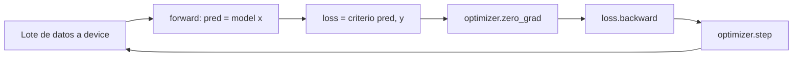

# PyTorch

Parte de: [[21-IA-Machine-Learning/04 Redes neuronales y deep learning/_Índice Redes neuronales y deep learning|Redes neuronales y deep learning]]

> [!info] Cómo avanzar
> `progreso`: **pendiente** → **viendo** (estudiando) → **visto** (contestaste la autoevaluación sin abrir las respuestas) → **dominado** (hiciste el laboratorio o lo aplicaste de verdad).

## Contenido

### Qué es
**PyTorch** es una librería de Python, de código abierto, para construir y entrenar redes neuronales. Ofrece **tensores** (arreglos multidimensionales que pueden vivir en CPU o GPU), **autograd** (cálculo automático de gradientes), módulos de capas (`torch.nn`), optimizadores (`torch.optim`) y utilidades de datos (`torch.utils.data`). Es el estándar de facto en investigación y la base de librerías como Hugging Face Transformers.

### Cómo funciona
**Tensores**: como un `ndarray` de NumPy, pero con dos superpoderes: pueden moverse a la GPU (`.to("cuda")`) y pueden registrar operaciones para derivar. Tienen `shape`, `dtype` (por ejemplo `float32`) y `device`.

**Autograd**: si un tensor tiene `requires_grad=True`, PyTorch construye un grafo de las operaciones hechas con él. Al llamar `.backward()` sobre un escalar (la pérdida), recorre el grafo al revés y deja los gradientes en el atributo `.grad` de cada parámetro. Es la implementación de [[Descenso de gradiente y backpropagation|backpropagation]] que no tienes que escribir.

**`nn.Module`**: la clase base de modelos. Defines las capas en `__init__` y el cálculo en `forward`. `model.parameters()` entrega todos los pesos al optimizador.

**El ciclo de entrenamiento**, siempre los mismos pasos:



1. Tomar un lote del `DataLoader` y moverlo al dispositivo.
2. Forward: calcular predicciones.
3. Calcular la [[Función de pérdida]].
4. Limpiar gradientes (`zero_grad`).
5. Backward: calcular gradientes.
6. `step`: el optimizador actualiza pesos ([[Optimizadores (SGD y Adam)]]).
Al final de cada época, validar en modo evaluación.

**`torch.no_grad()`** desactiva el registro del grafo: se usa al evaluar o hacer inferencia, porque ahorra memoria y tiempo y evita modificar gradientes por accidente. Va junto con `model.eval()`, que cambia el comportamiento de dropout y batch norm ([[Regularización y dropout]]).

**Dispositivos**: tu GTX 1660 Ti (6 GB, arquitectura Turing) es compatible con CUDA y sirve para aprender y entrenar modelos pequeños o medianos en `float32`. Ese chip no tiene Tensor Cores, así que la precisión mixta (`torch.autocast` con fp16) no te dará el salto de velocidad que sí da en GPUs con Tensor Cores, y 6 GB limitan el tamaño de modelo y lote. Para entrenar cosas más grandes usa **Google Colab**: abre un notebook, elige *Entorno de ejecución → Cambiar tipo de entorno → GPU* y el mismo código corre con `device = "cuda"`. En el plan gratuito la GPU no está garantizada y las sesiones tienen límite de tiempo, así que guarda checkpoints en Google Drive.

### Ejemplo
Plantilla completa con `Dataset`, `DataLoader`, selección de dispositivo, entrenamiento y evaluación:

```python
import torch
from torch import nn
from torch.utils.data import TensorDataset, DataLoader

device = "cuda" if torch.cuda.is_available() else "cpu"
print("usando:", device, torch.cuda.get_device_name(0) if device == "cuda" else "")

# Datos sintéticos: 2 clases separables por una curva
X = torch.randn(2000, 2)
y = ((X[:, 0] ** 2 + X[:, 1] ** 2) < 1).long()
ds_tr = TensorDataset(X[:1600], y[:1600]); ds_va = TensorDataset(X[1600:], y[1600:])
dl_tr = DataLoader(ds_tr, batch_size=64, shuffle=True)
dl_va = DataLoader(ds_va, batch_size=256)

class Clasificador(nn.Module):
    def __init__(self):
        super().__init__()
        self.red = nn.Sequential(nn.Linear(2, 32), nn.ReLU(), nn.Linear(32, 2))
    def forward(self, x):
        return self.red(x)

modelo = Clasificador().to(device)              # el modelo al dispositivo
opt = torch.optim.Adam(modelo.parameters(), lr=1e-2)
criterio = nn.CrossEntropyLoss()

for epoca in range(10):
    modelo.train()
    for xb, yb in dl_tr:
        xb, yb = xb.to(device), yb.to(device)   # los datos al MISMO dispositivo
        opt.zero_grad()
        loss = criterio(modelo(xb), yb)
        loss.backward()
        opt.step()
    modelo.eval()
    aciertos = 0
    with torch.no_grad():
        for xb, yb in dl_va:
            xb, yb = xb.to(device), yb.to(device)
            aciertos += (modelo(xb).argmax(1) == yb).sum().item()
    print(f"época {epoca}: exactitud val = {aciertos / len(ds_va):.2%}")

torch.save(modelo.state_dict(), "clasificador.pt")   # guardar solo los pesos
```

Practica este flujo en [[Lab 3 - Red neuronal pequeña en PyTorch]].

### Cuándo usarlo y cuándo no
- **Úsalo** para redes neuronales de cualquier tipo, para afinar modelos de Hugging Face y para investigar.
- **Para ML clásico** sobre tablas (regresiones, árboles) es más directo scikit-learn.
- **Para servir modelos en .NET** puedes exportar a ONNX y usar [[ONNX Runtime]].

### Errores comunes
- **`Expected all tensors to be on the same device`**: el modelo está en GPU y los datos en CPU (o al revés). Mueve modelo **y** cada lote con `.to(device)`, y crea los tensores nuevos (máscaras, etiquetas) en el mismo `device`.
- **Olvidar `zero_grad()`**: los gradientes se acumulan.
- **Evaluar sin `model.eval()` y `torch.no_grad()`**: métricas inconsistentes y más memoria usada.
- **`CUDA out of memory`**: baja el `batch_size`, libera tensores que ya no usas o entrena en Colab.
- **Tipos incorrectos**: etiquetas de clasificación deben ser `long`; entradas, `float32`.

### Para profundizar
- [Documentación oficial de PyTorch](https://docs.pytorch.org/docs/stable/index.html)
- [Tutorial "Learn the Basics" de PyTorch](https://docs.pytorch.org/tutorials/beginner/basics/intro.html)
- [Instalación local (elige versión de CUDA)](https://pytorch.org/get-started/locally/)
- [Preguntas frecuentes de Google Colab](https://research.google.com/colaboratory/faq.html)

## Autoevaluación

Contesta primero en voz alta o en papel; luego despliega la respuesta.

> [!question]- ¿Qué son tensores y autograd?
> Tensores: arreglos n-dimensionales que pueden vivir en GPU. Autograd: registra operaciones y calcula gradientes con `loss.backward()`.

> [!question]- ¿Cuáles son los pasos del ciclo de entrenamiento?
> ```python
> for xb, yb in loader:
>     optimizer.zero_grad()
>     loss = loss_fn(model(xb), yb)
>     loss.backward()
>     optimizer.step()
> ```

> [!question]- ¿Para qué sirve `torch.no_grad()`?
> En evaluación/inferencia evita registrar el grafo de gradientes: ahorra memoria y tiempo.

> [!question]- Error común: `Expected all tensors to be on the same device`.
> El modelo está en GPU y los datos en CPU (o al revés). Mueve ambos con `.to(device)`.

## Práctica

- [[Lab 3 - Red neuronal pequeña en PyTorch]]

