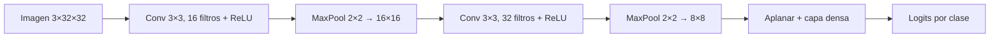

# Redes convolucionales (CNN)

Parte de: [[21-IA-Machine-Learning/04 Redes neuronales y deep learning/_Índice Redes neuronales y deep learning|Redes neuronales y deep learning]]

> [!info] Cómo avanzar
> `progreso`: **pendiente** → **viendo** (estudiando) → **visto** (contestaste la autoevaluación sin abrir las respuestas) → **dominado** (hiciste el laboratorio o lo aplicaste de verdad).

## Contenido

### Qué es
Una **red convolucional (CNN)** es una red neuronal diseñada para datos con estructura espacial, sobre todo imágenes. En lugar de conectar cada píxel con cada neurona, usa **filtros** pequeños (por ejemplo, 3×3) que se deslizan por la imagen buscando patrones locales: bordes, texturas, formas y, en capas profundas, partes de objetos. Son la base clásica de clasificación de imágenes, detección de objetos y segmentación.

### Cómo funciona
**Convolución**: un filtro de `k×k` pesos recorre la imagen; en cada posición multiplica elemento a elemento con el parche que tiene debajo y suma, produciendo un valor de un **mapa de características**. Con varios filtros obtienes varios mapas (canales de salida).

Dos ideas hacen a las CNN eficientes frente a una [[Redes neuronales multicapa|MLP]]:
- **Conectividad local**: cada salida solo mira un parche pequeño.
- **Pesos compartidos**: el mismo filtro se usa en toda la imagen, así que un detector de bordes aprendido arriba a la izquierda sirve también abajo a la derecha (equivarianza a la traslación). Resultado: muchísimos menos parámetros.

**Tamaño de salida** de una convolución (por dimensión):
`salida = ⌊(entrada + 2·padding − filtro) / stride⌋ + 1`
- *Padding*: bordes de ceros añadidos. Con filtro 3×3, padding 1 y stride 1, el tamaño se conserva.
- *Stride*: cuántos píxeles avanza el filtro. Stride 2 reduce a la mitad.
Ejemplo: entrada 64×64, filtro 3×3, sin padding, stride 2 → `⌊(64 − 3)/2⌋ + 1 = 31`.

**Parámetros de una capa convolucional**: `(k·k·canales_entrada + 1) · filtros`. Una conv 5×5 con 1 canal de entrada y 8 filtros tiene `(25 + 1)·8 = 208` parámetros, sin importar el tamaño de la imagen. Una capa densa sobre una imagen de 64×64 a 8 salidas tendría más de 32 000.

**Pooling**: reduce el tamaño de los mapas resumiendo regiones. *Max pooling* 2×2 con stride 2 toma el máximo de cada bloque y divide alto y ancho entre dos. Baja el cómputo, aumenta el campo receptivo y da algo de tolerancia a pequeños desplazamientos. No tiene parámetros.



Las capas iniciales aprenden patrones simples y las profundas combinan esos patrones en conceptos más abstractos. Arquitecturas conocidas: LeNet, VGG, ResNet (con conexiones residuales que permiten redes muy profundas) y EfficientNet.

### Ejemplo
CNN pequeña para CIFAR-10 (imágenes 32×32 a color, 10 clases). Corre en tu GTX 1660 Ti, aunque una época es mucho más rápida en una GPU de Colab:

```python
import torch
from torch import nn
from torchvision import datasets, transforms
from torch.utils.data import DataLoader

device = "cuda" if torch.cuda.is_available() else "cpu"
tf = transforms.Compose([transforms.RandomHorizontalFlip(), transforms.ToTensor()])
train = datasets.CIFAR10("datos", train=True, download=True, transform=tf)
dl = DataLoader(train, batch_size=128, shuffle=True, num_workers=2)

modelo = nn.Sequential(
    nn.Conv2d(3, 16, kernel_size=3, padding=1), nn.ReLU(), nn.MaxPool2d(2),   # 16×16×16
    nn.Conv2d(16, 32, kernel_size=3, padding=1), nn.ReLU(), nn.MaxPool2d(2),  # 32×8×8
    nn.Flatten(),
    nn.Linear(32 * 8 * 8, 128), nn.ReLU(),
    nn.Linear(128, 10),
).to(device)

print("parámetros primera conv:", sum(p.numel() for p in modelo[0].parameters()))  # (3·3·3+1)·16
opt = torch.optim.Adam(modelo.parameters(), lr=1e-3)
criterio = nn.CrossEntropyLoss()

modelo.train()
for xb, yb in dl:                     # una época
    xb, yb = xb.to(device), yb.to(device)
    opt.zero_grad()
    loss = criterio(modelo(xb), yb)
    loss.backward()
    opt.step()
print("pérdida del último lote:", loss.item())
```

### Cuándo usarlo y cuándo no
- **CNN desde cero**: cuando tus imágenes son muy distintas de las fotos comunes (radiografías, espectrogramas, piezas impresas en 3D vistas de cerca) y tienes bastantes datos etiquetados.
- **CNN preentrenada** (ResNet, EfficientNet de torchvision): cuando tienes pocos datos o poco cómputo. Reutilizas filtros aprendidos con millones de imágenes y solo reentrenas la cabeza o afinas un poco ([[Transfer learning y fine-tuning]]). Es la opción por defecto en la práctica.
- **Alternativas**: los *Vision Transformers* compiten o superan a las CNN con muchos datos; para tablas o texto, las CNN no son la herramienta adecuada.

### Errores comunes
- **Calcular mal el tamaño antes de la capa densa**: el error típico es `mat1 and mat2 shapes cannot be multiplied`. Imprime `x.shape` tras cada bloque o usa `nn.LazyLinear`.
- **Olvidar normalizar las imágenes** con las medias y desviaciones que espera el modelo preentrenado.
- **Aumento de datos también en validación**: los aumentos aleatorios van solo en entrenamiento.
- **Orden de dimensiones**: PyTorch espera `N×C×H×W` (lote, canales, alto, ancho), no `N×H×W×C`.

### Para profundizar
- [CS231n: redes convolucionales](https://cs231n.github.io/convolutional-networks/)
- [torch.nn.Conv2d](https://docs.pytorch.org/docs/stable/generated/torch.nn.Conv2d.html)
- [Modelos preentrenados de torchvision](https://docs.pytorch.org/vision/stable/models.html)

## Ejercicios

Resuélvelos en papel o en la herramienta; la solución está plegada.

> [!question]- Entrada 32×32, filtro 3×3, padding 1, stride 1. ¿Tamaño de salida?
> `(32 - 3 + 2)/1 + 1 = 32` → 32×32

> [!question]- Entrada 28×28, filtro 5×5, sin padding, stride 1.
> `(28 - 5)/1 + 1 = 24` → 24×24

> [!question]- Max pooling 2×2 con stride 2 sobre 32×32.
> 16×16

> [!question]- Parámetros de una conv 3×3 con 3 canales de entrada y 16 filtros.
> `(3·3·3 + 1)·16 = 448`

## Autoevaluación

Contesta primero en voz alta o en papel; luego despliega la respuesta.

> [!question]- ¿Qué ventaja tiene una convolución frente a una capa densa en imágenes?
> Comparte pesos (el mismo filtro recorre toda la imagen) y aprovecha la localidad: muchos menos parámetros y detecta patrones donde sea que aparezcan.

> [!question]- ¿Qué hace el pooling?
> Reduce el tamaño espacial (p. ej. max pooling 2×2) conservando las activaciones más fuertes.

> [!question]- ¿Cuándo usarías una CNN preentrenada en vez de entrenar desde cero?
> Casi siempre con pocos datos: transfer learning desde un modelo entrenado en millones de imágenes.

