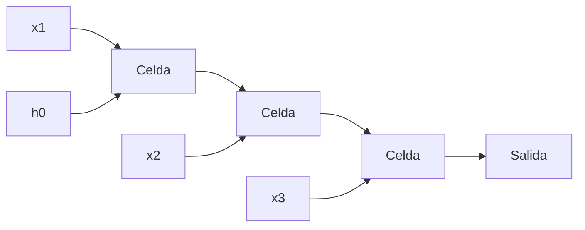

# Redes recurrentes (RNN y LSTM)

Parte de: [[21-IA-Machine-Learning/04 Redes neuronales y deep learning/_Índice Redes neuronales y deep learning|Redes neuronales y deep learning]]

> [!info] Cómo avanzar
> `progreso`: **pendiente** → **viendo** (estudiando) → **visto** (contestaste la autoevaluación sin abrir las respuestas) → **dominado** (hiciste el laboratorio o lo aplicaste de verdad).

## Contenido

### Qué es
Una **red recurrente (RNN)** procesa secuencias (texto, series de tiempo, audio) **un elemento a la vez**, manteniendo un **estado oculto** que resume lo visto hasta ese momento. Una **LSTM** (*Long Short-Term Memory*) es una RNN con un mecanismo de compuertas que le permite recordar información durante muchos más pasos. Fueron el estándar para lenguaje antes de los [[Transformers]] y siguen siendo útiles en series de tiempo pequeñas y dispositivos con pocos recursos.

### Cómo funciona
**RNN simple**
En cada paso `t` recibe la entrada `xₜ` y el estado anterior `hₜ₋₁`, y calcula:
`hₜ = tanh(Wₓ·xₜ + Wₕ·hₜ₋₁ + b)`
Los **mismos pesos** se usan en todos los pasos, así que la red puede procesar secuencias de cualquier longitud. La salida puede tomarse en cada paso (etiquetar cada palabra) o solo al final (clasificar toda la secuencia).



**El problema**: entrenar una RNN es aplicar backprop "a través del tiempo": el gradiente viaja hacia atrás paso por paso, multiplicándose cada vez por los pesos recurrentes y por la derivada de tanh ([[Sigmoide y tanh]]). En secuencias largas se **desvanece** (las dependencias lejanas no se aprenden) o **explota**. En la práctica, una RNN simple olvida lo que pasó hace unas decenas de pasos.

**LSTM**
Agrega una **celda de memoria** `cₜ`, una especie de "cinta transportadora" por la que la información fluye con cambios mínimos, y tres compuertas con sigmoide (valores entre 0 y 1):
- **Compuerta de olvido**: decide qué parte de la memoria anterior se borra.
- **Compuerta de entrada**: decide qué información nueva se escribe.
- **Compuerta de salida**: decide qué parte de la memoria se expone como estado oculto `hₜ`.
Como la memoria se actualiza sumando en lugar de multiplicando repetidamente, el gradiente puede viajar muchos pasos sin desvanecerse. La **GRU** es una variante con dos compuertas, más ligera y con resultados parecidos.

**Por qué los transformers las desplazaron en lenguaje**
1. **Secuencialidad**: una RNN no puede calcular el paso 100 sin haber calculado el 99, así que no aprovecha bien el paralelismo de la GPU ([[GPUs y por qué importan]]). Un transformer procesa todas las posiciones del texto a la vez durante el entrenamiento.
2. **Dependencias largas**: aun con LSTM, la información debe "sobrevivir" paso a paso; en la [[Mecanismo de atención|atención]], cualquier token mira directamente a cualquier otro.
3. **Escalabilidad**: al entrenar en paralelo, los transformers pudieron crecer a miles de millones de parámetros y datos masivos, que es lo que dio lugar a los LLMs.

### Ejemplo
LSTM para predecir el siguiente valor de una serie de tiempo (una onda senoidal con ruido). Corre bien en CPU o en tu GTX 1660 Ti:

```python
import torch
from torch import nn

torch.manual_seed(0)
t = torch.linspace(0, 100, 2000)
serie = torch.sin(t) + 0.1 * torch.randn_like(t)

ventana = 30
X = torch.stack([serie[i:i + ventana] for i in range(len(serie) - ventana)]).unsqueeze(-1)  # N×30×1
y = serie[ventana:].unsqueeze(-1)                                                          # N×1

class Pronostico(nn.Module):
    def __init__(self):
        super().__init__()
        self.lstm = nn.LSTM(input_size=1, hidden_size=32, batch_first=True)
        self.salida = nn.Linear(32, 1)
    def forward(self, x):
        h_todos, (h_final, c_final) = self.lstm(x)   # h_final: 1×N×32
        return self.salida(h_final[-1])              # predecir con el último estado

modelo = Pronostico()
opt = torch.optim.Adam(modelo.parameters(), lr=1e-2)
for epoca in range(30):
    opt.zero_grad()
    loss = nn.functional.mse_loss(modelo(X), y)
    loss.backward()
    nn.utils.clip_grad_norm_(modelo.parameters(), 1.0)   # evita explosión del gradiente
    opt.step()
print("MSE final:", round(loss.item(), 4))
```

Observa `batch_first=True` (forma lote × secuencia × rasgos) y el *gradient clipping*, una práctica estándar en redes recurrentes.

### Cuándo usarlo y cuándo no
- **Úsalas** en series de tiempo de tamaño moderado, sensores o señales en dispositivos con poca memoria, o cuando necesitas procesar un flujo en tiempo real paso a paso con estado.
- **No las uses** para lenguaje natural en proyectos nuevos: un transformer preentrenado será mejor.
- **Para pronóstico tabular** de ventas o demanda, compara antes con modelos clásicos o gradient boosting con variables de retraso; a menudo ganan con menos esfuerzo.

### Errores comunes
- **Confundir el orden de dimensiones**: por defecto `nn.LSTM` espera secuencia × lote × rasgos; usa `batch_first=True` si tus datos vienen lote primero.
- **No escalar la serie**: valores grandes saturan tanh y el entrenamiento se estanca.
- **Mezclar el futuro en el entrenamiento**: al dividir series de tiempo, separa por fecha, no al azar.
- **Olvidar el clipping**: gradientes que explotan producen `nan` de repente.

### Para profundizar
- [Understanding LSTM Networks (Christopher Olah)](https://colah.github.io/posts/2015-08-Understanding-LSTMs/)
- [torch.nn.LSTM](https://docs.pytorch.org/docs/stable/generated/torch.nn.LSTM.html)
- [Deep Learning, capítulo 10: modelos de secuencia](https://www.deeplearningbook.org/contents/rnn.html)

## Autoevaluación

Contesta primero en voz alta o en papel; luego despliega la respuesta.

> [!question]- ¿Qué hace una RNN?
> Procesa una secuencia paso a paso manteniendo un estado oculto que resume lo visto.

> [!question]- ¿Qué problema resuelve LSTM?
> Las dependencias largas: sus compuertas (olvido, entrada, salida) controlan qué información se guarda y mitigan el desvanecimiento del gradiente.

> [!question]- ¿Por qué los transformers las desplazaron en lenguaje?
> La atención procesa toda la secuencia en paralelo (mejor uso de GPU) y relaciona posiciones lejanas directamente.

