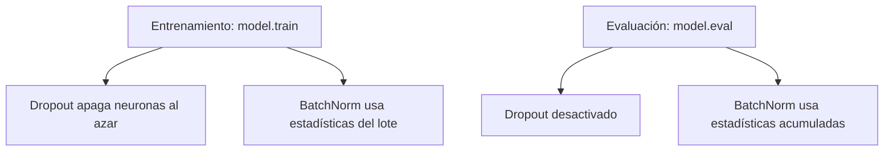

# Regularización y dropout

Parte de: [[21-IA-Machine-Learning/04 Redes neuronales y deep learning/_Índice Redes neuronales y deep learning|Redes neuronales y deep learning]]

> [!info] Cómo avanzar
> `progreso`: **pendiente** → **viendo** (estudiando) → **visto** (contestaste la autoevaluación sin abrir las respuestas) → **dominado** (hiciste el laboratorio o lo aplicaste de verdad).

## Contenido

### Qué es
**Regularizar** es aplicar técnicas que evitan que una red **memorice** los datos de entrenamiento y la obligan a aprender patrones que generalicen. Una red grande con pocos datos puede llevar la pérdida de entrenamiento casi a cero mientras la de validación empeora: es el sobreajuste de [[Overfitting, underfitting y sesgo-varianza]]. Las herramientas principales son **L2 / weight decay**, **dropout**, **early stopping** y **aumento de datos**.

### Cómo funciona
**L2 (weight decay)**
Suma a la [[Función de pérdida]] un término `λ·Σw²`. Al minimizar, la red paga un costo por tener pesos grandes, así que prefiere soluciones con pesos pequeños y repartidos, que producen funciones más suaves y menos sensibles al ruido. En la práctica se activa con el parámetro `weight_decay` del optimizador (mejor con AdamW, ver [[Optimizadores (SGD y Adam)]]). L1 (`λ·Σ|w|`) empuja pesos a exactamente cero; se usa menos en deep learning.

**Dropout**
Durante el **entrenamiento**, en cada paso apaga al azar cada neurona con probabilidad `p` (por ejemplo, 0.5 en capas densas, menos en capas cercanas a la entrada). Las neuronas que quedan se escalan por `1/(1−p)` para que el valor esperado no cambie. Efecto:
- Ninguna neurona puede depender de que otra específica esté presente; se evitan "coadaptaciones".
- Es como entrenar muchas subredes distintas que comparten pesos y promediarlas.
Durante la **evaluación**, dropout se desactiva y se usan todas las neuronas.

**Otras técnicas**
- **Early stopping**: monitoreas la pérdida de validación y detienes (o te quedas con el mejor checkpoint) cuando deja de mejorar varias épocas seguidas.
- **Aumento de datos** (*data augmentation*): en imágenes, recortes, giros, cambios de brillo; en texto, paráfrasis. Más variedad, menos memorización.
- **Batch normalization / layer normalization**: normalizan activaciones; estabilizan el entrenamiento y tienen un efecto regularizador leve.
- **Más datos o un modelo más pequeño**: a veces la mejor regularización.
- **Transfer learning**: partir de pesos preentrenados reduce cuánto tiene que aprender la red desde cero ([[Transfer learning y fine-tuning]]).



### Ejemplo
Red con dropout, weight decay y early stopping. Observa el uso de `model.train()` y `model.eval()`:

```python
import copy
import torch
from torch import nn

modelo = nn.Sequential(
    nn.Linear(20, 128), nn.ReLU(), nn.Dropout(p=0.3),
    nn.Linear(128, 64), nn.ReLU(), nn.Dropout(p=0.3),
    nn.Linear(64, 2),
)
opt = torch.optim.AdamW(modelo.parameters(), lr=1e-3, weight_decay=1e-2)
perdida = nn.CrossEntropyLoss()

X_tr, y_tr = torch.randn(800, 20), torch.randint(0, 2, (800,))
X_va, y_va = torch.randn(200, 20), torch.randint(0, 2, (200,))

mejor, paciencia, sin_mejora, mejor_estado = float("inf"), 5, 0, None
for epoca in range(100):
    modelo.train()                          # activa dropout
    opt.zero_grad()
    perdida(modelo(X_tr), y_tr).backward()
    opt.step()

    modelo.eval()                           # desactiva dropout para medir
    with torch.no_grad():
        val = perdida(modelo(X_va), y_va).item()
    if val < mejor:
        mejor, sin_mejora, mejor_estado = val, 0, copy.deepcopy(modelo.state_dict())
    else:
        sin_mejora += 1
        if sin_mejora >= paciencia:
            print(f"early stopping en la época {epoca}")
            break

modelo.load_state_dict(mejor_estado)        # quedarse con el mejor checkpoint
```

Con datos aleatorios como estos el modelo no puede aprender nada real, así que verás cómo early stopping corta pronto: justo lo que quieres cuando la validación no mejora.

### Cuándo usarlo y cuándo no
- **Úsala** siempre que la brecha entre entrenamiento y validación crezca.
- **Weight decay** suele estar activo por defecto en entrenamientos serios; ajusta su valor con validación.
- **Dropout** es muy útil en capas densas y en cabezas de clasificación; en CNNs modernas se usa menos (BatchNorm y aumento de datos hacen buena parte del trabajo).
- **No la necesitas** (o necesitas menos) cuando el modelo está **subajustado**: si ni en entrenamiento aprende, regularizar empeora las cosas.

### Errores comunes
- **Evaluar sin `model.eval()`**: dropout sigue apagando neuronas y BatchNorm usa estadísticas del lote, así que las métricas salen ruidosas y peores, y cada ejecución da un resultado distinto. Usa `model.eval()` más `torch.no_grad()` al validar, y regresa a `model.train()` antes de seguir entrenando.
- **Dropout demasiado alto** (0.7–0.9 en todas las capas): la red no logra aprender.
- **Elegir el número de épocas mirando el conjunto de prueba**: eso es fuga de información; usa validación.
- **Aumentos de datos que cambian la etiqueta** (girar un "6" hasta que parezca "9").

### Para profundizar
- [Dropout: A Simple Way to Prevent Neural Networks from Overfitting (JMLR)](https://jmlr.org/papers/v15/srivastava14a.html)
- [torch.nn.Dropout](https://docs.pytorch.org/docs/stable/generated/torch.nn.Dropout.html)
- [Deep Learning, capítulo 7: regularización](https://www.deeplearningbook.org/contents/regularization.html)

## Autoevaluación

Contesta primero en voz alta o en papel; luego despliega la respuesta.

> [!question]- ¿Qué hace la regularización L2 (weight decay)?
> Penaliza pesos grandes, empujando a soluciones más simples que generalizan mejor.

> [!question]- ¿Cómo funciona dropout?
> Durante el entrenamiento apaga neuronas al azar con probabilidad *p*; obliga a no depender de unas pocas. En inferencia se desactiva.

> [!question]- Error común: evaluar sin `model.eval()` en PyTorch.
> Dropout (y BatchNorm) siguen en modo entrenamiento y las predicciones salen ruidosas o distintas cada vez.

> [!question]- Menciona otras dos técnicas de regularización.
> *Early stopping* y aumento de datos (data augmentation).

## Práctica

- [[Lab 3 - Red neuronal pequeña en PyTorch]]

