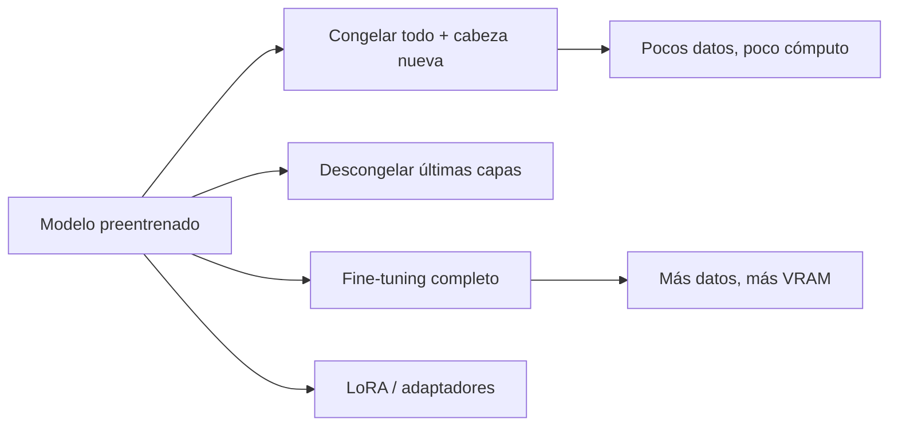

# Transfer learning y fine-tuning

Parte de: [[21-IA-Machine-Learning/04 Redes neuronales y deep learning/_Índice Redes neuronales y deep learning|Redes neuronales y deep learning]]

> [!info] Cómo avanzar
> `progreso`: **pendiente** → **viendo** (estudiando) → **visto** (contestaste la autoevaluación sin abrir las respuestas) → **dominado** (hiciste el laboratorio o lo aplicaste de verdad).

## Contenido

### Qué es
**Transfer learning** es reutilizar un modelo que ya aprendió una tarea general con muchísimos datos (por ejemplo, reconocer objetos en millones de fotos, o predecir texto) como punto de partida para **tu** tarea, que suele tener pocos datos. **Fine-tuning** es la forma de hacerlo en la que sigues entrenando algunos o todos los pesos del modelo preentrenado con tus datos. Es la manera normal de trabajar en deep learning hoy: casi nadie entrena desde cero.

### Cómo funciona
Un modelo preentrenado ya contiene representaciones útiles: en una [[Redes convolucionales (CNN)|CNN]], las primeras capas detectan bordes y texturas, y las últimas, conceptos más específicos; en un [[Transformers|transformer]], las capas capturan sintaxis y significado. Tú solo necesitas adaptar la parte final.

**Estrategias**, de menos a más costosa:
1. **Extracción de características (congelar todo)**: congelas todas las capas preentrenadas (`requires_grad = False`) y entrenas solo una cabeza nueva (por ejemplo, una capa lineal con tus clases). Rápido, poca memoria, funciona con muy pocos datos.
2. **Fine-tuning parcial**: descongelas las últimas capas además de la cabeza. Se adapta más a tu dominio.
3. **Fine-tuning completo**: entrenas todos los pesos. Máxima adaptación, pero necesita más datos, más memoria (gradientes y estado del optimizador para todo) y más cuidado para no destruir lo aprendido.
4. **Ajuste eficiente en parámetros (PEFT)**: congelas el modelo y entrenas pequeñas matrices añadidas; es el estándar para LLMs ([[LoRA y ajuste eficiente]]).



**La tasa de aprendizaje** es crítica: los pesos preentrenados ya están en un buen lugar. Una tasa alta (como las que usarías desde cero) da pasos enormes que borran ese conocimiento, el llamado **olvido catastrófico**. Usa tasas 10 a 100 veces menores para las capas preentrenadas que para la cabeza nueva, y considera un *warmup* ([[Optimizadores (SGD y Adam)]]).

### Ejemplo
Clasificar fotos de tus impresiones 3D en "bien" y "con defecto" (warping, stringing) con pocas imágenes. Con una ResNet18 preentrenada, la fase 1 corre bien en tu GTX 1660 Ti; para afinar modelos más grandes, usa Colab.

```python
import torch
from torch import nn
from torchvision import models, datasets, transforms
from torch.utils.data import DataLoader

device = "cuda" if torch.cuda.is_available() else "cpu"
pesos = models.ResNet18_Weights.DEFAULT
tf = pesos.transforms()                       # mismo preprocesamiento que en el preentrenamiento
# Estructura: fotos/train/bien/*.jpg y fotos/train/defecto/*.jpg
ds = datasets.ImageFolder("fotos/train", transform=tf)
dl = DataLoader(ds, batch_size=32, shuffle=True)

modelo = models.resnet18(weights=pesos)
for p in modelo.parameters():                 # Fase 1: congelar todo
    p.requires_grad = False
modelo.fc = nn.Linear(modelo.fc.in_features, len(ds.classes))   # cabeza nueva, entrenable
modelo = modelo.to(device)

def entrenar(parametros, epocas):
    opt = torch.optim.AdamW(parametros)
    criterio = nn.CrossEntropyLoss()
    modelo.train()
    for _ in range(epocas):
        for xb, yb in dl:
            xb, yb = xb.to(device), yb.to(device)
            opt.zero_grad()
            criterio(modelo(xb), yb).backward()
            opt.step()

entrenar([{"params": modelo.fc.parameters(), "lr": 1e-3}], epocas=5)

# Fase 2: descongelar el último bloque con una tasa mucho menor
for p in modelo.layer4.parameters():
    p.requires_grad = True
entrenar([{"params": modelo.fc.parameters(), "lr": 1e-4},
          {"params": modelo.layer4.parameters(), "lr": 1e-5}], epocas=3)
```

### Cuándo usarlo y cuándo no
- **Úsalo** casi siempre que exista un modelo preentrenado del mismo tipo de datos (imágenes, texto, audio) y tengas pocos ejemplos o poco cómputo.
- **Congela más** cuanto menos datos tengas o más parecido sea tu dominio al original.
- **Afina más** cuando tu dominio es distinto (imágenes médicas, jerga legal) y tienes datos suficientes.
- **No lo necesitas** si con un prompt a un LLM o con [[Embeddings]] y un clasificador simple ya resuelves la tarea; para LLMs revisa [[Fine-tuning vs RAG vs prompting]].

### Errores comunes
- **Tasa de aprendizaje alta al afinar**: destruye los pesos preentrenados; la pérdida sube o el modelo queda peor que sin entrenar. Usa tasas pequeñas, por grupos de parámetros, con warmup.
- **Preprocesamiento distinto al original**: tamaños o normalización diferentes degradan mucho el rendimiento; usa las transformaciones del propio modelo.
- **Olvidar pasar al optimizador solo los parámetros entrenables** o, al revés, dejar congelado lo que querías afinar.
- **Validar con imágenes casi idénticas a las de entrenamiento** (fotos de la misma pieza): la exactitud sale inflada.
- **No revisar la licencia** del modelo preentrenado para uso comercial.

### Para profundizar
- [Tutorial de transfer learning de PyTorch](https://docs.pytorch.org/tutorials/beginner/transfer_learning_tutorial.html)
- [Modelos y pesos preentrenados de torchvision](https://docs.pytorch.org/vision/stable/models.html)
- [Fine-tuning con Hugging Face Transformers](https://huggingface.co/docs/transformers/training)

## Autoevaluación

Contesta primero en voz alta o en papel; luego despliega la respuesta.

> [!question]- ¿Qué es transfer learning?
> Reutilizar un modelo preentrenado en una tarea grande como punto de partida para otra tarea, con muchos menos datos.

> [!question]- ¿Qué diferencia hay entre congelar capas y hacer fine-tuning completo?
> Congelar: solo entrenas la cabeza nueva (rápido, pocos datos). Fine-tuning completo: ajustas todos los pesos con tasa baja (mejor ajuste, más datos y cómputo).

> [!question]- Error común: tasa de aprendizaje alta al afinar.
> Destruye lo aprendido (olvido catastrófico). Usa tasas bajas y pocas épocas.

