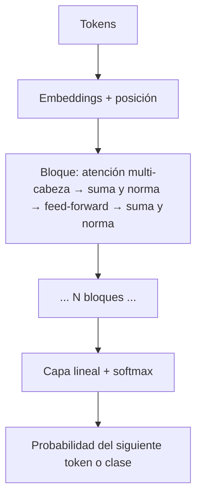

# Transformers

Parte de: [[21-IA-Machine-Learning/04 Redes neuronales y deep learning/_Índice Redes neuronales y deep learning|Redes neuronales y deep learning]]

> [!info] Cómo avanzar
> `progreso`: **pendiente** → **viendo** (estudiando) → **visto** (contestaste la autoevaluación sin abrir las respuestas) → **dominado** (hiciste el laboratorio o lo aplicaste de verdad).

## Contenido

### Qué es
El **transformer** es la arquitectura de red neuronal, presentada en 2017 en el artículo *Attention Is All You Need*, que procesa secuencias usando **atención** en lugar de recurrencia. Es la base de los LLMs (familias tipo GPT, Claude, Llama), de modelos de comprensión de texto como BERT, de los modelos de embeddings y de muchos modelos de visión y audio. Entenderlo es entender qué hay "dentro" de cualquier herramienta de IA generativa que uses.

### Cómo funciona
**Bloques de un transformer** (en orden):
1. **Tokenización y embeddings**: el texto se parte en tokens y cada uno se convierte en un vector con una tabla de [[Embeddings]].
2. **Información de posición**: la atención por sí sola no sabe el orden; se agregan codificaciones posicionales (fijas, aprendidas o rotatorias como RoPE).
3. **N bloques idénticos apilados**, cada uno con:
   - **Autoatención multi-cabeza** ([[Mecanismo de atención]]): cada token mezcla información de los demás.
   - **Red feed-forward** por posición: una pequeña [[Redes neuronales multicapa|MLP]] (con GELU u otra activación) aplicada a cada token por separado.
   - **Conexiones residuales**: la entrada de cada subcapa se suma a su salida (`x + subcapa(x)`), lo que permite apilar decenas de bloques sin que el gradiente se pierda.
   - **Normalización de capa** (*LayerNorm* o variantes) para estabilizar.
4. **Cabeza de salida**: una capa lineal que produce logits sobre el vocabulario (en LLMs) o sobre clases.



**Encoder vs. decoder**
- **Encoder**: la atención es **bidireccional**: cada token ve toda la secuencia, antes y después. Produce representaciones ricas del texto completo. Ideal para entender: clasificación, extracción de entidades, embeddings. Ejemplo: BERT.
- **Decoder**: la atención es **causal** (máscara que impide ver tokens futuros). Se entrena para predecir el siguiente token y genera texto uno a uno. Es la arquitectura de la mayoría de los LLMs actuales.
- **Encoder-decoder**: el encoder lee la entrada completa y el decoder genera la salida atendiendo también al encoder (atención cruzada). Fue el diseño original para traducción; ejemplo: T5.

**Por qué crece el costo con el contexto**: la autoatención compara cada token con todos los demás, así que con `n` tokens se calcula una matriz de `n × n` por cabeza y por capa. Duplicar el contexto multiplica por cuatro esa parte del cómputo y la memoria. Además, al generar, el modelo guarda las keys y values de todos los tokens previos (la **caché KV**), que crece linealmente con el contexto y ocupa VRAM. Por eso los contextos largos son más lentos y caros ([[Costo y latencia de LLMs]]).

**Por qué ganaron**: se entrenan en paralelo sobre todas las posiciones (a diferencia de las RNN), escalan bien con más datos y parámetros, y la atención captura dependencias a cualquier distancia.

### Ejemplo
Usa un transformer preentrenado con Hugging Face y mira su estructura. El modelo de este ejemplo es pequeño y corre en CPU o en tu GTX 1660 Ti:

```python
# pip install transformers torch
from transformers import AutoTokenizer, AutoModel
import torch

nombre = "distilbert-base-multilingual-cased"        # encoder pequeño multilingüe
tok = AutoTokenizer.from_pretrained(nombre)
modelo = AutoModel.from_pretrained(nombre)

entrada = tok("El servicio de identidad emite tokens JWT firmados con RS256.", return_tensors="pt")
print(tok.convert_ids_to_tokens(entrada["input_ids"][0]))   # cómo se tokenizó

with torch.no_grad():
    salida = modelo(**entrada)
print(salida.last_hidden_state.shape)    # 1 × num_tokens × 768: un vector por token
print(modelo.config.n_layers, "bloques,", modelo.config.n_heads, "cabezas")

# Un bloque encoder genérico de PyTorch, para ver las piezas
bloque = torch.nn.TransformerEncoderLayer(d_model=64, nhead=4, dim_feedforward=256, batch_first=True)
print(bloque)
```

Para generar texto con un decoder, los LLMs grandes se usan por API; modelos abiertos pequeños puedes probarlos en Colab con `AutoModelForCausalLM`.

### Cuándo usarlo y cuándo no
- **Úsalo** (preentrenado) para casi cualquier tarea de lenguaje: clasificación, extracción, resumen, búsqueda semántica, generación; también en visión con suficientes datos.
- **Encoder** para entender y clasificar con baja latencia; **decoder** para generar o razonar con instrucciones.
- **No lo uses** para tablas pequeñas o problemas simples donde un modelo clásico basta; ni lo entrenes desde cero sin datos y cómputo enormes: parte siempre de uno preentrenado ([[Transfer learning y fine-tuning]]).

### Errores comunes
- **Creer que "entiende" como una persona**: aprende patrones estadísticos del texto; por eso puede alucinar ([[Alucinaciones y cómo reducirlas]]).
- **Confundir encoder y decoder**: usar BERT para generar texto o un LLM gigante para una clasificación que un encoder pequeño resuelve más barato.
- **Ignorar el límite de tokens** del modelo: el texto se trunca y pierdes información.
- **Mezclar tokenizador y modelo distintos**: cada modelo tiene su propio vocabulario.

### Para profundizar
- [Attention Is All You Need (Vaswani et al.)](https://arxiv.org/abs/1706.03762)
- [The Illustrated Transformer (Jay Alammar)](https://jalammar.github.io/illustrated-transformer/)
- [Curso de LLMs de Hugging Face](https://huggingface.co/learn/llm-course/chapter1/1)
- [Documentación de Hugging Face Transformers](https://huggingface.co/docs/transformers/index)

## Autoevaluación

Contesta primero en voz alta o en papel; luego despliega la respuesta.

> [!question]- ¿Qué bloques tiene un transformer?
> Embeddings + codificación posicional, y capas repetidas de atención multi-cabeza + red feed-forward, con conexiones residuales y normalización.

> [!question]- ¿Qué diferencia hay entre encoder y decoder?
> El encoder ve toda la secuencia (bueno para entender/clasificar, tipo BERT). El decoder usa atención causal: solo ve tokens anteriores (genera texto, tipo GPT).

> [!question]- ¿Por qué crece el costo con el contexto?
> La atención compara cada token con todos los demás: costo cuadrático en la longitud de la secuencia.

