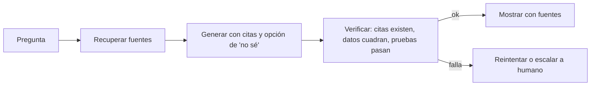

# Alucinaciones y cómo reducirlas

Parte de: [[21-IA-Machine-Learning/05 Modelos de lenguaje/_Índice Modelos de lenguaje|Modelos de lenguaje]]

> [!info] Cómo avanzar
> `progreso`: **pendiente** → **viendo** (estudiando) → **visto** (contestaste la autoevaluación sin abrir las respuestas) → **dominado** (hiciste el laboratorio o lo aplicaste de verdad).

## Contenido

### Qué es
Una **alucinación** es una respuesta de un LLM que suena segura y bien escrita pero es **falsa, inventada o no está respaldada** por las fuentes que se le dieron: una cita de un artículo que no existe, un método de una librería que nunca existió, un número de política equivocado, un resumen que agrega datos ausentes del documento. No es un defecto ocasional sino una consecuencia directa de cómo funcionan estos modelos, así que hay que diseñar el sistema para reducirlas y detectarlas.

### Cómo funciona
**Por qué ocurren**
- El modelo genera el token **más plausible** dado el contexto ([[Cómo funciona un LLM (tokens, contexto y predicción)]]). "Plausible" no es lo mismo que "verdadero": si no tiene la información, produce algo con la forma correcta.
- Su conocimiento está comprimido en los pesos, con huecos y una fecha de corte; datos raros, recientes o privados son terreno fértil para inventar.
- Los procesos de entrenamiento tienden a premiar respuestas completas y seguras; admitir "no sé" no siempre es lo más probable.
- Contextos largos y ruidosos, preguntas ambiguas o premisas falsas en la pregunta ("¿por qué el método X de Dapper hace Y?") empujan a inventar.

**Tipos útiles de distinguir**
- **Factuales**: hechos del mundo incorrectos.
- **De fidelidad**: la respuesta contradice o añade cosas al documento que se le dio (clave en [[RAG (generación aumentada con recuperación)|RAG]] y resúmenes).
- **De código**: APIs, parámetros o paquetes inexistentes.

**Formas de reducirlas** (combina varias):
1. **Darle la información** en el contexto (RAG o [[Tool calling (llamadas a herramientas)]]) en vez de depender de su memoria.
2. **Permitir explícitamente "no sé"** y definir qué responder si la información no está.
3. **Pedir citas o extractos textuales** de la fuente que respaldan cada afirmación, y verificarlas en código (que la cita exista en el documento).
4. **Restringir el alcance**: "usa solo la información de `<docs>`".
5. **Temperatura baja** en tareas factuales ([[Parámetros de generación (temperatura y top-p)]]).
6. **Salidas estructuradas y validación** contra tus datos ([[Salidas estructuradas (JSON)]]).
7. **Verificación externa**: comprobar con una fuente independiente, ejecutar el código generado en pruebas, o un segundo paso de verificación que compare la respuesta con los documentos.
8. **Medir** con un conjunto de evaluación de fidelidad ([[Evaluación de respuestas de LLMs]]) y mostrar las fuentes al usuario para que pueda comprobar.

**Por qué no basta preguntarle al mismo modelo si está seguro**: su "confianza" expresada en texto es otra generación más, producida por el mismo mecanismo que alucinó; suele contestar que sí, o cambiar de opinión solo porque la pregunta sugiere duda. No tiene acceso a una medida fiable de su propio error. La autoverificación ayuda un poco cuando se le da **evidencia** para contrastar (los documentos, el resultado de ejecutar el código), pero la verificación de verdad debe venir de fuera: fuentes, pruebas, reglas o personas.



### Ejemplo
Generar con citas textuales y verificar en código que cada cita esté realmente en la fuente:

```python
import os
from anthropic import Anthropic
from pydantic import BaseModel

class Afirmacion(BaseModel):
    texto: str
    cita_textual: str          # extracto exacto del documento que la respalda

class Respuesta(BaseModel):
    encontrado: bool
    afirmaciones: list[Afirmacion]

documento = open("politica_viaticos.md", encoding="utf-8").read()
resp = Anthropic().messages.parse(
    model=os.environ["LLM_MODEL"], max_tokens=800, temperature=0,
    system=("Responde solo con base en <doc>. Para cada afirmación copia una cita textual exacta. "
            "Si la información no está, responde encontrado=false y sin afirmaciones."),
    messages=[{"role": "user", "content": f"<doc>{documento}</doc>\n¿Cuál es el tope diario de comidas?"}],
    output_format=Respuesta,
)
r = resp.parsed_output
no_respaldadas = [a for a in r.afirmaciones if a.cita_textual not in documento]
if not r.encontrado or no_respaldadas:
    print("Sin respaldo suficiente: mostrar 'no encontrado' o enviar a revisión", no_respaldadas)
else:
    for a in r.afirmaciones:
        print(a.texto, "→", a.cita_textual)
```

Para código generado, la verificación equivalente es compilarlo y correr las pruebas (en tu caso, `dotnet build` y `dotnet test` en el pipeline de Azure DevOps).

### Cuándo usarlo y cuándo no
- **Aplica estas defensas** siempre que la respuesta se use para decidir algo, se muestre a clientes o tenga consecuencias legales o económicas.
- **Puedes relajar** en tareas creativas (lluvia de ideas, borradores) donde "inventar" es lo deseado, siempre que una persona revise.
- **No uses un LLM** como única fuente para datos críticos (montos, fechas legales, dosis): consúltalos de un sistema autorizado.

### Errores comunes
- **Confiar en "no inventes nada"** como única medida: ayuda poco si el modelo no tiene la información.
- **Preguntar al mismo modelo "¿estás seguro?"** y tomarlo como verificación.
- **No mostrar fuentes** al usuario: le quitas la posibilidad de detectar el error.
- **Medir solo con ejemplos fáciles**: las alucinaciones aparecen en preguntas sin respuesta en los documentos; incluye esos casos en tu evaluación.
- **Instalar paquetes sugeridos sin revisar que existan**: un nombre inventado puede coincidir con un paquete malicioso registrado por un atacante.

### Para profundizar
- [Reducir alucinaciones (documentación de Claude)](https://platform.claude.com/docs/en/test-and-evaluate/strengthen-guardrails/reduce-hallucinations)
- [OWASP Top 10 para aplicaciones con LLM (proyecto GenAI de OWASP)](https://genai.owasp.org/)
- [Retrieval-Augmented Generation (Lewis et al.)](https://arxiv.org/abs/2005.11401)

## Autoevaluación

Contesta primero en voz alta o en papel; luego despliega la respuesta.

> [!question]- ¿Qué es una alucinación?
> Una respuesta fluida y segura pero falsa o sin sustento (citas, cifras, APIs inventadas).

> [!question]- Menciona cuatro formas de reducirlas.
> RAG con fuentes, pedir citas verificables, permitir "no sé", temperatura baja, validar con herramientas (calculadora, consulta a BD) y evaluar sistemáticamente.

> [!question]- ¿Por qué no basta con preguntarle al mismo modelo si está seguro?
> Su autoevaluación no es confiable; verifica contra fuentes o con otro proceso independiente.

## Práctica

- [[Lab 5 - RAG mínimo con evaluación de recuperación]]

