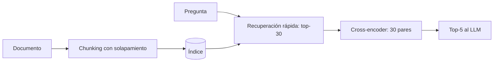

# Chunking y reranking

Parte de: [[21-IA-Machine-Learning/05 Modelos de lenguaje/_Índice Modelos de lenguaje|Modelos de lenguaje]]

> [!info] Cómo avanzar
> `progreso`: **pendiente** → **viendo** (estudiando) → **visto** (contestaste la autoevaluación sin abrir las respuestas) → **dominado** (hiciste el laboratorio o lo aplicaste de verdad).

## Contenido

### Qué es
**Chunking** es dividir documentos en fragmentos (*chunks*) antes de calcular sus embeddings e indexarlos. **Reranking** es reordenar los fragmentos recuperados con un modelo más preciso antes de pasárselos al LLM. Son dos de las palancas con más impacto en la calidad de un sistema [[RAG (generación aumentada con recuperación)|RAG]]: si el fragmento correcto no se recupera o queda en el lugar 15, el LLM no puede usarlo.

### Cómo funciona
**Por qué dividir**
- Los modelos de embeddings tienen un límite de tokens de entrada, y un vector que resume un documento de 30 páginas mezcla tantos temas que no se parece mucho a ninguna pregunta concreta.
- Fragmentos enfocados producen embeddings más precisos y permiten mandar al LLM solo lo relevante (menos costo, menos ruido).
- El tamaño es un equilibrio: chunks muy chicos pierden contexto ("esto aplica solo a…" queda en otro fragmento); muy grandes diluyen el significado y gastan contexto.

**Solapamiento (overlap)**: cada chunk repite los últimos tokens del anterior. Así, una idea que cae justo en la frontera aparece completa en al menos un fragmento.

**Cuántos chunks salen**: con un documento de `N` tokens, chunks de tamaño `C` y solapamiento `S`, el paso es `C − S` y el número es `⌈(N − C) / (C − S)⌉ + 1` (si `N > C`). Ejemplo: 2 000 tokens, chunks de 300 y solapamiento de 50 → paso 250 → `⌈1 700 / 250⌉ + 1 = 8` chunks. Sin solapamiento, es simplemente `⌈N / C⌉`.

**Estrategias de chunking**
- **Tamaño fijo** (por tokens o caracteres): simple, pero corta en cualquier lugar.
- **Recursivo por separadores**: intenta cortar por secciones, luego párrafos, luego oraciones, hasta caber en el tamaño.
- **Por estructura**: usa encabezados de Markdown, secciones de un PDF o funciones de código; mantiene tablas y bloques de código completos. Agrega el título de la sección al chunk como contexto.
- **Semántico**: corta donde cambia el tema, comparando embeddings de oraciones consecutivas.

**Reranking**
La recuperación por embeddings usa un **bi-encoder**: pregunta y documento se convierten en vectores **por separado** y se comparan con coseno. Es rapidísimo porque los vectores de los documentos se calculan una sola vez, pero pierde matices. Un **reranker** suele ser un **cross-encoder**: recibe el par (pregunta, fragmento) **juntos** y produce un puntaje de relevancia; ve la interacción entre ambos textos y es mucho más preciso, pero hay que ejecutarlo una vez por cada par. Por eso se usa en dos etapas: recuperas un top amplio y barato (por ejemplo, 30 por coseno o búsqueda híbrida) y el reranker evalúa esos 30 pares para quedarte con los 5 mejores. Hay rerankers abiertos y también como servicio (por ejemplo, el semantic ranker de Azure AI Search, ver [[Embeddings y bases vectoriales (pgvector y Azure AI Search)]]).



### Ejemplo
Chunking con solapamiento y reranking con un cross-encoder abierto:

```python
# pip install sentence-transformers transformers
from sentence_transformers import SentenceTransformer, CrossEncoder
from transformers import AutoTokenizer
import numpy as np

tok = AutoTokenizer.from_pretrained("gpt2")

def chunks_por_tokens(texto, tam=300, solape=50):
    ids = tok.encode(texto)
    paso = tam - solape
    trozos = []
    for inicio in range(0, max(len(ids) - solape, 1), paso):
        trozos.append(tok.decode(ids[inicio:inicio + tam]))
        if inicio + tam >= len(ids):
            break
    return trozos

documento = open("manual_dionisio.md", encoding="utf-8").read()
fragmentos = chunks_por_tokens(documento)
print(len(fragmentos), "chunks")

bi = SentenceTransformer("paraphrase-multilingual-MiniLM-L12-v2")
cross = CrossEncoder("cross-encoder/ms-marco-MiniLM-L-6-v2")   # entrenado en inglés; prueba uno multilingüe para español

pregunta = "¿Cómo se registran los errores de validación?"
M = bi.encode(fragmentos, normalize_embeddings=True)
q = bi.encode([pregunta], normalize_embeddings=True)[0]
candidatos = np.argsort(-(M @ q))[:30]                          # etapa 1: barata
puntajes = cross.predict([(pregunta, fragmentos[i]) for i in candidatos])   # etapa 2: 30 evaluaciones
mejores = [fragmentos[candidatos[i]] for i in np.argsort(-puntajes)[:5]]
```

Para Markdown como tus notas de Obsidian, conviene cortar primero por encabezados `##` y `###` y solo después por tamaño.

### Cuándo usarlo y cuándo no
- **Chunking**: siempre que indexes documentos más largos que unos cientos de tokens. Empieza con un tamaño moderado y algo de solapamiento, y ajusta midiendo el hit rate.
- **Reranking**: cuando la respuesta correcta aparece en el top-20 pero no en el top-3, o cuando mandar muchos fragmentos al LLM sale caro. Añade latencia, así que mídela.
- **No lo necesitas** si tus documentos ya son cortos y autocontenidos (FAQs, fichas de producto): cada uno es un chunk.

### Errores comunes
- **Chunks de tamaño fijo que parten tablas o código**: una tabla partida por la mitad pierde los encabezados y un bloque de código cortado ya no tiene sentido; el embedding no representa bien ninguna de las dos mitades. Usa chunking por estructura que respete tablas y bloques de código, y repite encabezados o títulos como contexto.
- **Sin solapamiento**: ideas cortadas en la frontera.
- **Perder metadatos**: sin fuente, sección y fecha no puedes citar ni filtrar.
- **Reranker en otro idioma** sin evaluarlo con tus datos en español.
- **Ajustar sin medir**: cambia tamaño, solapamiento o reranker y compara contra el mismo conjunto de preguntas ([[Evaluación de respuestas de LLMs]]).

### Para profundizar
- [Recuperar y reordenar con Sentence Transformers](https://www.sbert.net/examples/applications/retrieve_rerank/README.html)
- [Recuperación de información con Sentence Transformers](https://sbert.net/examples/applications/information-retrieval/)
- [Semantic ranker en Azure AI Search](https://learn.microsoft.com/en-us/azure/search/semantic-search-overview)

## Ejercicios

Resuélvelos en papel o en la herramienta; la solución está plegada.

> [!question]- Documento de 1 000 tokens, chunks de 200 y solapamiento de 50. ¿Cuántos chunks?
> Paso = 150. Inicios 0, 150, …, 750 y uno final en 900 → **7 chunks**. Fórmula: `ceil((1000 - 200)/150) + 1 = 7`.

> [!question]- Con chunks de 500 y sin solapamiento, ¿cuántos?
> 2.

> [!question]- Recuperas top-20 por coseno y luego reranker a top-5. ¿Cuántas evaluaciones hace el reranker por pregunta?
> 20 (una por par pregunta-fragmento).

## Autoevaluación

Contesta primero en voz alta o en papel; luego despliega la respuesta.

> [!question]- ¿Por qué dividir documentos en chunks?
> Los embeddings representan mejor textos cortos y enfocados, y solo se manda al modelo lo relevante.

> [!question]- ¿Para qué sirve el solapamiento?
> Evita cortar una idea a la mitad entre dos chunks.

> [!question]- ¿Qué es un reranker?
> Un modelo (cross-encoder) que puntúa pares pregunta-fragmento con más precisión que el coseno; se aplica a los top-N recuperados para quedarse con los mejores.

> [!question]- Error común: chunks de tamaño fijo que parten tablas o código.
> Divide por estructura (títulos, párrafos, funciones) cuando puedas.

## Práctica

- [[Lab 5 - RAG mínimo con evaluación de recuperación]]

