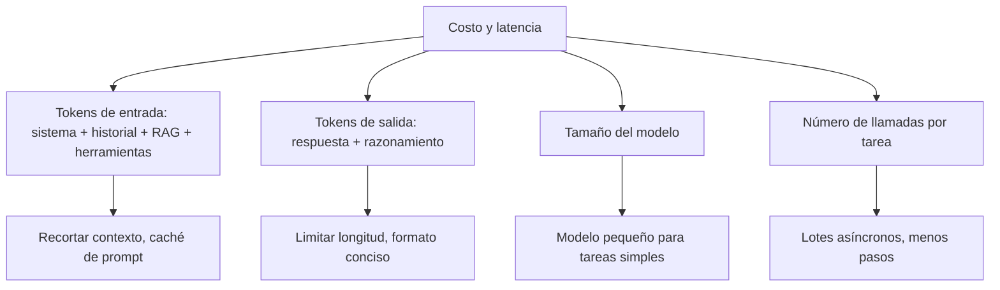

# Costo y latencia de LLMs

Parte de: [[21-IA-Machine-Learning/05 Modelos de lenguaje/_Índice Modelos de lenguaje|Modelos de lenguaje]]

> [!info] Cómo avanzar
> `progreso`: **pendiente** → **viendo** (estudiando) → **visto** (contestaste la autoevaluación sin abrir las respuestas) → **dominado** (hiciste el laboratorio o lo aplicaste de verdad).

## Contenido

### Qué es
Usar un LLM por API cuesta dinero **por token** y tarda tiempo **por token**. Entender de qué dependen ambos te permite estimar el presupuesto de una funcionalidad antes de construirla, elegir el modelo adecuado y optimizar sin perder calidad. Los precios y los modelos cambian con frecuencia, así que aquí aprendes a **calcular** con los precios vigentes de la página oficial de tu proveedor, no a memorizar cifras.

### Cómo funciona
**Costo de una llamada**
`costo = tokens_entrada × precio_entrada + tokens_salida × precio_salida`
- Los precios suelen expresarse por **millón de tokens** y son distintos para entrada y salida; normalmente la **salida es varias veces más cara** que la entrada.
- **Tokens de entrada** incluyen todo lo que envías: prompt de sistema, historial de la conversación, documentos de RAG, definiciones de herramientas e imágenes. En conversaciones largas el historial se reenvía en cada turno y crece.
- **Tokens de salida** incluyen la respuesta y, en modelos con razonamiento extendido, los tokens de "pensamiento" que también se cobran.
- **El modelo** importa mucho: los modelos grandes cuestan bastante más por token que los pequeños de la misma familia.

**Ejemplo de estimación** (precios ficticios para practicar el cálculo): 5 000 solicitudes al día con 1 500 tokens de entrada y 400 de salida son 7.5 millones de tokens de entrada y 2 millones de salida al día. Con un precio de ejemplo de 2 unidades por millón de entrada y 8 por millón de salida: `7.5 × 2 + 2 × 8 = 15 + 16 = 31` unidades diarias. Si recortas la entrada a la mitad, ahorras 7.5 unidades (≈ 24 %).

**Latencia**
- **Tiempo al primer token** (TTFT): depende del tamaño del prompt (el modelo debe procesar toda la entrada), de la carga del proveedor y de la red.
- **Velocidad de generación** (tokens por segundo): la salida se genera token por token, así que **una respuesta larga tarda proporcionalmente más**. Normalmente la salida domina la latencia total.
- **Modelo**: los modelos más grandes suelen ser más lentos.
- **Herramientas y pasos**: cada ida y vuelta de [[Tool calling (llamadas a herramientas)]] o cada paso de un agente suma una llamada completa.



**Formas de reducir costo** (y a menudo latencia):
1. **Modelo adecuado a la tarea**: uno pequeño para clasificar o extraer; el grande solo para lo difícil. Puedes enrutar según la complejidad.
2. **Recortar la entrada**: RAG con menos fragmentos y más precisos ([[Chunking y reranking]]), resumir el historial, quitar instrucciones redundantes.
3. **Limitar la salida**: `max_tokens` razonable, pedir respuestas concisas o JSON en lugar de prosa.
4. **Caché de prompt**: si muchas llamadas comparten un prefijo largo e idéntico (instrucciones, documentos, herramientas), el proveedor puede cachearlo y cobrar las lecturas de caché a una fracción del precio normal de entrada. En la API de Claude se activa con `cache_control` y la caché tiene una vida corta por defecto que se renueva con cada uso; el prefijo debe ser exactamente igual. Pon lo estable al inicio y lo variable al final.
5. **Procesamiento por lotes asíncrono** para tareas que no necesitan respuesta inmediata (clasificar miles de registros de Wee.Reporteria durante la noche): las APIs de lotes ofrecen descuento a cambio de esperar (en Anthropic, 50 % según su documentación).
6. **Caché de respuestas propia** para preguntas repetidas.
7. **Streaming** no reduce el costo, pero mejora la latencia **percibida**: el usuario ve texto desde el primer token.

### Ejemplo
Calculadora de costo y medición de latencia real con streaming:

```python
import os, time
from anthropic import Anthropic

def costo_diario(solicitudes, tok_in, tok_out, precio_in_millon, precio_out_millon):
    entrada = solicitudes * tok_in / 1e6 * precio_in_millon
    salida = solicitudes * tok_out / 1e6 * precio_out_millon
    return entrada, salida, entrada + salida

# Precios de EJEMPLO: reemplázalos con los de la página oficial del modelo que uses
print(costo_diario(5_000, 1_500, 400, precio_in_millon=2, precio_out_millon=8))

cliente = Anthropic()
inicio = time.perf_counter(); primer_token = None
with cliente.messages.stream(
    model=os.environ["LLM_MODEL"], max_tokens=300,
    system=[{"type": "text", "text": open("instrucciones_largas.md", encoding="utf-8").read(),
             "cache_control": {"type": "ephemeral"}}],      # prefijo estable cacheable
    messages=[{"role": "user", "content": "Resume la política de reembolsos en 3 viñetas."}],
) as stream:
    for texto in stream.text_stream:
        if primer_token is None:
            primer_token = time.perf_counter() - inicio
        print(texto, end="", flush=True)
    final = stream.get_final_message()
total = time.perf_counter() - inicio
print(f"\nTTFT: {primer_token:.2f}s · total: {total:.2f}s · uso: {final.usage}")
```

El objeto `usage` te dice cuántos tokens se leyeron de caché y cuántos se cobraron completos; regístralo en tus logs para conocer el costo real por funcionalidad.

### Cuándo usarlo y cuándo no
- **Estima antes de construir** cualquier funcionalidad con volumen (chat de soporte, clasificación masiva).
- **Optimiza cuando ya funciona y mediste**: primero calidad, luego costo; no sacrifiques precisión sin evaluarlo ([[Evaluación de respuestas de LLMs]]).
- **Considera un modelo abierto local o propio** cuando el volumen es enorme y estable o los datos no pueden salir ([[Modelos abiertos vs comerciales]]); en tu GTX 1660 Ti solo caben modelos pequeños cuantizados.

### Errores comunes
- **Calcular solo con la pregunta del usuario**: olvidas el prompt de sistema, el historial y los documentos de RAG, que suelen ser la mayor parte.
- **Ignorar el precio de salida** y los tokens de razonamiento.
- **Prefijos que cambian en cada llamada** (fecha y hora al inicio del prompt): invalidan la caché.
- **Usar el modelo más grande para todo**.
- **No poner límites**: sin `max_tokens`, cuotas ni alertas de presupuesto, un error en un ciclo de agente puede costar mucho.

### Para profundizar
- [Precios de la API de Claude](https://platform.claude.com/docs/en/about-claude/pricing)
- [Caché de prompts (documentación de Claude)](https://platform.claude.com/docs/en/build-with-claude/prompt-caching)
- [Procesamiento por lotes (documentación de Claude)](https://platform.claude.com/docs/en/build-with-claude/batch-processing)

## Ejercicios

Resuélvelos en papel o en la herramienta; la solución está plegada.

> [!question]- 10 000 solicitudes al día con 2 000 tokens de entrada y 300 de salida. ¿Tokens diarios de cada tipo?
> Entrada `20 000 000`; salida `3 000 000`.

> [!question]- Con un precio **de ejemplo** de 1 unidad por millón de tokens de entrada y 4 por millón de salida, ¿costo diario?
> `20·1 + 3·4 = 32` unidades. (Precio ilustrativo, no real.)

> [!question]- Si recortas la entrada a 800 tokens, ¿cuánto bajas el costo del ejemplo?
> Entrada `8M → 8` unidades; total `8 + 12 = 20` (−37.5 %).

## Autoevaluación

Contesta primero en voz alta o en papel; luego despliega la respuesta.

> [!question]- ¿De qué depende el costo de una llamada?
> Del número de tokens de entrada y de salida (suelen cobrarse distinto) y del modelo. Revisa el precio vigente del proveedor; cambia seguido.

> [!question]- ¿Qué afecta la latencia?
> Tamaño del modelo, tokens de salida (se generan uno a uno), longitud del contexto, carga del servicio y red. *Streaming* mejora la latencia percibida.

> [!question]- Menciona tres formas de reducir costo.
> Modelos más pequeños para tareas simples, recortar el contexto (RAG en vez de todo el documento), caché de prompts/respuestas, limitar `max_tokens`.

