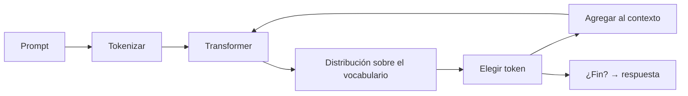

# Cómo funciona un LLM (tokens, contexto y predicción)

Parte de: [[21-IA-Machine-Learning/05 Modelos de lenguaje/_Índice Modelos de lenguaje|Modelos de lenguaje]]

> [!info] Cómo avanzar
> `progreso`: **pendiente** → **viendo** (estudiando) → **visto** (contestaste la autoevaluación sin abrir las respuestas) → **dominado** (hiciste el laboratorio o lo aplicaste de verdad).

## Contenido

### Qué es
Un **LLM** (*large language model*) es un [[Transformers|transformer]] de tipo decoder, con miles de millones de parámetros, entrenado con enormes cantidades de texto para una tarea muy simple: **predecir el siguiente token**. De esa tarea, a gran escala y con un ajuste posterior para seguir instrucciones, surgen habilidades como resumir, traducir, programar o razonar paso a paso. Entender tokens, contexto y predicción te explica casi todo su comportamiento: costos, límites, errores y por qué los prompts importan.

### Cómo funciona
**Tokens**: el modelo no ve letras ni palabras, sino **tokens**, fragmentos de texto definidos por un tokenizador (normalmente con algoritmos tipo BPE). Una palabra común en inglés suele ser un token; palabras largas, poco comunes o en otros idiomas se dividen en varios ("desarrollador" puede ser 2 o 3 tokens). Los espacios, signos y números también cuentan. Cada token se convierte en un vector con una tabla de [[Embeddings]]. El conteo de tokens determina costo y uso del contexto, y varía entre modelos porque cada uno tiene su propio tokenizador.

**Predicción autorregresiva**:
1. El texto de entrada (prompt) se tokeniza.
2. El modelo procesa todos los tokens y produce, para la última posición, un **logit por cada token del vocabulario**.
3. Con [[Softmax]] esos logits se vuelven una distribución de probabilidad sobre el siguiente token.
4. Se **elige** un token (el más probable o muestreando, según los [[Parámetros de generación (temperatura y top-p)]]).
5. El token elegido se agrega al final y se repite, hasta un token de fin o un límite de longitud.



**Ventana de contexto**: es el máximo de tokens que el modelo puede considerar a la vez, sumando **entrada y salida** (instrucciones del sistema, historial de la conversación, documentos que pegues, definiciones de herramientas y la respuesta que genera). Cada modelo tiene su propio límite; consúltalo en su documentación. Si lo excedes, la API responde con error o la aplicación debe recortar: quitar mensajes viejos, resumir el historial o mandar solo los fragmentos relevantes (que es la idea de [[RAG (generación aumentada con recuperación)]]). Lo que queda fuera del contexto, el modelo **no lo ve**. Además, contextos largos cuestan más y son más lentos ([[Costo y latencia de LLMs]]), y la información enterrada en medio de un contexto muy largo a veces se aprovecha peor.

**Entrenamiento en etapas**: (1) preentrenamiento con texto masivo para predecir el siguiente token; (2) ajuste con instrucciones y ejemplos de conversación; (3) ajuste con preferencias humanas o retroalimentación, para que sea útil y seguro. El modelo resultante no tiene memoria entre llamadas: cada solicitud a la API es independiente y tu aplicación debe reenviar el historial.

**Conocimiento paramétrico**: lo que "sabe" está comprimido en sus pesos como patrones estadísticos, con una fecha de corte de entrenamiento. No consulta una base de datos de hechos; genera el texto más plausible dado el contexto.

### Ejemplo
Cuenta tokens con un tokenizador abierto y observa cómo se dividen las palabras en español:

```python
# pip install transformers
from transformers import AutoTokenizer

tok = AutoTokenizer.from_pretrained("gpt2")          # tokenizador BPE pequeño y público
for texto in ["The developer deployed the API",
              "El desarrollador desplegó la API",
              "Itzamna.Dionisio usa Dapper con procedimientos almacenados"]:
    ids = tok.encode(texto)
    print(len(ids), "tokens:", tok.convert_ids_to_tokens(ids))
```

Y con una API comercial, la respuesta incluye el uso de tokens (aquí con el SDK de Anthropic; el identificador del modelo va en una variable de entorno porque los nombres cambian):

```python
# pip install anthropic   ·   ANTHROPIC_API_KEY y LLM_MODEL como variables de entorno
import os
from anthropic import Anthropic

cliente = Anthropic()
resp = cliente.messages.create(
    model=os.environ["LLM_MODEL"],
    max_tokens=200,                                   # límite de tokens de salida
    messages=[{"role": "user", "content": "Explica qué es un token en una frase."}],
)
print(resp.content[0].text)
print("entrada:", resp.usage.input_tokens, "salida:", resp.usage.output_tokens)
```

### Cuándo usarlo y cuándo no
- **Úsalo** para tareas de lenguaje abiertas: redactar, resumir, clasificar con criterio, extraer datos de texto libre, generar código, conversar.
- **No lo uses como fuente de verdad** para datos exactos o actuales (saldos, inventarios, normativa reciente): conéctalo a tus datos con RAG o con [[Tool calling (llamadas a herramientas)]].
- **No lo uses** para cálculos exactos o lógica determinista que un programa normal hace mejor y más barato.

### Errores comunes
- **Creer que el modelo consulta una base de datos de hechos**: genera texto plausible a partir de patrones; si algo no está en su entrenamiento ni en el contexto, puede inventarlo con total seguridad. Dale los datos en el contexto y pide citas.
- **Contar palabras en lugar de tokens** al estimar límites y costos.
- **Asumir que recuerda conversaciones anteriores**: la memoria la gestiona tu aplicación.
- **Meter todo en el contexto "por si acaso"**: más costo, más latencia y a veces peores respuestas.

### Para profundizar
- [Curso de LLMs de Hugging Face](https://huggingface.co/learn/llm-course/chapter1/1)
- [Resumen de tokenizadores (Hugging Face)](https://huggingface.co/docs/transformers/tokenizer_summary)
- [Documentación de la plataforma de Claude: prompting y API](https://platform.claude.com/docs/en/build-with-claude/prompt-engineering/overview)

## Autoevaluación

Contesta primero en voz alta o en papel; luego despliega la respuesta.

> [!question]- ¿Qué es un token?
> Un fragmento de texto (palabra, parte de palabra o símbolo) con el que trabaja el modelo. En español una palabra suele ocupar uno o más tokens.

> [!question]- ¿Qué hace un LLM al generar?
> Predice una distribución de probabilidad para el siguiente token, elige uno, lo agrega al contexto y repite.

> [!question]- ¿Qué es la ventana de contexto y qué pasa si la excedes?
> El máximo de tokens (entrada + salida) que el modelo puede considerar. Si la excedes, la API da error o hay que recortar; lo que no está en el contexto, el modelo no lo "recuerda".

> [!question]- Error común: creer que el modelo consulta una base de datos de hechos.
> Genera texto plausible a partir de patrones aprendidos; por eso puede alucinar. Para datos actuales o privados se usa RAG o herramientas.

## Práctica

- [[Lab 5 - RAG mínimo con evaluación de recuperación]]

