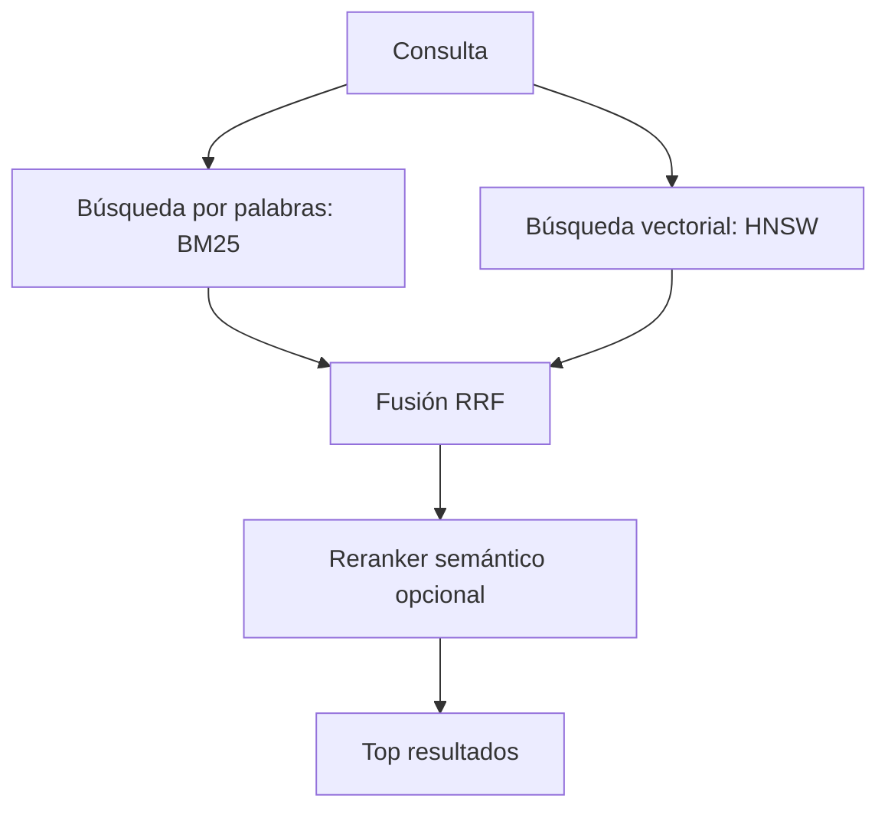

# Embeddings y bases vectoriales (pgvector y Azure AI Search)

Parte de: [[21-IA-Machine-Learning/05 Modelos de lenguaje/_Índice Modelos de lenguaje|Modelos de lenguaje]]

> [!info] Cómo avanzar
> `progreso`: **pendiente** → **viendo** (estudiando) → **visto** (contestaste la autoevaluación sin abrir las respuestas) → **dominado** (hiciste el laboratorio o lo aplicaste de verdad).

## Contenido

### Qué es
Una **base vectorial** guarda [[Embeddings]] (vectores que representan el significado de un texto o imagen) junto con su contenido y metadatos, y permite buscar rápidamente **los vectores más cercanos** a un vector de consulta. Es el componente de búsqueda de un sistema [[RAG (generación aumentada con recuperación)|RAG]] y de buscadores semánticos o recomendadores. Para tu stack, las dos opciones naturales son **pgvector** (una extensión de PostgreSQL) y **Azure AI Search** (servicio administrado de búsqueda en Azure).

### Cómo funciona
**Búsqueda por vecinos más cercanos**: comparar la consulta con todos los vectores (búsqueda exacta) es lento con millones de filas. Por eso se usan índices de **vecinos aproximados** (ANN), que sacrifican un poco de exactitud por mucha velocidad:
- **HNSW**: un grafo de varias capas que se recorre de forma "codiciosa" hacia los vecinos más cercanos. Rápido y con buen recall; usa más memoria y tarda más en construirse.
- **IVFFlat**: agrupa los vectores en listas (clusters) y solo busca en las más cercanas. Construcción más rápida y menos memoria; conviene crearlo cuando ya hay datos.

**pgvector**
Agrega el tipo `vector(n)` a PostgreSQL y operadores de distancia: `<->` (euclidiana), `<=>` (distancia coseno) y `<#>` (producto interno negativo). Los índices se crean con `USING hnsw` o `USING ivfflat` y la clase de operador correspondiente (por ejemplo, `vector_cosine_ops`). Según su documentación, el tipo `vector` admite hasta 16 000 dimensiones, pero los índices HNSW e IVFFlat sobre `vector` llegan a 2 000. La gran ventaja: los vectores viven **junto con tus datos relacionales**, así que filtras con SQL normal (`WHERE tenant_id = …`), haces joins, transacciones y respaldos con lo que ya conoces.

**Azure AI Search**
Servicio administrado que indexa texto y vectores. Ofrece búsqueda de texto completo (BM25), búsqueda vectorial (HNSW o KNN exhaustivo), filtros, facetas y **búsqueda híbrida**: en una sola consulta ejecuta en paralelo la parte de texto y la vectorial y **fusiona** los resultados con *Reciprocal Rank Fusion* (RRF). Opcionalmente aplica el **semantic ranker**, que reordena los mejores resultados con un modelo de comprensión de lenguaje. Se integra con el resto de Azure y con Microsoft Foundry ([[Azure OpenAI y Azure AI Foundry]]).

**Búsqueda híbrida**: combinar palabras clave y vectores. Los embeddings capturan significado ("devolver dinero" ≈ "reembolso"), pero fallan con coincidencias exactas (códigos de error, números de pedido, nombres propios); BM25 es lo contrario. Juntas, y luego reordenadas, suelen dar los mejores resultados ([[Chunking y reranking]]).



### Ejemplo
pgvector en el Postgres de Pochteca.Nomisma, con Python. Es SQL, así que puedes dejar las consultas en archivos `.sql` como en tus reglas:

```sql
-- 001_documentos.sql
CREATE EXTENSION IF NOT EXISTS vector;
CREATE TABLE IF NOT EXISTS documento_chunk (
    id         bigserial PRIMARY KEY,
    tenant_id  int        NOT NULL,
    fuente     text       NOT NULL,
    contenido  text       NOT NULL,
    embedding  vector(384) NOT NULL          -- dimensión del modelo de embeddings
);
CREATE INDEX IF NOT EXISTS ix_chunk_embedding
    ON documento_chunk USING hnsw (embedding vector_cosine_ops);

-- buscar_similares.sql  (1 - distancia coseno = similitud)
SELECT fuente, contenido, 1 - (embedding <=> %(q)s::vector) AS similitud
FROM documento_chunk
WHERE tenant_id = %(tenant)s
ORDER BY embedding <=> %(q)s::vector
LIMIT 5;
```

```python
# pip install psycopg[binary] pgvector sentence-transformers
import psycopg
from pgvector.psycopg import register_vector
from sentence_transformers import SentenceTransformer

modelo = SentenceTransformer("paraphrase-multilingual-MiniLM-L12-v2")   # 384 dimensiones
with psycopg.connect("dbname=nomisma") as con:      # credenciales fuera del código
    register_vector(con)
    q = modelo.encode("¿cómo se calcula el saldo?", normalize_embeddings=True)
    sql = open("buscar_similares.sql", encoding="utf-8").read()
    for fila in con.execute(sql, {"q": q, "tenant": 1}):
        print(fila)
```

Del lado de .NET existe el proyecto pgvector-dotnet con integración para Npgsql y Dapper (Pendiente de confirmar el nombre exacto del paquete y su versión para .NET 10).

### Cuándo usarlo y cuándo no
- **pgvector**: ya usas PostgreSQL, el volumen es de miles a algunos millones de fragmentos, quieres filtros relacionales y pocas piezas que operar. Ideal para Pochteca.Nomisma.
- **Azure AI Search**: necesitas búsqueda híbrida y reranking semántico listos, conectores para indexar contenido de Azure, escalado administrado o integración con Foundry. Revisa los niveles de precio antes de elegir.
- **Ninguna de las dos**: para un prototipo con unos cientos de fragmentos, un arreglo de NumPy en memoria basta.

### Errores comunes
- **Cambiar de modelo de embeddings sin reindexar**: los vectores viejos y los nuevos viven en espacios distintos (a veces ni tienen la misma dimensión) y las similitudes dejan de tener sentido. Guarda el nombre y versión del modelo junto a cada vector y reindexa todo al cambiar.
- **Usar un operador distinto al del índice**: si creaste el índice con `vector_cosine_ops` pero ordenas por `<->`, PostgreSQL no lo usa.
- **No filtrar por permisos o tenant**: fuga de información entre clientes.
- **Solo búsqueda vectorial** con consultas que contienen códigos exactos.
- **No medir el recall** del índice aproximado al ajustar sus parámetros.

### Para profundizar
- [pgvector en PGXN (documentación de la extensión)](https://pgxn.org/dist/vector)
- [Búsqueda vectorial en Azure AI Search](https://learn.microsoft.com/en-us/azure/search/vector-search-overview)
- [Búsqueda híbrida en Azure AI Search](https://learn.microsoft.com/en-us/azure/search/hybrid-search-overview)
- [Clasificación con RRF en búsqueda híbrida](https://learn.microsoft.com/en-us/azure/search/hybrid-search-ranking)

## Autoevaluación

Contesta primero en voz alta o en papel; luego despliega la respuesta.

> [!question]- ¿Qué hace una base vectorial?
> Guarda vectores y responde consultas de vecinos más cercanos (k-NN), normalmente con índices aproximados (HNSW, IVF) para ser rápida.

> [!question]- ¿Cuándo usarías pgvector?
> Si ya usas PostgreSQL y quieres vectores junto a tus datos relacionales, con filtros SQL y transacciones.

> [!question]- ¿Qué es la búsqueda híbrida?
> Combinar búsqueda por palabras clave (BM25) con vectorial; ayuda con nombres propios, códigos y siglas que los embeddings captan mal. Azure AI Search la ofrece (nombre y funciones actuales: Pendiente de confirmar).

> [!question]- Error común: cambiar de modelo de embeddings sin reindexar.
> Los vectores viejos y nuevos no son comparables; hay que regenerar todo el índice.

## Práctica

- [[Lab 4 - Embeddings y búsqueda por similitud]]

