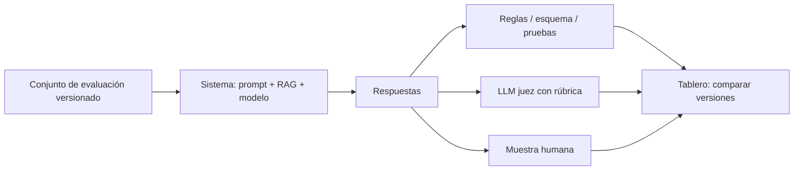

# Evaluación de respuestas de LLMs

Parte de: [[21-IA-Machine-Learning/05 Modelos de lenguaje/_Índice Modelos de lenguaje|Modelos de lenguaje]]

> [!info] Cómo avanzar
> `progreso`: **pendiente** → **viendo** (estudiando) → **visto** (contestaste la autoevaluación sin abrir las respuestas) → **dominado** (hiciste el laboratorio o lo aplicaste de verdad).

## Contenido

### Qué es
**Evaluar** un sistema con LLM es medir de forma repetible qué tan bien responde en **tus** casos de uso, para decidir con datos si un cambio de prompt, modelo, chunking o parámetro mejora o empeora. Sin evaluación, cada ajuste es una corazonada y es fácil arreglar un caso mientras se rompen otros diez. Es el equivalente de las pruebas automatizadas en software, con la diferencia de que las salidas no son deterministas y "correcto" a veces es un juicio.

### Cómo funciona
**1. Conjunto de evaluación propio**: los benchmarks públicos miden capacidades generales, no tu dominio, tu idioma, tus documentos ni tus formatos. Arma un conjunto de 30 a 200 casos reales: preguntas de usuarios, tickets, correos, con su respuesta esperada o criterios de aceptación. Incluye casos difíciles, ambiguos y **preguntas sin respuesta en los documentos** (para medir si el sistema sabe decir "no sé"). Versiona el conjunto junto al código.

**2. Tipos de evaluación**
- **Comparación exacta o con reglas**: la salida es una categoría, un número o un JSON; comparas directamente o con expresiones, validación de esquema, pruebas unitarias del código generado. Barata y objetiva; úsala siempre que puedas.
- **Similitud con una referencia**: métricas de solapamiento o similitud de embeddings entre la respuesta y la esperada. Útil como señal, pero premian parecerse en la forma, no en el fondo.
- **LLM como juez**: otro llamado a un LLM califica la respuesta con una rúbrica (por ejemplo, de 1 a 5, o correcto/incorrecto con justificación). Escala bien para respuestas abiertas.
- **Evaluación humana**: la referencia de calidad; cara, así que se usa para calibrar a los jueces automáticos y revisar muestras.
- **En producción**: retroalimentación de usuarios (pulgares, ediciones), tasa de escalamiento a humano, monitoreo de costos y latencia.

**3. Métricas de RAG, separando etapas** ([[RAG (generación aumentada con recuperación)]]):
- **Recuperación**: *hit rate@k* (en qué fracción de preguntas aparece el fragmento correcto entre los `k` recuperados) y *MRR* (promedio de `1/posición` del primer fragmento correcto; premia que aparezca arriba). Ejemplo: si en 40 preguntas el fragmento correcto está en el top-3 en 30, el hit rate@3 es `30/40 = 75 %`.
- **Generación**: **fidelidad** (*faithfulness*: ¿cada afirmación está respaldada por los fragmentos?) y **relevancia** de la respuesta (¿contesta lo que se preguntó?), además de la corrección contra la referencia.
Así sabes si mejorar el chunking/embeddings o el prompt/modelo.

**Riesgos del LLM como juez**
- **Sesgos**: prefiere respuestas largas, la que aparece primero en comparaciones por pares, o textos de su misma familia de modelos.
- **Inconsistencia**: puede calificar distinto el mismo caso; usa temperatura 0, rúbricas concretas y pide justificación antes del puntaje.
- **Comparte puntos ciegos** con el modelo evaluado: si ambos desconocen un dato, el juez no detecta el error.
- **Mitigación**: calibra el juez contra una muestra calificada por personas, intercambia el orden en comparaciones por pares, y combínalo con métricas basadas en reglas.

Al reportar, usa promedios y también **porcentajes de casos aceptables** (por ejemplo, % con puntaje ≥ 4): un promedio de 4 puede esconder varios ceros. Practícalo en [[Lab 7 - Evaluación de respuestas de un LLM]].



### Ejemplo
Métricas de recuperación y un juez con rúbrica:

```python
import os, statistics
from anthropic import Anthropic
from pydantic import BaseModel

def hit_rate_y_mrr(resultados):
    """resultados: lista de (ids_recuperados_en_orden, id_correcto)"""
    hits, rr = 0, []
    for recuperados, correcto in resultados:
        if correcto in recuperados:
            hits += 1
            rr.append(1 / (recuperados.index(correcto) + 1))
        else:
            rr.append(0.0)
    return hits / len(resultados), sum(rr) / len(rr)

print(hit_rate_y_mrr([(["a", "b", "c"], "a"), (["d", "e", "f"], "e"), (["g", "h", "i"], "z")]))

class Veredicto(BaseModel):
    justificacion: str
    puntaje: int          # 1 a 5

RUBRICA = """Califica la RESPUESTA contra la REFERENCIA del 1 al 5:
5 = correcta y completa; 4 = correcta con omisiones menores; 3 = parcialmente correcta;
2 = mayormente incorrecta; 1 = incorrecta o inventa datos. Justifica antes de dar el puntaje."""

def juzgar(pregunta, respuesta, referencia) -> Veredicto:
    r = Anthropic().messages.parse(
        model=os.environ["JUEZ_MODEL"], max_tokens=400, temperature=0, system=RUBRICA,
        messages=[{"role": "user", "content":
                   f"<pregunta>{pregunta}</pregunta><respuesta>{respuesta}</respuesta><referencia>{referencia}</referencia>"}],
        output_format=Veredicto,
    )
    return r.parsed_output

puntajes = [3, 5, 4, 1, 4, 5]                    # ejemplo de resultados del juez
print("promedio:", round(statistics.mean(puntajes), 2),
      "aceptables (≥4):", f"{sum(p >= 4 for p in puntajes) / len(puntajes):.0%}")
```

Corre esta evaluación en tu pipeline de Azure DevOps cada vez que cambies el prompt o el modelo, y guarda los resultados para comparar versiones.

### Cuándo usarlo y cuándo no
- **Siempre** antes de poner en producción un sistema con LLM y en cada cambio relevante.
- **Reglas primero**; juez LLM para lo que las reglas no cubren; humanos para calibrar.
- **No te quedes** con benchmarks públicos para elegir modelo: sirven para preseleccionar, la decisión se toma con tu conjunto.

### Errores comunes
- **Conjunto de evaluación demasiado pequeño o fácil**: los resultados no representan producción.
- **Evaluar solo la respuesta final** en RAG: no sabrás si falla la recuperación o la generación.
- **Confiar ciegamente en el juez** sin calibrarlo con personas.
- **Ajustar el prompt mirando el conjunto de evaluación hasta "memorizarlo"**: separa un subconjunto que no uses para iterar.
- **Ignorar la variabilidad**: corre varias veces o con temperatura 0 y reporta rangos.

### Para profundizar
- [Métricas de Ragas para evaluar RAG](https://docs.ragas.io/en/stable/references/metrics.html)
- [Reducir alucinaciones y fortalecer guardrails (documentación de Claude)](https://platform.claude.com/docs/en/test-and-evaluate/strengthen-guardrails/reduce-hallucinations)
- [Curso de LLMs de Hugging Face](https://huggingface.co/learn/llm-course/chapter1/1)

## Ejercicios

Resuélvelos en papel o en la herramienta; la solución está plegada.

> [!question]- En 20 preguntas, el fragmento correcto aparece en el top-5 en 16. ¿Hit rate@5?
> `16/20 = 0.80`

> [!question]- Un juez puntúa 1–5. Resultados `[5, 4, 2, 5, 4]`. ¿Promedio y % con ≥ 4?
> Promedio `4.0`; 4 de 5 → `80 %`.

## Autoevaluación

Contesta primero en voz alta o en papel; luego despliega la respuesta.

> [!question]- ¿Por qué hace falta un conjunto de evaluación propio?
> Los benchmarks públicos no reflejan tu caso. Un set de preguntas reales con respuestas esperadas permite comparar prompts y modelos y detectar regresiones.

> [!question]- ¿Qué tipos de evaluación hay?
> Exactas (coincidencia, JSON válido, regex), por referencia (similitud con la respuesta esperada), LLM como juez con rúbrica, y revisión humana.

> [!question]- ¿Qué riesgos tiene usar un LLM como juez?
> Sesgos (prefiere respuestas largas o su propio estilo, orden de presentación). Usa rúbricas concretas, calibra con muestras revisadas por humanos.

> [!question]- En RAG, ¿qué métricas separan recuperación y generación?
> Recuperación: ¿el fragmento correcto está en el top-k? (hit rate, recall@k). Generación: fidelidad al contexto y relevancia de la respuesta.

## Práctica

- [[Lab 7 - Evaluación de respuestas de un LLM]]

