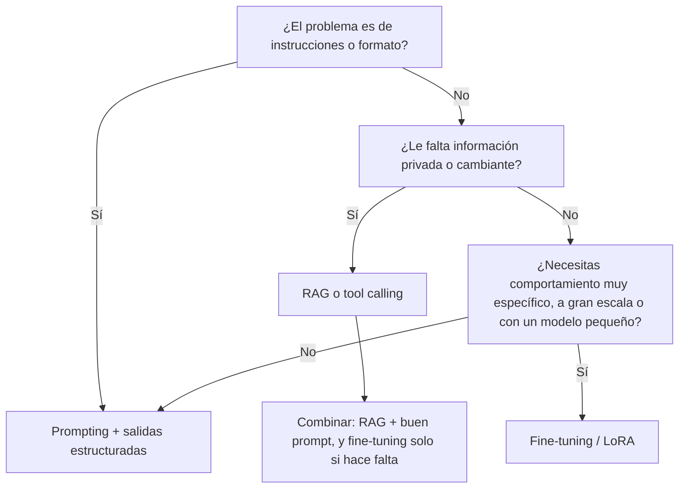

# Fine-tuning vs RAG vs prompting

Parte de: [[21-IA-Machine-Learning/05 Modelos de lenguaje/_Índice Modelos de lenguaje|Modelos de lenguaje]]

> [!info] Cómo avanzar
> `progreso`: **pendiente** → **viendo** (estudiando) → **visto** (contestaste la autoevaluación sin abrir las respuestas) → **dominado** (hiciste el laboratorio o lo aplicaste de verdad).

## Contenido

### Qué es
Son las tres formas principales de adaptar un LLM a tu caso de uso. **Prompting** cambia las instrucciones y el contexto de cada llamada. **RAG** le da al modelo información externa recuperada en el momento. **Fine-tuning** reentrena el modelo (o una parte pequeña, como con LoRA) con ejemplos para cambiar su comportamiento. Elegir bien evita meses de trabajo innecesario: la regla general es empezar por la más barata y escalar solo si los resultados medidos lo justifican.

### Cómo funciona
**Prompting** ([[Prompting efectivo]])
- Resuelve: *cómo* debe hacer la tarea (instrucciones, formato, tono, ejemplos few-shot).
- Costo: casi nulo para iterar; se cambia en minutos.
- Límite: no le da al modelo conocimiento que no tiene; los prompts muy largos encarecen cada llamada.

**RAG** ([[RAG (generación aumentada con recuperación)]])
- Resuelve: *qué información* usar. Inyecta conocimiento privado, extenso o que cambia, con citas.
- Costo: construir y mantener el índice, chunking, evaluación de recuperación.
- Ventaja clave: actualizar el conocimiento es reindexar un documento; no hay que reentrenar nada. Puedes respetar permisos por usuario y auditar de dónde salió cada respuesta.

**Fine-tuning** ([[Transfer learning y fine-tuning]], [[LoRA y ajuste eficiente]])
- Resuelve: *comportamiento* consistente: un formato o estilo muy específico, una tarea estrecha repetida millones de veces, terminología de dominio, o hacer que un modelo más pequeño y barato rinda como uno grande en esa tarea.
- Costo: preparar cientos o miles de ejemplos de calidad, cómputo de entrenamiento (para modelos abiertos, en Colab o la nube; tu GTX 1660 Ti queda corta salvo para modelos diminutos), evaluación y volver a entrenar cuando cambien los requisitos.
- Límite: es una mala forma de **enseñar hechos**. El modelo absorbe patrones, no una base de datos confiable: puede mezclar o inventar detalles, no puede citar la fuente y queda desactualizado en cuanto cambian los datos.



**Se combinan**: un sistema maduro suele usar prompting siempre, RAG para el conocimiento y, a veces, un modelo afinado para el estilo o la tarea concreta. Para datos estructurados vivos (pedidos, saldos), la mejor "fuente" es una consulta directa vía [[Tool calling (llamadas a herramientas)]].

### Ejemplo
Tres casos reales de tu entorno:

1. **Políticas internas que cambian cada mes** (vacaciones, gastos, lineamientos de seguridad): **RAG**. Indexas los documentos con su fecha de vigencia, filtras por la versión actual y pides citar la política. Cuando cambien, reindexas ese documento. Con fine-tuning tendrías que reentrenar cada mes y aun así no podrías demostrar de dónde salió una respuesta.
2. **Clasificar tickets de soporte de Itzamna.Clio en 5 categorías**: **prompting** con few-shot y salida estructurada. Si llegas a millones de tickets y el costo importa, podrías afinar un modelo pequeño con los tickets ya clasificados.
3. **Generar descripciones de reportes de Wee.Reporteria con el formato exacto de tu equipo**: primero un prompt con plantilla y ejemplos; si tras medir sigue habiendo inconsistencias de formato con muchos casos, fine-tuning con LoRA de un modelo abierto en Colab.

Una forma rápida de decidir con datos: arma 30–50 preguntas reales con su respuesta esperada ([[Evaluación de respuestas de LLMs]]), mide con prompting puro, luego con RAG, y solo si ambos quedan cortos invierte en fine-tuning.

```python
# Esqueleto de comparación (las funciones dependen de tu implementación)
variantes = {"solo_prompt": responder_con_prompt, "rag": responder_con_rag}
for nombre, fn in variantes.items():
    aciertos = sum(juez_correcto(p["pregunta"], fn(p["pregunta"]), p["esperada"]) for p in conjunto)
    print(nombre, f"{aciertos / len(conjunto):.0%}")
```

### Cuándo usarlo y cuándo no
- **Prompting**: siempre como base; suficiente para muchas tareas.
- **RAG**: conocimiento privado, voluminoso, cambiante o que requiere citas y permisos.
- **Fine-tuning**: formato/estilo/tarea muy específicos, alto volumen, reducción de costo con modelos pequeños, o latencia baja. No para hechos.

### Errores comunes
- **Hacer fine-tuning para "enseñarle" hechos**: el modelo no memoriza de forma confiable, sigue alucinando, no cita, y se desactualiza con cada cambio; además necesitas muchos ejemplos por cada dato. Usa RAG para hechos y fine-tuning para comportamiento.
- **Saltar directo a fine-tuning** sin haber probado un buen prompt ni medido.
- **RAG para todo**: si la información cabe en el prompt, pégala.
- **No tener un conjunto de evaluación**: sin él no sabes si la opción cara mejoró algo.

### Para profundizar
- [Guía de ingeniería de prompts de Claude](https://platform.claude.com/docs/en/build-with-claude/prompt-engineering/overview)
- [Retrieval-Augmented Generation (Lewis et al.)](https://arxiv.org/abs/2005.11401)
- [Documentación de PEFT (Hugging Face)](https://huggingface.co/docs/peft/index)

## Autoevaluación

Contesta primero en voz alta o en papel; luego despliega la respuesta.

> [!question]- ¿Qué resuelve cada uno?
> Prompting: instrucciones y ejemplos, lo primero que pruebas. RAG: darle conocimiento actual o privado. Fine-tuning: cambiar estilo, formato o comportamiento de forma consistente.

> [!question]- Necesitas que responda sobre políticas internas que cambian cada mes. ¿Qué eliges?
> RAG: actualizas los documentos sin reentrenar y puedes citar la fuente.

> [!question]- Error común: hacer fine-tuning para "enseñarle" hechos.
> Es caro, difícil de actualizar y no garantiza que recuerde los datos exactos; RAG es mejor para conocimiento.

