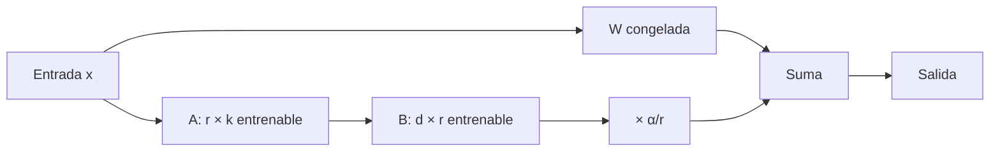

# LoRA y ajuste eficiente

Parte de: [[21-IA-Machine-Learning/05 Modelos de lenguaje/_Índice Modelos de lenguaje|Modelos de lenguaje]]

> [!info] Cómo avanzar
> `progreso`: **pendiente** → **viendo** (estudiando) → **visto** (contestaste la autoevaluación sin abrir las respuestas) → **dominado** (hiciste el laboratorio o lo aplicaste de verdad).

## Contenido

### Qué es
**LoRA** (*Low-Rank Adaptation*) es una técnica de **ajuste eficiente en parámetros** (PEFT) para afinar modelos grandes: en lugar de actualizar todos los pesos, se **congela** el modelo original y se entrenan dos matrices pequeñas por cada capa elegida, cuyo producto representa el cambio. Así entrenas una fracción mínima de los parámetros, con mucha menos memoria, y el resultado es un "adaptador" de pocos megabytes. **QLoRA** combina LoRA con un modelo base **cuantizado a 4 bits** para reducir todavía más la memoria.

### Cómo funciona
En una capa lineal con pesos `W` de tamaño `d × k`, el fine-tuning completo aprende una actualización `ΔW` del mismo tamaño. La hipótesis de LoRA es que esa actualización tiene **rango bajo**: se puede aproximar como el producto de dos matrices delgadas:

`ΔW = B · A`, con `B` de `d × r` y `A` de `r × k`, y `r` (el **rango**) pequeño, por ejemplo 4, 8 o 16.

La salida de la capa pasa a ser `W·x + (α/r)·B·A·x`, donde `α` es un factor de escala. `W` queda congelada; solo se entrenan `A` y `B`. `B` se inicializa en ceros, así que al inicio el modelo se comporta exactamente como el original.

**Parámetros entrenables** por matriz: `r·(d + k)`. Ejemplo: una matriz de 1024×1024 tiene 1 048 576 pesos; con LoRA de rango 4 entrenas `4·(1024 + 1024) = 8 192`, es decir, alrededor del 0.78 %. Duplicar el rango duplica esa cantidad.

**Ventajas prácticas**
- **Memoria**: no guardas gradientes ni estado del optimizador para los pesos congelados; solo para los adaptadores ([[GPUs y por qué importan]]).
- **Almacenamiento y despliegue**: un adaptador pesa megabytes; puedes tener varios (uno por cliente o tarea) sobre el mismo modelo base y cambiarlos en caliente, o **fusionarlos** con `W` para no agregar latencia.
- **Menos olvido**: el modelo base no cambia, así que conserva más de su capacidad general.

**QLoRA**
1. Carga el modelo base cuantizado a 4 bits (formato NF4) para que ocupe aproximadamente una cuarta parte que en 16 bits.
2. Entrena adaptadores LoRA en mayor precisión encima de ese modelo congelado.
3. Usa trucos adicionales (doble cuantización, optimizadores paginados) para evitar picos de memoria.
Esto permite afinar modelos de varios miles de millones de parámetros en una sola GPU con algo más de VRAM que tu GTX 1660 Ti; para practicar, usa **Google Colab** con GPU (la T4 que suele asignar el plan gratuito no soporta bf16, así que usa `float16` como tipo de cómputo).



### Ejemplo
Configurar LoRA y QLoRA con las librerías `peft`, `transformers` y `bitsandbytes` (córrelo en Colab con GPU; el ID del modelo es un ejemplo de modelo abierto pequeño, revisa su licencia):

```python
# pip install transformers peft bitsandbytes accelerate
import torch
from transformers import AutoModelForCausalLM, AutoTokenizer, BitsAndBytesConfig
from peft import LoraConfig, get_peft_model, prepare_model_for_kbit_training

modelo_id = "Qwen/Qwen2.5-0.5B-Instruct"     # Pendiente de confirmar: elige un modelo vigente y su licencia

cuant = BitsAndBytesConfig(                   # QLoRA: base en 4 bits
    load_in_4bit=True,
    bnb_4bit_quant_type="nf4",
    bnb_4bit_use_double_quant=True,
    bnb_4bit_compute_dtype=torch.float16,     # T4 sin bf16
)
tok = AutoTokenizer.from_pretrained(modelo_id)
base = AutoModelForCausalLM.from_pretrained(modelo_id, quantization_config=cuant, device_map="auto")
base = prepare_model_for_kbit_training(base)

config = LoraConfig(
    r=8, lora_alpha=16, lora_dropout=0.05,
    target_modules=["q_proj", "v_proj"],      # proyecciones de atención (nombres según la arquitectura)
    task_type="CAUSAL_LM",
)
modelo = get_peft_model(base, config)
modelo.print_trainable_parameters()            # muestra entrenables vs. totales y el porcentaje

# ... entrenar con Trainer o un ciclo propio ...
modelo.save_pretrained("adaptador-reportes")   # guarda solo el adaptador (megabytes)
```

Calcula tú mismo cuántos parámetros añade:

```python
def params_lora(d, k, r):
    return r * (d + k)

for r in (4, 8, 16):
    p = params_lora(1024, 1024, r)
    print(r, p, f"{p / (1024 * 1024):.2%}")
```

### Cuándo usarlo y cuándo no
- **Úsalo** cuando ya decidiste que necesitas fine-tuning ([[Fine-tuning vs RAG vs prompting]]) de un modelo abierto y no tienes GPUs con mucha memoria; o cuando quieres varios comportamientos especializados sobre un mismo modelo base.
- **QLoRA** cuando ni siquiera el modelo en 16 bits cabe en tu GPU.
- **Fine-tuning completo** solo si tienes muchos datos, cómputo de sobra y LoRA ya no alcanza.
- **No lo uses** para meter conocimiento factual que cambia; eso es RAG.

### Errores comunes
- **Rango muy alto "por si acaso"**: más memoria y más riesgo de sobreajuste sin mejora clara; empieza con 8 o 16 y mide.
- **`target_modules` incorrectos**: los nombres de capas cambian entre arquitecturas; revisa `print(modelo)`.
- **Olvidar que el adaptador depende del modelo base exacto**: aplicarlo a otra versión no funciona.
- **Pocos datos de mala calidad**: LoRA no compensa ejemplos inconsistentes.
- **Ignorar la licencia del modelo base** al distribuir el resultado ([[Modelos abiertos vs comerciales]]).

### Para profundizar
- [LoRA: Low-Rank Adaptation of Large Language Models (Hu et al.)](https://arxiv.org/abs/2106.09685)
- [QLoRA: Efficient Finetuning of Quantized LLMs (Dettmers et al.)](https://arxiv.org/abs/2305.14314)
- [Documentación de PEFT (Hugging Face)](https://huggingface.co/docs/peft/index)
- [bitsandbytes en Hugging Face](https://huggingface.co/docs/bitsandbytes/index)

## Ejercicios

Resuélvelos en papel o en la herramienta; la solución está plegada.

> [!question]- Matriz de 4096×4096 con LoRA de rango 8. ¿Parámetros entrenables y qué porcentaje del total?
> LoRA: `2·4096·8 = 65 536`. Completa: `16 777 216`. Porcentaje `≈ 0.39 %`.

> [!question]- ¿Y con rango 16?
> `131 072` (≈ 0.78 %).

## Autoevaluación

Contesta primero en voz alta o en papel; luego despliega la respuesta.

> [!question]- ¿Qué es LoRA?
> Congela los pesos originales y entrena dos matrices pequeñas de rango *r* (`ΔW = B·A`) por capa. Se entrena una fracción mínima de parámetros.

> [!question]- ¿Qué ventaja práctica tiene?
> Menos memoria y cómputo; los adaptadores pesan poco y se pueden intercambiar sobre el mismo modelo base.

> [!question]- ¿Qué es QLoRA?
> LoRA sobre un modelo base cuantizado (4 bits) para afinar modelos grandes en GPUs modestas.

