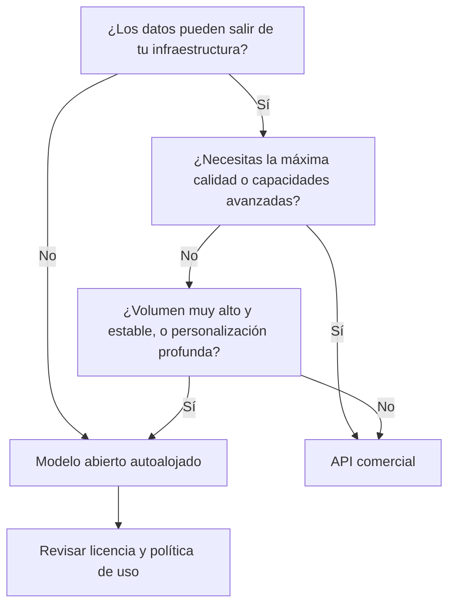

# Modelos abiertos vs comerciales

Parte de: [[21-IA-Machine-Learning/05 Modelos de lenguaje/_Índice Modelos de lenguaje|Modelos de lenguaje]]

> [!info] Cómo avanzar
> `progreso`: **pendiente** → **viendo** (estudiando) → **visto** (contestaste la autoevaluación sin abrir las respuestas) → **dominado** (hiciste el laboratorio o lo aplicaste de verdad).

## Contenido

### Qué es
Hay dos grandes formas de usar un LLM. Los **modelos comerciales por API** (los de Anthropic, OpenAI, Google y otros) se usan a través de un servicio: envías texto y pagas por tokens, sin acceso a los pesos. Los **modelos de pesos abiertos** publican sus pesos para descargarlos y ejecutarlos donde quieras (tu PC, tu servidor, la nube) o afinarlos. Elegir entre ellos afecta calidad, costo, privacidad, control, esfuerzo de operación y obligaciones legales.

### Cómo funciona
**Modelos de pesos abiertos: ventajas**
- **Control y privacidad**: los datos no salen de tu infraestructura; útil con información sensible o requisitos regulatorios ([[Privacidad de datos al usar IA]]).
- **Personalización profunda**: fine-tuning completo o con [[LoRA y ajuste eficiente|LoRA]], cuantización, cambios de arquitectura.
- **Costo predecible a gran volumen**: pagas hardware y operación, no tokens.
- **Sin dependencia de un proveedor**: el modelo no cambia ni se retira sin aviso; reproducibilidad.
- **Funcionan sin conexión**.
Desventajas: tú operas todo (GPUs, escalado, actualizaciones, seguridad, monitoreo); los modelos que caben en hardware modesto suelen rendir por debajo de los comerciales más capaces; y la carga de evaluar seguridad y calidad es tuya.

**Modelos comerciales por API: ventajas**
- **Calidad de punta** y capacidades avanzadas (contextos largos, visión, uso de herramientas, razonamiento extendido) sin infraestructura.
- **Cero operación**: escalado, disponibilidad y actualizaciones los resuelve el proveedor.
- **Empezar en minutos** y pagar solo lo que usas.
- **Integración empresarial**: en Azure puedes consumir modelos con la seguridad y facturación de tu suscripción ([[Azure OpenAI y Azure AI Foundry]]).
Desventajas: costo por token que crece con el volumen, datos que salen hacia el proveedor (revisa sus términos de retención y uso), límites de tasa, y modelos que se deprecan con el tiempo.

**"Abierto" no significa "libre para cualquier uso"**. Hay un espectro:
- **Licencias permisivas** (como Apache 2.0 o MIT): permiten uso comercial, modificación y redistribución con obligaciones mínimas (conservar avisos de licencia).
- **Licencias propias del fabricante**: permiten muchos usos pero con condiciones. Por ejemplo, la licencia comunitaria de Llama 4 exige pedir una licencia a Meta si tus productos superan 700 millones de usuarios activos mensuales, mostrar "Built with Llama" al distribuir y cumplir una política de uso aceptable que prohíbe ciertos usos.
- **Licencias no comerciales o de investigación**: no puedes usarlos en un producto.
Además, "pesos abiertos" no es lo mismo que **código abierto** en sentido estricto: muchos modelos no publican sus datos ni el código de entrenamiento. La Open Source Initiative publicó una definición específica de IA de código abierto que pide más que solo los pesos.



### Ejemplo
Prueba un modelo abierto pequeño localmente en tu GTX 1660 Ti con **Ollama** (gratuito, expone una API HTTP en `localhost`). Con 6 GB de VRAM, apunta a modelos pequeños cuantizados a 4 bits; los más grandes se ejecutarán parcialmente en CPU y serán lentos.

```bash
# Instala Ollama desde su sitio oficial y descarga un modelo pequeño
# (elige uno del catálogo de ollama.com y revisa su licencia en la ficha del modelo)
ollama pull <modelo-pequeño>
ollama run <modelo-pequeño> "Explica qué es ProblemDetails en ASP.NET Core en 3 líneas"
```

```python
# El mismo prompt contra el modelo local (API de Ollama) y contra una API comercial
import os, requests
from anthropic import Anthropic

prompt = "Explica qué es ProblemDetails en ASP.NET Core en 3 líneas."

local = requests.post("http://localhost:11434/api/generate",
                      json={"model": os.environ["MODELO_LOCAL"], "prompt": prompt, "stream": False},
                      timeout=120).json()["response"]
print("LOCAL:\n", local)

comercial = Anthropic().messages.create(model=os.environ["LLM_MODEL"], max_tokens=200,
                                        messages=[{"role": "user", "content": prompt}])
print("API:\n", comercial.content[0].text)
```

Compara calidad, latencia y costo con un pequeño conjunto de preguntas de tu dominio ([[Evaluación de respuestas de LLMs]]) antes de decidir. Para afinar un modelo abierto, usa Google Colab.

### Cuándo usarlo y cuándo no
- **API comercial**: prototipos, tareas que requieren la mejor calidad, volumen moderado, equipos sin capacidad de operar GPUs.
- **Pesos abiertos**: datos que no pueden salir, alto volumen estable, necesidad de afinar a fondo, operación sin internet, o aprendizaje y experimentación local.
- **Híbrido**: un modelo abierto pequeño para tareas simples y masivas, y uno comercial para las complejas.

### Errores comunes
- **Pensar que "abierto" = libre para cualquier uso**: lee la licencia y la política de uso aceptable; verifica uso comercial, atribución, restricciones de escala y si aplica a modelos derivados o afinados.
- **Subestimar el costo de operar** un modelo propio (GPUs, guardias, actualizaciones, seguridad).
- **Comparar con benchmarks públicos** en lugar de con tus tareas.
- **Enviar datos sensibles a una API** sin revisar términos de retención, región y acuerdos de tu empresa.
- **Fijarte en un modelo concreto para siempre**: diseña tu código (por ejemplo con [[Microsoft.Extensions.AI]] en .NET) para poder cambiar de modelo.

### Para profundizar
- [Política de uso aceptable de Llama 4 (referenciada por su licencia)](https://www.llama.com/llama4/use-policy)
- [Open Source AI Definition (Open Source Initiative)](https://opensource.org/ai/open-source-ai-definition)
- [Model cards en Hugging Face (dónde revisar licencia y limitaciones)](https://huggingface.co/docs/hub/model-cards)
- [Ollama](https://ollama.com/)

## Autoevaluación

Contesta primero en voz alta o en papel; luego despliega la respuesta.

> [!question]- ¿Qué ventajas tiene un modelo de pesos abiertos?
> Correrlo en tu infraestructura (privacidad, sin depender de un proveedor), afinarlo y controlar versiones.

> [!question]- ¿Y uno comercial por API?
> Suele dar mayor capacidad sin operar GPUs, con escalado y mejoras continuas; a cambio, dependes del proveedor y envías datos fuera.

> [!question]- Error común: "abierto" = libre para cualquier uso.
> Revisa la licencia: algunas restringen uso comercial o por número de usuarios.

