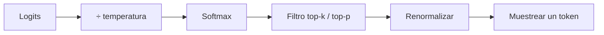

# Parámetros de generación (temperatura y top-p)

Parte de: [[21-IA-Machine-Learning/05 Modelos de lenguaje/_Índice Modelos de lenguaje|Modelos de lenguaje]]

> [!info] Cómo avanzar
> `progreso`: **pendiente** → **viendo** (estudiando) → **visto** (contestaste la autoevaluación sin abrir las respuestas) → **dominado** (hiciste el laboratorio o lo aplicaste de verdad).

## Contenido

### Qué es
Los **parámetros de generación** controlan cómo un LLM elige cada token a partir de la distribución de probabilidad que calcula ([[Cómo funciona un LLM (tokens, contexto y predicción)]]). Los más comunes son **temperatura**, **top-p** (*nucleus sampling*), **top-k**, el **máximo de tokens** de salida y las **secuencias de paro**. Con ellos decides entre respuestas consistentes y predecibles o respuestas variadas y creativas.

### Cómo funciona
**Temperatura (T)**: antes del [[Softmax]], los logits se dividen entre `T`:
`p = softmax(logits / T)`
- `T < 1` agranda las diferencias: la distribución se vuelve más "picuda" y el token más probable gana casi siempre.
- `T = 1` deja la distribución original.
- `T > 1` achica las diferencias: tokens menos probables tienen más oportunidad; más variedad y más riesgo de incoherencia.
- `T → 0` equivale a elegir siempre el más probable (*greedy*).

Ejemplo con logits `[3, 1, 0]`: con `T = 1` las probabilidades son ≈ `[0.844, 0.114, 0.042]`; con `T = 0.5` (logits `[6, 2, 0]`) quedan ≈ `[0.980, 0.018, 0.002]`; con `T = 2` (logits `[1.5, 0.5, 0]`) quedan ≈ `[0.629, 0.231, 0.140]`.

**Top-p (nucleus sampling)**: ordena los tokens de mayor a menor probabilidad y se queda con el **conjunto mínimo cuya probabilidad acumulada alcanza `p`**; luego renormaliza y muestrea solo entre ellos. Con probabilidades `[0.6, 0.25, 0.1, 0.05]` y `top-p = 0.9`, las acumuladas son 0.6, 0.85 y 0.95: se quedan los tres primeros y se descarta el último. Su ventaja es que se adapta: si el modelo está muy seguro, el núcleo tiene pocos tokens; si está indeciso, incluye más.

**Top-k**: se queda con los `k` tokens más probables, sin importar cuánta probabilidad sumen.

**Otros**: `max_tokens` corta la salida (si se alcanza, la respuesta puede quedar incompleta); las **secuencias de paro** detienen la generación al aparecer cierto texto.



**Recomendaciones de valores**:
- **Extraer datos a JSON, clasificar, responder con base en documentos**: temperatura baja (0 a 0.2) para resultados estables; mejor aún, combina con [[Salidas estructuradas (JSON)]].
- **Lluvia de ideas, nombres para un proyecto, textos creativos**: temperatura más alta (alrededor de 0.8 a 1) y opcionalmente top-p cerca de 0.9–0.95.
- En general **ajusta temperatura o top-p, no ambos a la vez**, para entender el efecto. Algunos proveedores lo recomiendan explícitamente y algunos modelos recientes no aceptan ciertos parámetros o fijan sus valores; revisa la documentación del modelo que uses.

Ojo: temperatura 0 reduce la variación, pero **no garantiza** salidas idénticas en todas las llamadas, por detalles de cómputo en paralelo del lado del proveedor.

### Ejemplo
Simula el efecto con NumPy, sin gastar tokens:

```python
import numpy as np

def probabilidades(logits, T):
    z = np.array(logits, dtype=float) / T
    e = np.exp(z - z.max())
    return e / e.sum()

def nucleo(probs, top_p):
    orden = np.argsort(probs)[::-1]
    acumulada = np.cumsum(probs[orden])
    n = int(np.searchsorted(acumulada, top_p) + 1)   # mínimo conjunto que alcanza top_p
    elegidos = orden[:n]
    p = np.zeros_like(probs); p[elegidos] = probs[elegidos]
    return elegidos, p / p.sum()

logits = [3.0, 1.0, 0.0]
for T in (0.5, 1.0, 2.0):
    print(f"T={T}: {probabilidades(logits, T).round(3)}")

probs = np.array([0.6, 0.25, 0.1, 0.05])
print(nucleo(probs, 0.9))                            # índices 0, 1, 2

rng = np.random.default_rng(0)
vocab = ["API", "servicio", "endpoint"]
for T in (0.2, 1.5):
    muestras = rng.choice(vocab, size=10, p=probabilidades(logits, T))
    print(T, list(muestras))
```

Con la API, los parámetros van en la llamada (por ejemplo `temperature=0.2` en el SDK de Anthropic o en el de OpenAI), junto con `max_tokens`.

### Cuándo usarlo y cuándo no
- **Baja la temperatura** en tareas con una respuesta correcta y cuando otra parte del sistema parsea la salida.
- **Súbela** cuando quieras diversidad, o cuando generes varias opciones para luego escoger.
- **No uses la temperatura como arreglo** para respuestas incorrectas: el problema suele ser el prompt o la falta de contexto.

### Errores comunes
- **Temperatura alta para extraer datos**: campos inventados o formatos inconsistentes.
- **Esperar determinismo total con T = 0**: puede haber pequeñas variaciones; si necesitas reproducibilidad, guarda las respuestas.
- **`max_tokens` muy bajo**: respuestas cortadas a la mitad, JSON incompleto. Revisa la razón de paro que devuelve la API.
- **Mover temperatura y top-p a la vez** y no saber cuál causó el cambio.

### Para profundizar
- [How to generate text (blog de Hugging Face)](https://huggingface.co/blog/how-to-generate)
- [The Curious Case of Neural Text Degeneration (nucleus sampling)](https://arxiv.org/abs/1904.09751)
- [Estrategias de generación en Hugging Face Transformers](https://huggingface.co/docs/transformers/main_classes/text_generation)

## Ejercicios

Resuélvelos en papel o en la herramienta; la solución está plegada.

> [!question]- Logits `[2, 1, 0]`. Calcula las probabilidades con T = 1, T = 0.5 y T = 2.
> T = 1: `[0.665, 0.245, 0.090]`
> T = 0.5 (logits `[4,2,0]`): `[0.867, 0.117, 0.016]`
> T = 2 (logits `[1,0.5,0]`): `[0.506, 0.307, 0.186]`

> [!question]- Probabilidades `[0.5, 0.3, 0.15, 0.05]` y top-p = 0.8. ¿Qué tokens quedan?
> Los dos primeros (0.5 + 0.3 = 0.8).

## Autoevaluación

Contesta primero en voz alta o en papel; luego despliega la respuesta.

> [!question]- ¿Qué hace la temperatura?
> Divide los logits antes de softmax: baja (<1) concentra la probabilidad en los tokens más probables (más determinista); alta (>1) la reparte (más variado).

> [!question]- ¿Qué es top-p (nucleus sampling)?
> Muestrea solo del conjunto mínimo de tokens cuya probabilidad acumulada llega a *p*.

> [!question]- ¿Qué valores usarías para extraer datos a JSON y para lluvia de ideas?
> Extracción: temperatura baja (≈0). Ideas: más alta. Conviene ajustar temperatura **o** top-p, no ambos a la vez.

## Práctica

- [[Lab 7 - Evaluación de respuestas de un LLM]]

