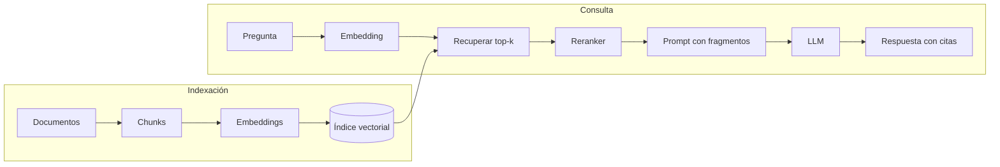

# RAG (generación aumentada con recuperación)

Parte de: [[21-IA-Machine-Learning/05 Modelos de lenguaje/_Índice Modelos de lenguaje|Modelos de lenguaje]]

> [!info] Cómo avanzar
> `progreso`: **pendiente** → **viendo** (estudiando) → **visto** (contestaste la autoevaluación sin abrir las respuestas) → **dominado** (hiciste el laboratorio o lo aplicaste de verdad).

## Contenido

### Qué es
**RAG** (*Retrieval-Augmented Generation*) es un patrón en el que, antes de que el LLM responda, tu sistema **busca** los fragmentos de información relevantes en tus propias fuentes (manuales, políticas, wikis, tickets, código) y los **incluye en el prompt** para que el modelo responda con base en ellos. Así el modelo puede contestar sobre datos privados o recientes que no vio en su entrenamiento, y puedes mostrar de dónde salió cada respuesta. Es la forma más común de conectar un LLM con el conocimiento de una empresa.

### Cómo funciona
Un pipeline RAG tiene dos fases:

**Indexación (una vez y cada vez que cambian los documentos)**
1. **Cargar** los documentos y extraer texto (PDF, Word, Markdown, páginas web).
2. **Dividir** en fragmentos (*chunks*) de tamaño manejable, con algo de solapamiento ([[Chunking y reranking]]).
3. **Calcular embeddings** de cada fragmento con un modelo de embeddings ([[Embeddings]]).
4. **Guardar** vectores, texto y metadatos (fuente, fecha, permisos) en una base vectorial o un índice de búsqueda ([[Embeddings y bases vectoriales (pgvector y Azure AI Search)]]).

**Consulta (cada pregunta)**
5. Calcular el embedding de la pregunta con **el mismo modelo**.
6. **Recuperar** los `k` fragmentos más similares (opcionalmente con búsqueda híbrida por palabras clave y vectores, y filtros por permisos).
7. **Reordenar** con un *reranker* (opcional, mejora mucho la precisión).
8. **Construir el prompt**: instrucciones + fragmentos delimitados con su fuente + pregunta, pidiendo responder solo con esa información y citar.
9. **Generar** la respuesta y devolverla con las citas.



**¿Falla la recuperación o la generación?** Cuando una respuesta es mala, revisa los fragmentos que se recuperaron para esa pregunta:
- Si **el fragmento correcto no está** entre los recuperados, el problema es de **recuperación**: chunking, modelo de embeddings, falta de búsqueda híbrida, `k` muy bajo o el documento ni siquiera se indexó.
- Si **el fragmento correcto sí está** y aun así la respuesta es mala o inventa, el problema es de **generación**: prompt, demasiado ruido en el contexto, modelo insuficiente.
Mídelo de forma sistemática con un conjunto de preguntas y su fragmento esperado (hit rate, MRR) y, por separado, la fidelidad de la respuesta ([[Evaluación de respuestas de LLMs]]).

### Ejemplo
RAG mínimo en memoria con sentence-transformers y un LLM por API. Imagina que indexas los documentos de reglas de tu equipo (vertical slice, ProblemDetails con `codigo`, secretos fuera del repo):

```python
import os
import numpy as np
from sentence_transformers import SentenceTransformer
from anthropic import Anthropic

docs = [
    {"fuente": "reglas/api.md", "texto": "Los errores de la API se devuelven como ProblemDetails e incluyen el campo codigo."},
    {"fuente": "reglas/datos.md", "texto": "Cada consulta SQL vive en su propio archivo .sql y tiene una interfaz dedicada."},
    {"fuente": "reglas/secretos.md", "texto": "Los secretos nunca van en el repositorio; se leen de Azure Key Vault o variables de entorno."},
]
emb = SentenceTransformer("paraphrase-multilingual-MiniLM-L12-v2")
matriz = emb.encode([d["texto"] for d in docs], normalize_embeddings=True)

def recuperar(pregunta, k=2):
    q = emb.encode([pregunta], normalize_embeddings=True)[0]
    puntajes = matriz @ q
    return [docs[i] | {"score": float(puntajes[i])} for i in np.argsort(-puntajes)[:k]]

def responder(pregunta):
    fragmentos = recuperar(pregunta)
    contexto = "\n".join(f'<doc fuente="{f["fuente"]}">{f["texto"]}</doc>' for f in fragmentos)
    resp = Anthropic().messages.create(
        model=os.environ["LLM_MODEL"], max_tokens=300, temperature=0,
        system=("Responde solo con la información de <docs>. Cita la fuente entre corchetes. "
                "Si la respuesta no está, di que no está en la documentación."),
        messages=[{"role": "user", "content": f"<docs>\n{contexto}\n</docs>\n\nPregunta: {pregunta}"}],
    )
    return resp.content[0].text, fragmentos

texto, usados = responder("¿Dónde guardo la cadena de conexión?")
print(texto); print([u["fuente"] for u in usados])
```

Lo construyes paso a paso con métricas en [[Lab 5 - RAG mínimo con evaluación de recuperación]].

### Cuándo usarlo y cuándo no
- **Úsalo** cuando las respuestas dependen de información privada, extensa o que cambia (políticas, documentación, catálogos) y quieres trazabilidad con citas.
- **No lo necesitas** si toda la información cabe cómodamente en el prompt y es poca; pégala directamente.
- **No es la herramienta** para cambiar el estilo o formato del modelo: eso es prompting o fine-tuning ([[Fine-tuning vs RAG vs prompting]]).
- **Para datos estructurados** (saldos, pedidos) es mejor una consulta exacta vía [[Tool calling (llamadas a herramientas)]].

### Errores comunes
- **Meter todos los documentos en el contexto**: es caro, lento, excede la ventana con facilidad y el modelo se distrae con información irrelevante; además no escala. Recupera solo lo pertinente.
- **No evaluar la recuperación por separado**: no sabrás qué arreglar.
- **Ignorar permisos**: si indexas todo junto, un usuario puede recibir fragmentos que no debería ver. Filtra por metadatos de acceso en la consulta.
- **Índice desactualizado**: el documento cambió y el índice no; programa la reindexación.
- **No pedir citas**: pierdes la forma más fácil de verificar.

### Para profundizar
- [Retrieval-Augmented Generation for Knowledge-Intensive NLP Tasks (Lewis et al.)](https://arxiv.org/abs/2005.11401)
- [Recuperar y reordenar con Sentence Transformers](https://www.sbert.net/examples/applications/retrieve_rerank/README.html)
- [Búsqueda híbrida en Azure AI Search](https://learn.microsoft.com/en-us/azure/search/hybrid-search-overview)

## Autoevaluación

Contesta primero en voz alta o en papel; luego despliega la respuesta.

> [!question]- ¿Qué es RAG?
> Recuperar fragmentos relevantes de tus documentos (búsqueda vectorial o híbrida) e incluirlos en el prompt para que el modelo responda con esa información.

> [!question]- ¿Cuáles son los pasos de un pipeline RAG?
> Ingesta: cargar → dividir (chunking) → embeddings → indexar. Consulta: embedding de la pregunta → recuperar top-k → (rerank) → prompt con contexto → respuesta con citas.

> [!question]- La respuesta es mala. ¿Cómo sabes si falla la recuperación o la generación?
> Revisa los fragmentos recuperados: si la respuesta no está ahí, falla la recuperación (chunking, embeddings, k); si está y el modelo la ignora, falla el prompt/generación.

> [!question]- Error común: meter todos los documentos en el contexto.
> Costo y latencia altos, y el modelo puede perder información en medio. Recupera solo lo relevante.

## Práctica

- [[Lab 5 - RAG mínimo con evaluación de recuperación]]

