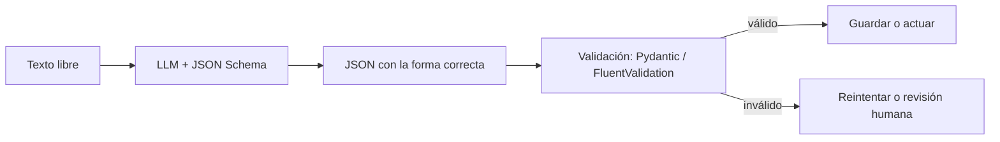

# Salidas estructuradas (JSON)

Parte de: [[21-IA-Machine-Learning/05 Modelos de lenguaje/_Índice Modelos de lenguaje|Modelos de lenguaje]]

> [!info] Cómo avanzar
> `progreso`: **pendiente** → **viendo** (estudiando) → **visto** (contestaste la autoevaluación sin abrir las respuestas) → **dominado** (hiciste el laboratorio o lo aplicaste de verdad).

## Contenido

### Qué es
Las **salidas estructuradas** consisten en hacer que el LLM responda en un formato que un programa pueda leer sin ambigüedad, normalmente **JSON que cumple un esquema** (campos, tipos, valores permitidos). Así conviertes texto libre (un correo, una factura, un ticket) en un objeto que tu código .NET o Python puede validar, guardar en la base o usar para decidir. Es lo que convierte a un LLM de "chat" en un componente de un sistema.

### Cómo funciona
Hay tres niveles de garantía, de menor a mayor:

1. **Pedir JSON en el prompt**: "Responde solo con JSON con los campos nombre, correo y monto". Funciona casi siempre, pero el modelo puede agregar texto antes o después, omitir campos, inventar nombres de campos, poner un número como texto o cortar el JSON si se acaba `max_tokens`.
2. **Modo JSON**: algunos proveedores garantizan que la salida sea JSON sintácticamente válido, pero no que siga tu esquema.
3. **Salida estructurada con esquema**: le pasas un **JSON Schema** en la llamada y el proveedor restringe la generación (decodificación con restricciones) para que la respuesta **cumpla el esquema**: campos requeridos presentes, tipos correctos, enums respetados. Tanto Anthropic (parámetro `output_config.format` de tipo `json_schema`, o `messages.parse()` con un modelo Pydantic en el SDK de Python) como OpenAI (Structured Outputs con `json_schema` y `strict`) lo ofrecen; revisa qué modelos lo soportan y qué partes de JSON Schema aceptan.

**Aun con esquema, valida**. El esquema garantiza la **forma**, no la **verdad**: el modelo puede llenar un campo con un valor inventado, una fecha imposible o un monto que no aparece en el texto. Tu código debe validar reglas de negocio (rangos, que el pedido exista, que el total cuadre) igual que validas cualquier entrada externa; en tu stack, con FluentValidation del lado de .NET o con Pydantic del lado de Python.



Consejos de diseño del esquema:
- Usa **enums** para categorías cerradas.
- Permite `null` (o un campo opcional) cuando el dato puede no venir en el texto; si todo es obligatorio, el modelo tenderá a inventar.
- Nombres de campo descriptivos y una `description` en cada uno ayudan al modelo.
- Mantén el esquema plano y pequeño cuando puedas.

### Ejemplo
Extraer datos de un correo de cliente con Pydantic y el SDK de Anthropic:

```python
# pip install anthropic pydantic
import os
from typing import Literal, Optional
from anthropic import Anthropic
from pydantic import BaseModel, Field

class Solicitud(BaseModel):
    cliente: str
    correo: Optional[str] = Field(description="Correo del cliente si aparece; si no, null")
    tipo: Literal["reembolso", "factura", "soporte", "otro"]
    numero_pedido: Optional[str]
    monto_mxn: Optional[float] = Field(description="Monto mencionado en pesos, sin símbolo")

texto = """Hola, soy Mariana López (mariana.lopez@example.com). Pedí la orden PX-2291
y me cobraron 1,250 pesos dos veces. ¿Me pueden regresar uno de los cargos?"""

cliente = Anthropic()
resp = cliente.messages.parse(
    model=os.environ["LLM_MODEL"],
    max_tokens=500,
    system="Extrae los datos del correo. Si un dato no aparece, usa null; no lo inventes.",
    messages=[{"role": "user", "content": f"<correo>{texto}</correo>"}],
    output_format=Solicitud,                 # el SDK convierte el modelo a JSON Schema
)
sol: Solicitud = resp.parsed_output
print(sol)

# Validación de negocio adicional (el esquema no la cubre)
if sol.monto_mxn is not None and not (0 < sol.monto_mxn < 100_000):
    raise ValueError("Monto fuera de rango: enviar a revisión humana")
```

Con un SDK u otro proveedor sin `parse`, el patrón es el mismo: pasa el esquema, recibe texto JSON y valida con `Solicitud.model_validate_json(...)`.

### Cuándo usarlo y cuándo no
- **Úsalo** siempre que la salida la consuma código: extracción de datos, clasificación, enrutamiento, llenado de formularios, generar parámetros para una consulta.
- **Para que el modelo invoque funciones** con argumentos, usa [[Tool calling (llamadas a herramientas)]], que se basa en la misma idea de esquemas.
- **No lo necesitas** cuando el resultado es texto para una persona (un resumen, una respuesta de chat).

### Errores comunes
- **Confiar en el JSON sin validarlo**: un campo con tipo correcto puede tener un valor falso o peligroso (por ejemplo, un ID de otro cliente). Valida forma **y** reglas de negocio, y trata la salida como entrada no confiable.
- **Parsear con expresiones regulares** una respuesta en texto libre en lugar de usar el soporte de esquemas.
- **Hacer todos los campos obligatorios**: el modelo rellena con inventos cuando el dato no existe.
- **`max_tokens` insuficiente**: JSON truncado; revisa la razón de paro.
- **Temperatura alta** en extracción: más variación innecesaria ([[Parámetros de generación (temperatura y top-p)]]).

### Para profundizar
- [Structured outputs en la documentación de Claude](https://platform.claude.com/docs/en/build-with-claude/structured-outputs)
- [Structured Outputs en la documentación de OpenAI](https://developers.openai.com/api/docs/guides/structured-outputs)
- [JSON Schema](https://json-schema.org/)
- [Documentación de Pydantic](https://docs.pydantic.dev/latest/)

## Autoevaluación

Contesta primero en voz alta o en papel; luego despliega la respuesta.

> [!question]- ¿Por qué pedir JSON a un LLM?
> Para que otro programa consuma la respuesta sin parsear texto libre (extracción de datos, clasificación, argumentos de herramientas).

> [!question]- ¿Qué diferencia hay entre pedir JSON en el prompt y usar salida estructurada con esquema?
> En el prompt es solo una instrucción y puede fallar. Muchas APIs permiten pasar un JSON Schema y restringen la generación a ese formato (el soporte exacto depende del proveedor: Pendiente de confirmar en el tuyo).

> [!question]- Error común: confiar en el JSON sin validarlo.
> Valida siempre (Pydantic, JSON Schema): aunque sea JSON válido, los valores pueden ser incorrectos o inventados.

## Práctica

- [[Lab 7 - Evaluación de respuestas de un LLM]]

