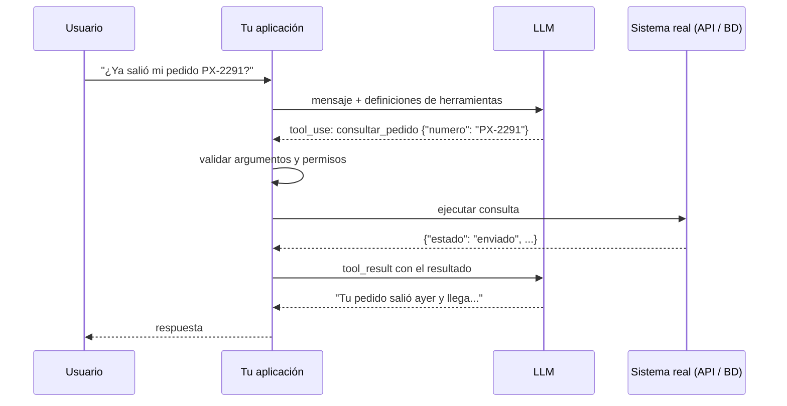

# Tool calling (llamadas a herramientas)

Parte de: [[21-IA-Machine-Learning/05 Modelos de lenguaje/_Índice Modelos de lenguaje|Modelos de lenguaje]]

> [!info] Cómo avanzar
> `progreso`: **pendiente** → **viendo** (estudiando) → **visto** (contestaste la autoevaluación sin abrir las respuestas) → **dominado** (hiciste el laboratorio o lo aplicaste de verdad).

## Contenido

### Qué es
**Tool calling** (o *function calling*) es la capacidad de un LLM de **pedir** que tu aplicación ejecute una función, indicando su nombre y los argumentos en formato estructurado. Le describes al modelo qué herramientas existen (por ejemplo, `consultar_pedido`, `buscar_documentos`, `crear_ticket`) y él decide cuándo usar una y con qué parámetros. Es lo que permite que un LLM consulte datos actuales, haga cálculos exactos o actúe en otros sistemas, y es la base de los agentes ([[El ciclo de un agente (razonar, actuar, observar)]]).

### Cómo funciona
**El modelo no ejecuta nada.** Solo genera una solicitud estructurada; **tu código** decide si la ejecuta, la ejecuta y le devuelve el resultado.

Flujo típico (con la API de Anthropic; en OpenAI y otros es equivalente con otros nombres):
1. Envías el mensaje del usuario junto con la lista de herramientas: cada una con `name`, `description` y `input_schema` (un JSON Schema de sus parámetros).
2. Si el modelo decide usar una, la respuesta termina con `stop_reason = "tool_use"` y contiene un bloque `tool_use` con `id`, `name` e `input` (los argumentos).
3. Tu aplicación **valida** los argumentos, ejecuta la función real (consulta a la base, llamada a una API) aplicando permisos del usuario.
4. Devuelves el resultado en un nuevo mensaje con un bloque `tool_result` que referencia el `tool_use_id`.
5. El modelo usa ese resultado para responder, o pide otra herramienta. Se repite hasta que responde en texto.



**La descripción es el "prompt" de la herramienta**. El modelo elige herramienta y argumentos leyendo nombre, descripción y esquema. Si la descripción es ambigua (por ejemplo, dos herramientas que "buscan clientes" sin explicar la diferencia, o un parámetro `fecha` sin formato), el modelo puede elegir la herramienta equivocada, no usarla cuando debía o mandar argumentos mal formados. Describe qué hace, cuándo usarla y cuándo **no**, el formato de cada parámetro y qué devuelve. Usa enums y campos requeridos en el esquema; algunos proveedores ofrecen modo estricto (`strict`) para garantizar que los argumentos cumplan el esquema.

Estándares como [[Herramientas y MCP (Model Context Protocol)|MCP]] permiten exponer herramientas una vez y usarlas desde distintos clientes.

### Ejemplo
Una herramienta de consulta de pedidos con validación antes de ejecutar:

```python
import json, os, re
from anthropic import Anthropic

cliente = Anthropic()
HERRAMIENTAS = [{
    "name": "consultar_pedido",
    "description": ("Obtiene el estado de envío de UN pedido del cliente autenticado. "
                    "Úsala solo cuando el usuario dé un número de pedido. No sirve para buscar productos."),
    "input_schema": {
        "type": "object",
        "properties": {"numero": {"type": "string", "description": "Formato PX-#### (ej. PX-2291)"}},
        "required": ["numero"],
        "additionalProperties": False,
    },
}]

PEDIDOS = {"PX-2291": {"cliente_id": 7, "estado": "enviado", "paqueteria": "DHL"}}

def consultar_pedido(numero: str, cliente_id: int) -> dict:
    if not re.fullmatch(r"PX-\d{4}", numero):                   # validar formato
        return {"error": "Número de pedido con formato inválido"}
    pedido = PEDIDOS.get(numero)
    if pedido is None or pedido["cliente_id"] != cliente_id:    # validar permisos
        return {"error": "Pedido no encontrado"}
    return {"estado": pedido["estado"], "paqueteria": pedido["paqueteria"]}

def conversar(pregunta: str, cliente_id: int) -> str:
    mensajes = [{"role": "user", "content": pregunta}]
    for _ in range(5):                                           # límite de iteraciones
        resp = cliente.messages.create(model=os.environ["LLM_MODEL"], max_tokens=500,
                                       tools=HERRAMIENTAS, messages=mensajes)
        if resp.stop_reason != "tool_use":
            return "".join(b.text for b in resp.content if b.type == "text")
        mensajes.append({"role": "assistant", "content": resp.content})
        resultados = []
        for bloque in resp.content:
            if bloque.type == "tool_use" and bloque.name == "consultar_pedido":
                salida = consultar_pedido(str(bloque.input.get("numero", "")), cliente_id)
                resultados.append({"type": "tool_result", "tool_use_id": bloque.id,
                                   "content": json.dumps(salida, ensure_ascii=False)})
        mensajes.append({"role": "user", "content": resultados})
    return "No pude completar la solicitud."

print(conversar("¿Ya salió mi pedido PX-2291?", cliente_id=7))
```

Fíjate en que el `cliente_id` lo pone **tu** código desde la sesión autenticada (por ejemplo, del JWT de Xolotl.Hecate), nunca el modelo.

### Cuándo usarlo y cuándo no
- **Úsalo** cuando el modelo necesita datos vivos (pedidos, inventario, calendario), cálculos exactos o ejecutar acciones.
- **Para solo extraer datos** de un texto, basta con [[Salidas estructuradas (JSON)]].
- **Para recuperar documentos**, puedes usar RAG directo o exponer la búsqueda como herramienta.
- **Evita** dar herramientas destructivas (borrar, pagar, enviar correos) sin confirmación humana.

### Errores comunes
- **Ejecutar los argumentos sin validar**: el modelo puede generar un ID de otro usuario, una ruta de archivo peligrosa o SQL inyectado, ya sea por error o por [[Prompt injection]] en los datos. Valida tipos, formatos y rangos, aplica la autorización del usuario real y usa consultas parametrizadas (o tus procedimientos almacenados con Dapper).
- **Descripciones ambiguas o herramientas que se traslapan**: elecciones erróneas.
- **Demasiadas herramientas**: más tokens por llamada y más confusión; expón solo las necesarias.
- **Ciclos sin límite**: pon un máximo de iteraciones y de tiempo.
- **No devolver los errores al modelo**: si la herramienta falla, regresa un `tool_result` con el error para que pueda corregirse o avisar.

### Para profundizar
- [Tool use con Claude (documentación oficial)](https://platform.claude.com/docs/en/agents-and-tools/tool-use/overview)
- [Implementar tool use (documentación de Claude)](https://platform.claude.com/docs/en/agents-and-tools/tool-use/implement-tool-use)
- [Model Context Protocol](https://modelcontextprotocol.io/)

## Autoevaluación

Contesta primero en voz alta o en papel; luego despliega la respuesta.

> [!question]- ¿Qué es tool calling?
> Le describes al modelo funciones (nombre, descripción, esquema de parámetros); el modelo responde con una solicitud de llamada y **tu código** la ejecuta y le devuelve el resultado.

> [!question]- ¿El modelo ejecuta la función?
> No. Solo propone el nombre y los argumentos; la ejecución, permisos y validación son responsabilidad de tu aplicación.

> [!question]- ¿Qué pasa si la descripción de la herramienta es ambigua?
> El modelo la elige mal o con argumentos incorrectos. Descripciones claras, parámetros tipados y pocos campos mejoran la precisión.

> [!question]- Error común: ejecutar los argumentos sin validar.
> Los argumentos pueden venir manipulados (prompt injection). Valida tipos y rangos, aplica permisos mínimos y pide aprobación para acciones destructivas.

## Práctica

- [[Lab 6 - Agente con tool calling y un servidor MCP sencillo]]

