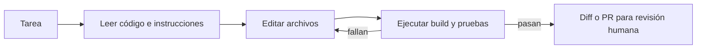

# Agentes de código (asistentes de programación)

Parte de: [[21-IA-Machine-Learning/06 Agentes de IA/_Índice Agentes de IA|Agentes de IA]]

> [!info] Cómo avanzar
> `progreso`: **pendiente** → **viendo** (estudiando) → **visto** (contestaste la autoevaluación sin abrir las respuestas) → **dominado** (hiciste el laboratorio o lo aplicaste de verdad).

## Contenido

### Qué es
Un **agente de código** es un agente especializado en desarrollo de software: lee tu repositorio, entiende la tarea, edita archivos, ejecuta comandos (compilar, correr pruebas, linters), observa los resultados y repite hasta terminar. Va más allá del autocompletado: puede implementar una funcionalidad, corregir un bug o hacer una refactorización de varios archivos. Ejemplos conocidos son Claude Code, GitHub Copilot (modo agente y agente de codificación que abre *pull requests*), Cursor y OpenAI Codex; las capacidades y planes cambian seguido, revisa la documentación de cada uno.

### Cómo funciona
Es el mismo ciclo de agente ([[El ciclo de un agente (razonar, actuar, observar)]]) con herramientas de desarrollo:
1. **Contexto**: lee archivos relevantes, busca con grep, y carga instrucciones del proyecto (archivos como `CLAUDE.md`, `AGENTS.md` o `.github/copilot-instructions.md` donde documentas convenciones: vertical slice, SQL en archivos `.sql`, ProblemDetails con `codigo`).
2. **Plan**: propone pasos (ver [[Planificación y descomposición de tareas]]).
3. **Acción**: edita archivos y ejecuta comandos en la terminal (`dotnet build`, `dotnet test`).
4. **Observación**: lee errores de compilación y pruebas fallidas, y corrige.
5. **Entrega**: un *diff*, un commit o un *pull request* para que lo revises.

Muchos se extienden con servidores MCP ([[Herramientas y MCP (Model Context Protocol)]]): documentación, Azure DevOps, bases de datos.



### Ejemplo
Tarea para Itzamna.Dionisio: "Agrega el endpoint `GET /api/clientes/{id}/saldo` siguiendo el slice de Clientes". Un buen flujo:
1. Le das la tarea con criterios claros: controller, interfaz `IConsultarSaldoCliente`, archivo `ConsultarSaldoCliente.sql`, validación con FluentValidation, ProblemDetails con `codigo` cuando no exista el cliente, y una prueba.
2. Le pides que primero proponga el plan y lo revisas.
3. Lo dejas trabajar en una rama, con permisos para `dotnet build` y `dotnet test`, pero **sin** acceso a secretos ni a producción.
4. Revisas el *diff* como revisarías el PR de un compañero.

Un archivo de instrucciones del repositorio ayuda muchísimo:

```markdown
# Convenciones de Itzamna.Dionisio
- Vertical slice: Features/<Modulo>/<Caso>/ con Controller, Validator, Query y archivo .sql
- Una interfaz por consulta; Dapper con SQL en archivos .sql embebidos; procedimientos en SQL Server
- Errores: ProblemDetails con extensión "codigo"
- No leer ni modificar appsettings.*.json con secretos; usar user-secrets
- Antes de terminar: dotnet build y dotnet test sin errores
```

#### Cómo revisar su trabajo
- **Lee el diff completo**, no solo el resumen que te da el agente: puede afirmar que "todas las pruebas pasan" cuando no las corrió o cuando modificó la prueba para que pase.
- **Corre tú mismo** build y pruebas; mejor aún, deja que lo haga el pipeline de Azure DevOps.
- Revisa que no haya **cambios fuera de alcance** (archivos no relacionados, dependencias nuevas, reglas de lint desactivadas).
- Busca **seguridad**: SQL concatenado, secretos en código, validaciones eliminadas, `catch` vacíos.
- Verifica que las pruebas nuevas prueben algo real y no solo `Assert.True(true)`.

### Cuándo usarlo y cuándo no
**Bueno para**: código repetitivo siguiendo un patrón existente, pruebas unitarias, migraciones mecánicas, explicar código desconocido, primeras versiones que luego pules.
**Cuidado con**: lógica crítica (seguridad, dinero, identidad como Xolotl.Hecate), decisiones de arquitectura, y código que no entiendes: si no podrías escribirlo o explicarlo, no puedes revisarlo bien. Para aprender un tema, escribe tú primero y usa al agente para revisar.

### Errores comunes
- **Riesgo de la terminal**: un agente con terminal ejecuta comandos con *tus* permisos. Un error o una [[Prompt injection]] escondida en un archivo, issue o dependencia puede llevarlo a borrar archivos, hacer `git push --force`, filtrar variables de entorno o instalar paquetes maliciosos. Mitígalo: aprueba comandos riesgosos ([[Humano en el ciclo (aprobaciones)]]), usa listas de comandos permitidos, trabaja en contenedor o máquina aislada, y no dejes secretos en el entorno.
- **Aceptar sin revisar**: el código "se ve bien" pero tiene errores sutiles.
- **Tareas vagas**: "mejora el módulo" produce cambios grandes y difíciles de revisar. Da alcance y criterio de terminado.
- **Sin instrucciones del proyecto**: el agente inventa su propio estilo (EF en vez de Dapper, excepciones en vez de ProblemDetails).
- **Sesiones larguísimas**: el contexto se llena y la calidad baja; divide en tareas pequeñas.

### Para profundizar
- [Documentación de Claude Code](https://code.claude.com/docs/en/overview)
- [GitHub Copilot - documentación](https://docs.github.com/copilot)
- [AGENTS.md - formato abierto de instrucciones para agentes](https://agents.md/)

## Autoevaluación

Contesta primero en voz alta o en papel; luego despliega la respuesta.

> [!question]- ¿Qué hace un agente de código?
> Lee el repositorio, propone o aplica cambios, ejecuta comandos y pruebas, y itera con los resultados.

> [!question]- ¿Cómo revisas su trabajo?
> Como el de cualquier colega: diffs pequeños, pruebas que pasen, revisión de seguridad y no aceptar cambios que no entiendas.

> [!question]- Riesgo al darle acceso a la terminal.
> Puede ejecutar comandos destructivos o filtrar secretos. Usa permisos, aprobaciones y entornos aislados.

