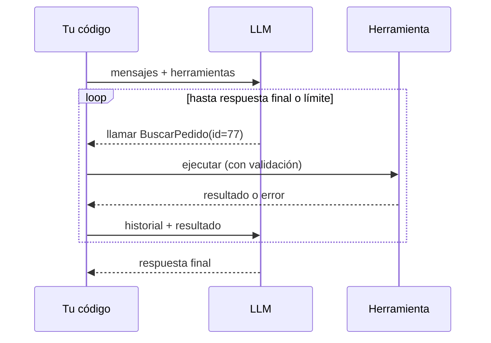

# El ciclo de un agente (razonar, actuar, observar)

Parte de: [[21-IA-Machine-Learning/06 Agentes de IA/_Índice Agentes de IA|Agentes de IA]]

> [!info] Cómo avanzar
> `progreso`: **pendiente** → **viendo** (estudiando) → **visto** (contestaste la autoevaluación sin abrir las respuestas) → **dominado** (hiciste el laboratorio o lo aplicaste de verdad).

## Contenido

### Qué es
El **ciclo del agente** es el bucle que convierte a un LLM en agente: **razonar** (el modelo decide qué hacer), **actuar** (pide llamar una herramienta) y **observar** (recibe el resultado y lo incorpora a su contexto). Se repite hasta que el modelo da una respuesta final o hasta que tu código lo detiene. A este patrón se le conoce como **ReAct** (*Reasoning + Acting*), por el artículo que lo popularizó.

### Cómo funciona
Paso a paso, desde el punto de vista de tu código:
1. Armas la lista de mensajes: instrucciones del sistema + petición del usuario, y le pasas al modelo la **descripción de las herramientas** (nombre, descripción y esquema JSON de parámetros).
2. El modelo responde con una de dos cosas: texto final, o una o varias **llamadas a herramienta** (`function_call` con nombre y argumentos).
3. Tu código **valida** los argumentos, ejecuta la herramienta y agrega el resultado al historial como mensaje de tipo herramienta.
4. Vuelves a llamar al modelo con el historial actualizado. Ahora "observa" el resultado y decide el siguiente paso.
5. Terminas cuando el modelo ya no pide herramientas, o cuando se cumple una **condición de paro**: máximo de iteraciones, presupuesto de tokens, tiempo límite o una acción que requiere aprobación humana.



#### Límite de pasos
Sin límite, un agente puede entrar en **bucle**: llama la misma herramienta una y otra vez con argumentos parecidos, o alterna entre dos acciones sin avanzar. Cada vuelta cuesta tokens y tiempo, y el historial crece hasta llenar la ventana de contexto. Por eso todo agente serio tiene un tope de iteraciones (por ejemplo 10–20), un presupuesto de costo y un *timeout*; al alcanzarlos, el agente se detiene y reporta lo que logró o escala a un humano.

#### Cuando una herramienta falla
Un error de herramienta **no debe tumbar el ciclo**. Lo correcto es devolver al modelo un resultado de error claro ("timeout al consultar el servicio de pagos", "el cliente 999 no existe") para que decida: reintentar con otros argumentos, usar otra herramienta, o explicar al usuario que no pudo. Tu código, además, debe poner reintentos con límite para errores transitorios y cortar si el mismo error se repite. Nunca devuelvas *stack traces* con secretos o rutas internas al modelo.

### Ejemplo
Ciclo manual en C# con [[Microsoft.Extensions.AI]], para ver el mecanismo sin "magia":

```csharp
using Microsoft.Extensions.AI;

const int MaxPasos = 8;
var herramientas = new Dictionary<string, AIFunction>
{
    ["BuscarPedido"] = AIFunctionFactory.Create((int id) =>
        id == 77 ? "Pedido 77: en tránsito" : throw new KeyNotFoundException($"Pedido {id} no existe"),
        "BuscarPedido", "Busca un pedido por id")
};
var opciones = new ChatOptions { Tools = [.. herramientas.Values] };
List<ChatMessage> historial =
[
    new(ChatRole.System, "Eres soporte. Usa herramientas; si fallan, explícalo."),
    new(ChatRole.User, "¿Dónde está mi pedido 77?")
];

for (int paso = 1; paso <= MaxPasos; paso++)
{
    ChatResponse r = await chatClient.GetResponseAsync(historial, opciones);
    historial.AddRange(r.Messages);

    var llamadas = r.Messages.SelectMany(m => m.Contents).OfType<FunctionCallContent>().ToList();
    if (llamadas.Count == 0) { Console.WriteLine(r.Text); return; }   // respuesta final

    foreach (var call in llamadas)
    {
        object? resultado;
        try { resultado = await herramientas[call.Name].InvokeAsync(new AIFunctionArguments(call.Arguments)); }
        catch (Exception ex) { resultado = $"ERROR: {ex.Message}"; }        // el modelo observa el error
        historial.Add(new ChatMessage(ChatRole.Tool, [new FunctionResultContent(call.CallId, resultado)]));
    }
}
Console.WriteLine("Se alcanzó el límite de pasos; escalar a un humano.");
```

En la práctica, `UseFunctionInvocation()` de Microsoft.Extensions.AI o Microsoft Agent Framework hacen este bucle por ti (con su propio máximo de iteraciones configurable), pero conviene entenderlo para depurar.

### Cuándo usarlo y cuándo no
El ciclo completo vale la pena cuando la cantidad de pasos depende de lo que se observa. Si siempre es "una herramienta y responder", basta con una sola ronda de *tool calling*. Si los pasos son fijos, programa un flujo y no un bucle abierto.

### Errores comunes
- **No poner condición de paro**: bucles caros e historiales enormes. Pon tope de pasos, tokens y tiempo.
- **Lanzar la excepción hacia arriba**: el agente muere a la mitad. Convierte errores en resultados que el modelo pueda leer.
- **Confiar en los argumentos del modelo**: valida tipos, rangos y permisos antes de ejecutar (FluentValidation sirve también aquí).
- **Resultados de herramienta gigantes**: devolver 5,000 filas llena el contexto. Pagina, resume o limita.
- **No registrar cada paso**: sin trazas (OpenTelemetry) no sabrás por qué el agente tomó una decisión.

### Para profundizar
- [ReAct: Synergizing Reasoning and Acting in Language Models (arXiv)](https://arxiv.org/abs/2210.03629)
- [Llamadas a funciones con Microsoft.Extensions.AI (Microsoft Learn)](https://learn.microsoft.com/dotnet/ai/quickstarts/use-function-calling)
- [Building effective agents (Anthropic)](https://www.anthropic.com/engineering/building-effective-agents)

## Autoevaluación

Contesta primero en voz alta o en papel; luego despliega la respuesta.

> [!question]- Describe el ciclo.
> El modelo razona sobre el estado, elige una acción (herramienta + argumentos), tu código la ejecuta, el resultado se agrega al contexto como observación, y se repite hasta terminar.

> [!question]- ¿Qué pasa si no pones límite de pasos?
> El agente puede quedar en bucle, gastando tokens y llamadas. Pon máximo de iteraciones, tiempo y presupuesto.

> [!question]- ¿Qué hace el agente si una herramienta falla?
> Debe recibir el error como observación (mensaje claro) para reintentar o cambiar de plan, no una excepción que tumbe el proceso.

## Práctica

- [[Lab 6 - Agente con tool calling y un servidor MCP sencillo]]

