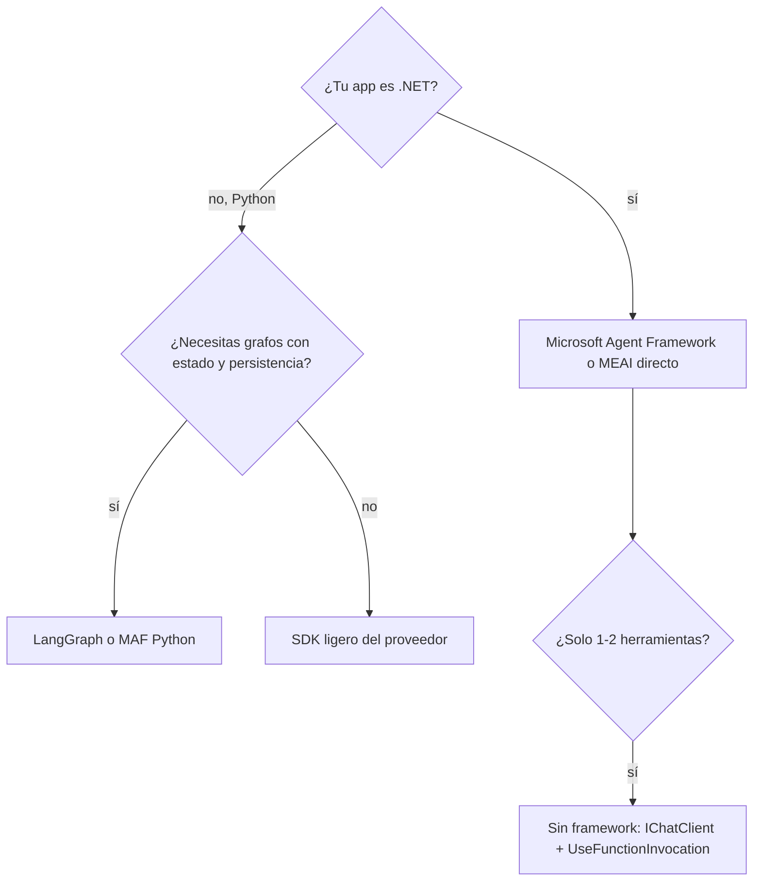

# Frameworks de agentes (comparativa)

Parte de: [[21-IA-Machine-Learning/06 Agentes de IA/_Índice Agentes de IA|Agentes de IA]]

> [!info] Cómo avanzar
> `progreso`: **pendiente** → **viendo** (estudiando) → **visto** (contestaste la autoevaluación sin abrir las respuestas) → **dominado** (hiciste el laboratorio o lo aplicaste de verdad).

## Contenido

### Qué es
Un **framework de agentes** es una librería que resuelve las partes repetitivas de construir agentes: el ciclo de llamadas a herramientas, la conexión con distintos modelos, la memoria/sesiones, la orquestación de varios agentes, la integración con MCP, la telemetría y la aprobación humana. Te ahorra código, pero te ata a sus abstracciones y a su ritmo de cambios.

### Cómo funciona
#### Criterios para comparar
1. **Lenguaje y ecosistema**: ¿soporta tu stack (.NET, Python, TypeScript)?
2. **Madurez y soporte**: ¿es versión estable (GA) o *preview*? ¿Quién lo mantiene y con qué compromiso? ¿Cada cuánto rompe la API?
3. **Proveedores de modelo**: ¿te deja cambiar entre Azure OpenAI, OpenAI, Anthropic, modelos locales (Ollama) sin reescribir?
4. **Herramientas y protocolos**: soporte de *tool calling*, MCP, A2A.
5. **Orquestación**: flujos multi-agente, flujos deterministas, *checkpoints* para tareas largas.
6. **Control humano y seguridad**: aprobaciones, límites, filtros.
7. **Observabilidad**: trazas OpenTelemetry, integración con herramientas de evaluación.
8. **Despliegue**: ¿corre en tu infraestructura o te empuja a un servicio específico?
9. **Comunidad y documentación**: ejemplos, respuestas a problemas comunes.

#### Frameworks conocidos (panorama general)
| Framework | Lenguajes | Comentario |
|---|---|---|
| **Microsoft Agent Framework** | .NET, Python | Versión 1.0 estable desde abril de 2026; unifica ideas de Semantic Kernel y AutoGen; construido sobre [[Microsoft.Extensions.AI]]; soporta MCP, *workflows* y aprobaciones |
| **Semantic Kernel** | .NET, Python, Java | Predecesor en Microsoft; Microsoft recomienda migrar los proyectos nuevos a Agent Framework (ver [[Semantic Kernel y Microsoft Agent Framework]]) |
| **LangGraph** (LangChain) | Python, JS/TS | Agentes como grafos de estados, con persistencia y control fino |
| **OpenAI Agents SDK** | Python, JS/TS | Ligero, con *handoffs* y guardrails |
| **Claude Agent SDK** (Anthropic) | Python, TS | El mismo motor de Claude Code como librería; herramientas de archivos y terminal |
| **Google ADK** | Python y otros | Kit de Google para agentes y multi-agentes |
| **CrewAI** | Python | Multi-agente por "roles" y "tareas" |
| **Pydantic AI** | Python | Énfasis en tipos y salidas validadas |

Versiones, nombres y estados cambian rápido: confirma en la documentación oficial antes de elegir.



### Ejemplo
El mismo agente "consultar pedido" en dos niveles de abstracción. Sin framework de agentes, solo con Microsoft.Extensions.AI:

```csharp
IChatClient cliente = chatClientBase.AsBuilder().UseFunctionInvocation().Build();
var opciones = new ChatOptions { Tools = [AIFunctionFactory.Create(ConsultarPedido)] };
var r = await cliente.GetResponseAsync("¿Dónde está mi pedido 77?", opciones);
```

Con Microsoft Agent Framework, que agrega sesiones, *workflows*, aprobaciones y hospedaje:

```csharp
AIAgent agente = chatClientBase.AsAIAgent(
    instructions: "Eres soporte de pedidos.",
    tools: [AIFunctionFactory.Create(ConsultarPedido)]);
var r = await agente.RunAsync("¿Dónde está mi pedido 77?");
```

Para Itzamna.Dionisio, la primera opción basta mientras sea un solo agente con pocas herramientas; la segunda conviene cuando aparezcan sesiones persistentes, aprobaciones o varios agentes.

### Cuándo usarlo y cuándo no
**Empieza sin framework** cuando:
- Tienes un solo agente con pocas herramientas: el bucle de [[El ciclo de un agente (razonar, actuar, observar)]] son unas decenas de líneas.
- Quieres entender bien el mecanismo antes de abstraerlo.
- Necesitas control total del flujo o el framework no soporta tu caso.

**Usa un framework** cuando necesitas multi-agente, persistencia de sesiones, aprobaciones, MCP y telemetría listos, o cuando el equipo se beneficia de convenciones comunes.

### Errores comunes
- **Elegir por popularidad** sin revisar soporte para tu lenguaje, madurez y licencia.
- **Adoptar un *preview* en producción** sin plan para cambios de API.
- **Acoplar el dominio al framework**: mantén tus herramientas como clases normales (testeables) y deja el framework en la orilla.
- **Usar el framework para ocultar lo que no entiendes**: cuando algo falle no sabrás si es tu prompt, tu herramienta o el framework.
- **Mezclar varios frameworks** en el mismo servicio sin necesidad.

### Para profundizar
- [Microsoft Agent Framework (Microsoft Learn)](https://learn.microsoft.com/agent-framework/)
- [LangGraph - documentación](https://docs.langchain.com/oss/python/langgraph/overview)
- [OpenAI Agents SDK](https://openai.github.io/openai-agents-python/)

## Autoevaluación

Contesta primero en voz alta o en papel; luego despliega la respuesta.

> [!question]- ¿Qué criterios usarías para comparar frameworks de agentes?
> Lenguaje (Python/.NET/TS), control del flujo (grafo explícito vs autónomo), soporte de tool calling y MCP, memoria/estado persistente, observabilidad, humano en el ciclo, madurez y licencia.

> [!question]- Menciona algunos frameworks conocidos.
> LangGraph, CrewAI, AutoGen, Semantic Kernel y Microsoft Agent Framework, además de los SDK de agentes de los proveedores de modelos. Estado, nombre comercial y versión actual de cada uno: (Pendiente de confirmar).

> [!question]- ¿Cuándo empezarías sin framework?
> Para aprender o en agentes simples: un bucle con la API de tool calling son pocas líneas y entiendes exactamente qué pasa.

