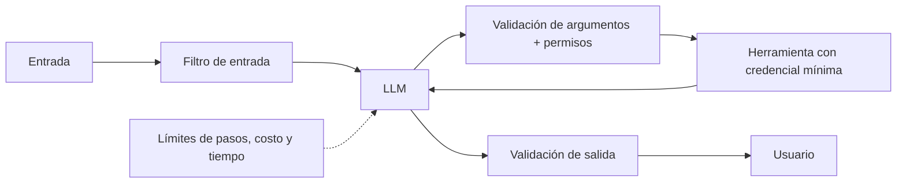

# Guardrails y límites de un agente

Parte de: [[21-IA-Machine-Learning/06 Agentes de IA/_Índice Agentes de IA|Agentes de IA]]

> [!info] Cómo avanzar
> `progreso`: **pendiente** → **viendo** (estudiando) → **visto** (contestaste la autoevaluación sin abrir las respuestas) → **dominado** (hiciste el laboratorio o lo aplicaste de verdad).

## Contenido

### Qué es
Los **guardrails** son controles que limitan lo que un agente puede recibir, decidir y hacer, para que sus errores o un ataque no causen daño. Se aplican en varias capas: **entrada** (qué le llega), **herramientas** (qué puede hacer), **salida** (qué devuelve) y **ejecución** (cuánto puede gastar y por cuánto tiempo).

La idea central: el LLM es un componente **no confiable**. Puede equivocarse, alucinar o ser manipulado por texto malicioso. Los guardrails viven en tu código e infraestructura, no en la buena voluntad del modelo.

### Cómo funciona
#### Por qué no basta con el prompt
Escribir "nunca borres datos" en el *system prompt* ayuda, pero **no es un control**: el modelo sigue instrucciones de forma probabilística, y un documento o correo con [[Prompt injection]] puede convencerlo de lo contrario. Si la herramienta `BorrarCliente` existe y tiene permisos, tarde o temprano alguien logrará que se invoque. Las reglas que importan se hacen cumplir **fuera** del modelo.

#### Capas de guardrails
| Capa | Ejemplos |
|---|---|
| Entrada | Filtros de contenido (como Azure AI Content Safety y sus *Prompt Shields*), límite de tamaño, detección de datos personales, marcar contenido externo como no confiable |
| Herramientas | Mínimo privilegio, herramientas específicas en vez de genéricas, validación de argumentos, listas de valores permitidos, aprobación humana |
| Salida | Validar contra esquema JSON, codificar antes de insertar en HTML, revisar que no filtre secretos o datos de otros usuarios |
| Ejecución | Máximo de pasos, tokens, costo y tiempo; *sandbox*; límites de tasa por usuario |
| Observabilidad | Trazas de cada paso, alertas, auditoría de acciones |

#### Mínimo privilegio aplicado a agentes
El agente debe tener **solo** las herramientas y permisos necesarios para su tarea, y nada más:
- Herramientas concretas (`ConsultarPedido(id)`) en lugar de genéricas (`EjecutarSql(texto)`).
- Credenciales propias del agente con permisos mínimos: un usuario de SQL Server que solo puede ejecutar ciertos procedimientos, una identidad administrada con un rol de lectura.
- Actuar **en nombre del usuario** con sus permisos (por ejemplo con el token del usuario), no con una cuenta de servicio todopoderosa; así el agente nunca ve datos que el usuario no podría ver.
- Separar agentes por función: el de soporte lee; el de facturación escribe, con aprobación.



### Ejemplo
Herramienta de Itzamna.Dionisio protegida en código: valida argumentos con FluentValidation, aplica el permiso del usuario y limita resultados, sin importar lo que el modelo "quiera".

```csharp
using System.ComponentModel;
using FluentValidation;

public sealed record ConsultaPedidos(int ClienteId, int Dias);

public sealed class ConsultaPedidosValidator : AbstractValidator<ConsultaPedidos>
{
    public ConsultaPedidosValidator()
    {
        RuleFor(x => x.ClienteId).GreaterThan(0);
        RuleFor(x => x.Dias).InclusiveBetween(1, 90);   // nunca "todo el historial"
    }
}

public sealed class HerramientasPedidos(IConsultarPedidos consulta, IUsuarioActual usuario)
{
    [Description("Lista pedidos recientes de un cliente (máximo 90 días).")]
    public async Task<string> ListarPedidos(int clienteId, int dias)
    {
        var args = new ConsultaPedidos(clienteId, dias);
        var v = new ConsultaPedidosValidator().Validate(args);
        if (!v.IsValid) return "ERROR: " + string.Join("; ", v.Errors.Select(e => e.ErrorMessage));

        if (!usuario.PuedeVerCliente(clienteId))          // permiso del usuario, no del agente
            return "ERROR: sin permiso para ese cliente";

        var pedidos = await consulta.EjecutarAsync(args);  // SQL en archivo .sql, usuario de BD de solo lectura
        return string.Join("\n", pedidos.Take(50));          // límite de tamaño hacia el modelo
    }
}
```

Y del lado del ciclo: `FunctionInvokingChatClient` permite configurar un máximo de iteraciones, y tu endpoint debe tener *timeout* y límite de tasa por usuario.

### Cuándo usarlo y cuándo no
Siempre hay guardrails; lo que cambia es cuántas capas. Un asistente interno de solo lectura necesita mínimo privilegio, límites de ejecución y validación de salida. Un agente con escritura, dinero o datos de clientes necesita además aprobación humana ([[Humano en el ciclo (aprobaciones)]]), filtros de entrada y auditoría. No confundas guardrails con censura: el objetivo es seguridad y exactitud, no bloquear preguntas legítimas.

### Errores comunes
- **Confiar en el *system prompt* como seguridad**: es una sugerencia, no un control.
- **Una cuenta de servicio con permisos de administrador** para el agente: cualquier inyección se vuelve un incidente grave.
- **Validar solo la entrada del usuario** y olvidar que documentos, correos, páginas web y respuestas de herramientas también traen texto que el modelo obedece.
- **Insertar la salida del modelo en HTML o SQL sin tratarla**: XSS o inyección SQL (ver [[OWASP Top 10 para LLMs]]).
- **Sin límites de consumo**: un bucle o un abuso puede costar mucho dinero en tokens.

### Para profundizar
- [OWASP Top 10 para aplicaciones LLM](https://genai.owasp.org/llm-top-10/)
- [Azure AI Content Safety (Microsoft Learn)](https://learn.microsoft.com/azure/ai-services/content-safety/overview)
- [Building effective agents (Anthropic)](https://www.anthropic.com/engineering/building-effective-agents)

## Autoevaluación

Contesta primero en voz alta o en papel; luego despliega la respuesta.

> [!question]- ¿Qué son los guardrails?
> Controles alrededor del modelo: validación de entrada y salida, listas de herramientas permitidas, permisos mínimos, límites de pasos y costos, filtros de contenido.

> [!question]- ¿Por qué no basta con instrucciones en el prompt?
> El modelo puede ignorarlas o ser manipulado. Los límites críticos deben imponerse en código (permisos, validaciones).

> [!question]- ¿Qué es el principio de mínimo privilegio aplicado a agentes?
> Dar solo las herramientas y permisos indispensables (p. ej. lectura en vez de escritura; una carpeta, no todo el disco).

## Práctica

- [[Lab 6 - Agente con tool calling y un servidor MCP sencillo]]

