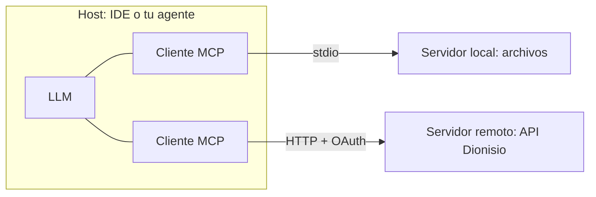

# Herramientas y MCP (Model Context Protocol)

Parte de: [[21-IA-Machine-Learning/06 Agentes de IA/_Índice Agentes de IA|Agentes de IA]]

> [!info] Cómo avanzar
> `progreso`: **pendiente** → **viendo** (estudiando) → **visto** (contestaste la autoevaluación sin abrir las respuestas) → **dominado** (hiciste el laboratorio o lo aplicaste de verdad).

## Contenido

### Qué es
Las **herramientas** son las funciones que un agente puede invocar: consultar una API, leer un archivo, buscar en una base vectorial. Cada herramienta se describe al modelo con nombre, descripción y esquema JSON de parámetros (ver [[Tool calling (llamadas a herramientas)]]).

El **Model Context Protocol (MCP)** es un protocolo abierto, basado en JSON-RPC 2.0, que estandariza cómo una aplicación de IA se conecta con fuentes de herramientas y datos. Lo propuso Anthropic a finales de 2024 y hoy lo soportan muchos clientes (asistentes de escritorio, VS Code, agentes de código) y SDKs oficiales en varios lenguajes, incluido C#. Es como un "USB-C" para conectar agentes con sistemas: escribes un servidor una vez y cualquier cliente compatible lo puede usar.

### Cómo funciona
Hay tres roles:
- **Host**: la aplicación donde vive el usuario (un IDE, un chat de escritorio, tu propio agente).
- **Cliente MCP**: el componente del host que mantiene una conexión 1:1 con un servidor.
- **Servidor MCP**: el programa que expone capacidades.

Un servidor puede exponer tres tipos de cosas:
1. **Tools**: acciones que el modelo decide invocar (`crear_ticket`, `consultar_inventario`).
2. **Resources**: datos de lectura identificados por URI (un archivo, un esquema de base de datos) que el host puede agregar al contexto.
3. **Prompts**: plantillas reutilizables que el usuario elige (por ejemplo "revisar este PR").

Transportes: **stdio** (el host lanza el servidor como proceso local y se hablan por entrada/salida estándar) y **Streamable HTTP** (servidor remoto, con autorización basada en OAuth). Al conectarse, cliente y servidor negocian versión y capacidades; luego el cliente pide `tools/list` y, cuando el modelo lo decide, `tools/call`.



La **ventaja** frente a programar cada integración a mano: sin MCP, cada combinación agente × sistema necesita su propio código de integración (M × N). Con MCP, cada sistema publica un servidor y cada agente implementa un cliente (M + N). Además, el descubrimiento es dinámico: el cliente pregunta qué herramientas hay.

### Ejemplo
Servidor MCP en C# con el SDK oficial (paquete `ModelContextProtocol`, versión 1.0 publicada en 2026, compatible con la especificación 2025-11-25), que expone el catálogo de Itzamna.Dionisio en solo lectura:

```csharp
// dotnet add package ModelContextProtocol
// dotnet add package Microsoft.Extensions.Hosting
using System.ComponentModel;
using Microsoft.Extensions.DependencyInjection;
using Microsoft.Extensions.Hosting;
using Microsoft.Extensions.Logging;
using ModelContextProtocol.Server;

var builder = Host.CreateApplicationBuilder(args);
// En stdio, stdout es el canal del protocolo: los logs van a stderr
builder.Logging.AddConsole(o => o.LogToStandardErrorThreshold = LogLevel.Trace);
builder.Services.AddMcpServer()
    .WithStdioServerTransport()
    .WithToolsFromAssembly();
await builder.Build().RunAsync();

[McpServerToolType]
public static class CatalogoTools
{
    [McpServerTool, Description("Devuelve existencias de un producto por SKU.")]
    public static string Existencias([Description("SKU del producto")] string sku)
        => sku == "A-100" ? "A-100: 42 piezas" : $"SKU {sku} no encontrado";
}
```

Del lado del cliente, `McpClient.CreateAsync(new StdioClientTransport(...))` conecta, `ListToolsAsync()` devuelve herramientas que ya son `AIFunction` de [[Microsoft.Extensions.AI]] y puedes pasarlas directo a un agente. Lo practicas en [[Lab 6 - Agente con tool calling y un servidor MCP sencillo]].

### Cuándo usarlo y cuándo no
- **Úsalo** cuando quieras que varias aplicaciones (tu agente, Copilot en VS Code, un asistente de escritorio) usen las mismas capacidades, o para consumir servidores ya existentes (GitHub, bases de datos, documentación).
- **No hace falta** si tienes un solo agente con dos funciones internas: registrarlas como herramientas locales es más simple.
- Para comunicación **entre agentes** existe otro protocolo, A2A (Agent2Agent); MCP es agente ↔ herramientas/datos.

### Errores comunes
- **Instalar servidores de terceros sin revisar**: un servidor MCP corre con tus permisos. Revisa quién lo mantiene, qué permisos pide (archivos, red, credenciales), su código si es posible, y fija la versión.
- **Confiar en las descripciones**: un servidor malicioso puede esconder instrucciones en la descripción de una herramienta o en sus respuestas (*tool poisoning*, una forma de [[Prompt injection]]). Trata todo lo que devuelve como datos no confiables.
- **Escribir logs a stdout en un servidor stdio**: corrompe el protocolo.
- **Herramientas demasiado amplias**: "ejecutar_comando" en lugar de acciones concretas. Aplica mínimo privilegio y pide aprobación para lo sensible ([[Humano en el ciclo (aprobaciones)]]).
- **Exponer un servidor HTTP sin autenticación**: usa la autorización OAuth que define la especificación.

### Para profundizar
- [Model Context Protocol - sitio oficial y especificación](https://modelcontextprotocol.io/)
- [SDK de C# para MCP - documentación](https://csharp.sdk.modelcontextprotocol.io/)
- [Crear un servidor MCP mínimo con .NET (Microsoft Learn)](https://learn.microsoft.com/dotnet/ai/quickstarts/build-mcp-server)

## Autoevaluación

Contesta primero en voz alta o en papel; luego despliega la respuesta.

> [!question]- ¿Qué es MCP?
> Un protocolo abierto para que aplicaciones de IA (clientes) se conecten a servidores que exponen herramientas, recursos y prompts de forma estándar.

> [!question]- ¿Qué tres cosas puede exponer un servidor MCP?
> **Tools** (acciones que el modelo puede invocar), **resources** (datos de lectura) y **prompts** (plantillas).

> [!question]- ¿Qué ventaja da frente a programar cada integración a mano?
> Escribes el servidor una vez y lo usa cualquier cliente compatible (asistentes, IDEs, agentes).

> [!question]- Riesgo: instalas un servidor MCP de un tercero. ¿Qué revisas?
> Qué permisos tiene (archivos, red, credenciales), quién lo mantiene y si sus descripciones o respuestas podrían contener instrucciones maliciosas. Dale el mínimo acceso y aprueba acciones sensibles.

## Práctica

- [[Lab 6 - Agente con tool calling y un servidor MCP sencillo]]

