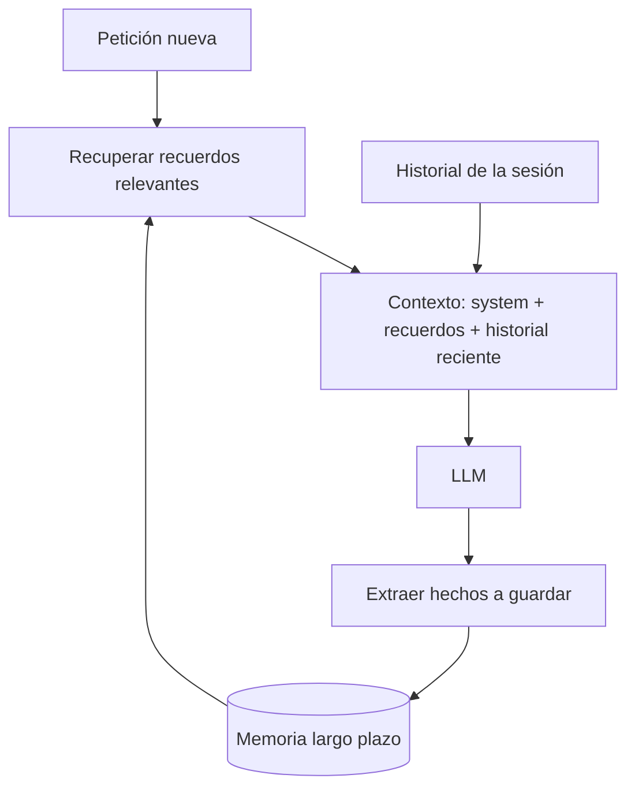

# Memoria de agentes (corto y largo plazo)

Parte de: [[21-IA-Machine-Learning/06 Agentes de IA/_Índice Agentes de IA|Agentes de IA]]

> [!info] Cómo avanzar
> `progreso`: **pendiente** → **viendo** (estudiando) → **visto** (contestaste la autoevaluación sin abrir las respuestas) → **dominado** (hiciste el laboratorio o lo aplicaste de verdad).

## Contenido

### Qué es
Un LLM **no recuerda nada** entre llamadas: cada petición es independiente. La "memoria" de un agente es información que tu aplicación guarda y vuelve a meter en el contexto. Se distinguen dos tipos:
- **Memoria de corto plazo**: el historial de la conversación o tarea actual (mensajes, llamadas a herramientas y sus resultados). Vive en la ventana de contexto y dura lo que dura la sesión.
- **Memoria de largo plazo**: datos que persisten entre sesiones: preferencias del usuario, hechos aprendidos, resúmenes de conversaciones pasadas, decisiones previas. Se guarda fuera del modelo (base de datos, almacén vectorial) y se **recupera** cuando es relevante.

### Cómo funciona
#### Corto plazo
En cada vuelta del ciclo envías al modelo todo el historial. El problema: la ventana de contexto es finita y cada token cuesta. Cuando el historial ya no cabe (o se vuelve caro), hay estrategias:
1. **Ventana deslizante**: conservar las instrucciones del sistema y los últimos N mensajes.
2. **Resumen**: comprimir los mensajes viejos en un resumen que generas con el propio LLM y sustituirlos.
3. **Recorte de resultados de herramientas**: guardar solo lo esencial de respuestas largas.
4. **Recuperación selectiva**: mover lo viejo a un almacén y traer solo lo relevante a la pregunta actual.

Lo que nunca debes recortar: el *system prompt*, la meta original y las decisiones o restricciones clave.

#### Largo plazo
Funciona como un [[RAG (generación aumentada con recuperación)]] sobre la historia del usuario:
1. **Escribir**: al terminar una interacción, decides (con reglas o con el LLM) qué vale la pena guardar: "el usuario prefiere respuestas en tablas", "el proyecto usa Dapper, no EF".
2. **Almacenar**: en una tabla (hechos estructurados) o como embeddings en pgvector / Azure AI Search ([[Embeddings y bases vectoriales (pgvector y Azure AI Search)]]).
3. **Recuperar**: al iniciar una tarea, buscas los recuerdos relevantes y los agregas al contexto.



### Ejemplo
En Microsoft Agent Framework la memoria de corto plazo vive en una **sesión** (`AgentSession`), que además puedes serializar para continuar después:

```csharp
using System.Text.Json;
using Microsoft.Agents.AI;

AgentSession sesion = await agente.CreateSessionAsync();
await agente.RunAsync("Mi proyecto Dionisio usa Dapper y SQL Server.", sesion);
var r = await agente.RunAsync("¿Qué ORM te dije que uso?", sesion); // recuerda: misma sesión
Console.WriteLine(r.Text);

// Persistir la sesión (por ejemplo en una tabla) para retomarla otro día
JsonElement estado = await agente.SerializeSessionAsync(sesion);
AgentSession retomada = await agente.DeserializeSessionAsync(estado);
```

Para largo plazo, una tabla sencilla en SQL Server suele bastar al inicio: `MemoriaUsuario(UsuarioId, Clave, Valor, Origen, FechaAlta, Expira)`, con una herramienta `RecordarPreferencia` que el agente invoca y una consulta `.sql` que cargas al iniciar la sesión. Cuando los recuerdos crezcan y necesites búsqueda semántica, pasas a embeddings.

### Cuándo usarlo y cuándo no
- **Corto plazo** siempre existe en un agente conversacional; lo que decides es cómo recortarlo.
- **Largo plazo** vale la pena en asistentes personales o de equipo donde repetir contexto es molesto. **No** lo agregues si las tareas son independientes (procesar un documento y terminar): aumenta complejidad, costo y riesgo de privacidad.
- Si la información es conocimiento de la empresa (manuales, políticas), eso es RAG sobre documentos, no "memoria del agente".

### Errores comunes
- **Meter todo el historial siempre**: costo y latencia crecen sin control, y el modelo se distrae con información vieja. Resume o recorta.
- **Guardar todo en largo plazo**: se acumulan datos irrelevantes o contradictorios. Define qué se guarda, con fecha y caducidad.
- **Memoria envenenada**: un documento o usuario malicioso logra que el agente "recuerde" una instrucción falsa que se activa en sesiones futuras. Valida lo que se guarda y trata los recuerdos como datos, no como órdenes ([[Prompt injection]]).
- **Privacidad**: guardar datos personales sin consentimiento, sin forma de borrarlos o mezclados entre usuarios. Separa por usuario/tenant y permite eliminar ([[Privacidad de datos al usar IA]]).
- **Perder la sesión entre peticiones HTTP**: en una API, la sesión debe persistirse (base de datos, caché distribuida), no en memoria del proceso.

### Para profundizar
- [Microsoft Agent Framework - documentación](https://learn.microsoft.com/agent-framework/)
- [Effective context engineering for AI agents (Anthropic)](https://www.anthropic.com/engineering/effective-context-engineering-for-ai-agents)
- [Hugging Face Agents Course](https://huggingface.co/learn/agents-course)

## Autoevaluación

Contesta primero en voz alta o en papel; luego despliega la respuesta.

> [!question]- ¿Qué es la memoria de corto plazo?
> El historial dentro de la ventana de contexto de la conversación o tarea actual.

> [!question]- ¿Y la de largo plazo?
> Información guardada fuera del modelo (BD, archivos, índice vectorial) que se recupera cuando hace falta en otras sesiones.

> [!question]- ¿Qué haces cuando el historial no cabe en el contexto?
> Resumir mensajes viejos, quedarte con los recientes y recuperar detalles bajo demanda.

> [!question]- Riesgo de la memoria persistente.
> Guardar datos sensibles o instrucciones inyectadas que luego se reutilizan. Controla qué se guarda y permite borrarlo.

