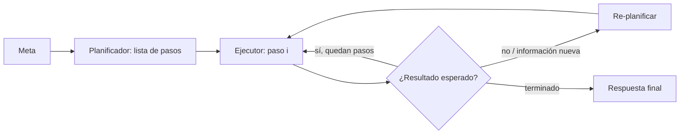

# Planificación y descomposición de tareas

Parte de: [[21-IA-Machine-Learning/06 Agentes de IA/_Índice Agentes de IA|Agentes de IA]]

> [!info] Cómo avanzar
> `progreso`: **pendiente** → **viendo** (estudiando) → **visto** (contestaste la autoevaluación sin abrir las respuestas) → **dominado** (hiciste el laboratorio o lo aplicaste de verdad).

## Contenido

### Qué es
**Planificar** es que el agente, antes de (o mientras) actúa, divida una meta grande en subtareas más pequeñas y ordenadas. **Descomponer** reduce la dificultad de cada paso: el modelo razona mejor sobre "busca las facturas canceladas de octubre" que sobre "audita la facturación del mes".

Por qué ayuda:
- Cada subtarea cabe mejor en el contexto y se puede verificar por separado.
- Hace visible el razonamiento: un humano puede revisar el plan antes de ejecutar.
- Permite paralelizar subtareas independientes y reintentar solo la que falló.
- Reduce el error acumulado: es más fácil detectar un paso equivocado que un resultado final raro.

### Cómo funciona
Hay dos estilos principales:

**1. Paso a paso (ReAct puro)**: el agente decide solo la siguiente acción en cada vuelta ([[El ciclo de un agente (razonar, actuar, observar)]]). Es flexible, pero en tareas largas puede perder el rumbo.

**2. Planificar-ejecutar (*plan-and-execute*)**: se separan dos fases:
1. Un **planificador** (una llamada al LLM, a veces con un modelo más capaz) produce una lista de pasos, idealmente como salida estructurada ([[Salidas estructuradas (JSON)]]).
2. Un **ejecutor** (otro agente o código) realiza cada paso con sus herramientas.
3. Tras cada paso (o al fallar uno) se **re-planifica**: se ajusta el resto del plan con lo aprendido.



Otras variantes: descomposición jerárquica (un paso se vuelve sub-plan), y planes como grafos donde algunos pasos corren en paralelo. En sistemas grandes, cada subtarea puede ir a un agente especializado ([[Sistemas multi-agente y orquestación]]).

### Ejemplo
Meta: "Prepara el reporte mensual de ventas canceladas para Wee.Reporteria". Plan generado como JSON:

```json
{
  "pasos": [
    {"id": 1, "accion": "Consultar ventas canceladas de octubre", "herramienta": "ConsultarCancelaciones"},
    {"id": 2, "accion": "Agrupar por motivo y sucursal", "herramienta": null},
    {"id": 3, "accion": "Generar Excel con la tabla y una gráfica", "herramienta": "GenerarExcel"},
    {"id": 4, "accion": "Redactar resumen de 5 líneas con hallazgos", "herramienta": null}
  ]
}
```

Y un esqueleto en C# que deserializa el plan y lo ejecuta, re-planificando si algo falla:

```csharp
using Microsoft.Extensions.AI;

public sealed record Paso(int Id, string Accion, string? Herramienta);
public sealed record Plan(List<Paso> Pasos);

// GetResponseAsync<T> pide al modelo una salida que cumpla el esquema de Plan
ChatResponse<Plan> respuesta = await chatClient.GetResponseAsync<Plan>(
    $"Divide en máximo 5 pasos de alto nivel: {meta}");
Plan plan = respuesta.Result;

foreach (var paso in plan.Pasos)
{
    var resultado = await ejecutor.RunAsync($"Ejecuta: {paso.Accion}", sesion);
    if (resultado.Text.StartsWith("ERROR"))
    {
        // re-planificar solo lo que falta, con la información del error
        plan = (await chatClient.GetResponseAsync<Plan>(
            $"El paso {paso.Id} falló: {resultado.Text}. Replantea los pasos restantes.")).Result;
        break; // en código real: reiniciar el recorrido con el nuevo plan
    }
}
```

### Cuándo usarlo y cuándo no
- **Úsalo** en tareas largas o de varias etapas (investigación, migraciones, reportes) y cuando quieras que un humano apruebe el plan antes de ejecutarlo.
- **No lo uses** en tareas de uno o dos pasos: el planificador agrega una llamada extra (costo y latencia) sin beneficio.
- Si los pasos siempre son los mismos, no pidas al LLM que los planifique: escríbelos en código como un flujo fijo.

### Errores comunes
- **Plan demasiado detallado al inicio**: el agente aún no sabe lo que va a encontrar; un plan de 30 micro-pasos se vuelve obsoleto en el paso 2 y obliga a seguir instrucciones equivocadas. Planifica a alto nivel y detalla conforme avanzas.
- **No re-planificar**: seguir el plan original aunque un resultado lo contradiga.
- **Planes en texto libre**: difíciles de validar. Usa JSON con esquema y valida (número máximo de pasos, herramientas existentes).
- **Pasos no verificables**: "mejorar el reporte" no tiene criterio de terminado; cada paso debe tener un resultado comprobable.
- **Permitir que el plan invente herramientas**: valida que cada `herramienta` exista y esté permitida.

### Para profundizar
- [Plan-and-Solve Prompting (arXiv)](https://arxiv.org/abs/2305.04091)
- [Salidas estructuradas con Microsoft.Extensions.AI (Microsoft Learn)](https://learn.microsoft.com/dotnet/ai/quickstarts/structured-output)
- [Building effective agents (Anthropic)](https://www.anthropic.com/engineering/building-effective-agents)

## Autoevaluación

Contesta primero en voz alta o en papel; luego despliega la respuesta.

> [!question]- ¿Por qué descomponer una tarea grande?
> El modelo comete menos errores con pasos pequeños y verificables; facilita revisar y reintentar solo lo que falló.

> [!question]- ¿Qué es el patrón planificar-ejecutar?
> Primero se genera un plan (lista de pasos) y luego se ejecuta cada paso, replanificando si los resultados cambian el panorama.

> [!question]- Error común: un plan demasiado detallado al inicio.
> Se vuelve obsoleto con la primera observación inesperada; planea a alto nivel y detalla sobre la marcha.

