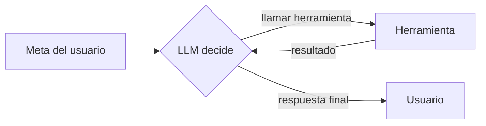

# Qué es un agente de IA

Parte de: [[21-IA-Machine-Learning/06 Agentes de IA/_Índice Agentes de IA|Agentes de IA]]

> [!info] Cómo avanzar
> `progreso`: **pendiente** → **viendo** (estudiando) → **visto** (contestaste la autoevaluación sin abrir las respuestas) → **dominado** (hiciste el laboratorio o lo aplicaste de verdad).

## Contenido

### Qué es
Un **agente de IA** es un programa en el que un modelo de lenguaje (LLM) decide, paso a paso, qué hacer para cumplir un objetivo: elige qué herramienta llamar, con qué argumentos, interpreta el resultado y decide si sigue o si ya terminó. La diferencia clave con un chat normal es la **autonomía sobre el flujo de control**: no eres tú quien programa el orden de los pasos, es el modelo quien lo decide en tiempo de ejecución.

Un agente se compone de cuatro piezas:
- **Modelo**: el LLM que razona (ver [[Cómo funciona un LLM (tokens, contexto y predicción)]]).
- **Instrucciones**: el *system prompt* con el rol, las reglas y los límites.
- **Herramientas**: funciones que puede invocar (consultar una API, leer un archivo, ejecutar SQL). Ver [[Tool calling (llamadas a herramientas)]] y [[Herramientas y MCP (Model Context Protocol)]].
- **Memoria/estado**: el historial de la conversación y lo que ha observado (ver [[Memoria de agentes (corto y largo plazo)]]).

### Cómo funciona
El agente corre en un ciclo: recibe la meta, el modelo propone una acción, tu código la ejecuta, el resultado vuelve al modelo y se repite hasta que el modelo responde sin pedir más herramientas o se alcanza un límite. El detalle está en [[El ciclo de un agente (razonar, actuar, observar)]].

Conviene verlo como un espectro de autonomía:

| Nivel | Quién decide los pasos | Ejemplo |
|---|---|---|
| Llamada simple | Tú | Resumir un texto |
| Flujo fijo (*workflow*) con LLM | Tú, en código | Clasificar un ticket → buscar en la base → redactar respuesta |
| Agente | El modelo | "Investiga por qué falló el pago 123 y propón una corrección" |

En un **flujo fijo** el LLM es una pieza más dentro de un pipeline que tú escribiste: siempre se ejecutan los mismos pasos en el mismo orden. Es predecible, barato y fácil de probar. En un **agente** el número y el orden de pasos cambian según lo que el modelo encuentre: más flexible, pero menos predecible, más caro y más difícil de evaluar.



### Ejemplo
En Itzamna.Dionisio podrías tener un agente de soporte interno que contesta "¿por qué el cliente 4512 no ve su factura?". Con herramientas de solo lectura (`BuscarCliente`, `ConsultarFacturas`, `LeerLogsRecientes`) el agente decide qué consultar primero; si encuentra que la factura está en estado "cancelada", consulta el log de cancelación y arma la explicación. Un flujo fijo no podría adaptarse a que la causa a veces esté en la factura y a veces en el log.

En C# con Microsoft Agent Framework (ver [[Semantic Kernel y Microsoft Agent Framework]]) se ve así:

```csharp
using System.ComponentModel;
using Microsoft.Agents.AI;
using Microsoft.Extensions.AI;

[Description("Obtiene el estado de las facturas de un cliente.")]
static string ConsultarFacturas([Description("Id del cliente")] int clienteId)
    => clienteId == 4512 ? "Factura F-889: cancelada el 2026-10-02" : "Sin facturas";

// chatClient es cualquier IChatClient (Azure OpenAI, Ollama, etc.)
AIAgent agente = chatClient.AsAIAgent(
    instructions: "Eres soporte interno. Solo lees datos; nunca modificas nada.",
    tools: [AIFunctionFactory.Create(ConsultarFacturas)]);

Console.WriteLine(await agente.RunAsync("¿Por qué el cliente 4512 no ve su factura?"));
```

### Cuándo usarlo y cuándo no
Úsalo cuando:
- La tarea tiene **pasos que no conoces de antemano** (diagnóstico, investigación, tareas abiertas).
- Necesitas combinar varias herramientas según lo que vayas descubriendo.
- Un error es recuperable o hay revisión humana antes de los efectos importantes.

**No** lo uses cuando:
- Los pasos son siempre los mismos: un flujo fijo o código normal es más barato, rápido y testeable.
- La tarea exige determinismo o exactitud total (cálculos fiscales, timbrado de CFDI, transferencias): usa código y, si acaso, el LLM solo para una parte acotada.
- La latencia o el costo importan mucho: cada paso es otra llamada al modelo (ver [[Costo y latencia de LLMs]]).
- No puedes darle herramientas seguras o no puedes evaluar su comportamiento.

Regla práctica: empieza con la solución más simple (una llamada, luego un flujo) y sube a agente solo cuando el flujo fijo no alcance.

### Errores comunes
- **Usar un agente para todo**: muchas tareas son un `if` y dos llamadas. El agente agrega costo y variabilidad sin beneficio.
- **Herramientas demasiado poderosas**: dar `EjecutarSql(string)` en lugar de consultas específicas. Aplica mínimo privilegio ([[Guardrails y límites de un agente]]).
- **Sin límite de pasos ni presupuesto**: el agente puede quedarse en bucle gastando tokens.
- **No evaluarlo**: "funcionó en mi prueba" no basta; mide con varias ejecuciones ([[Evaluación de agentes]]).
- **Confundir chat con agente**: si no llama herramientas ni decide pasos, es un chat con un buen prompt, no un agente.

### Para profundizar
- [Microsoft Agent Framework - documentación](https://learn.microsoft.com/agent-framework/)
- [Building effective agents (Anthropic)](https://www.anthropic.com/engineering/building-effective-agents)
- [Hugging Face Agents Course](https://huggingface.co/learn/agents-course)

## Autoevaluación

Contesta primero en voz alta o en papel; luego despliega la respuesta.

> [!question]- ¿Qué es un agente de IA?
> Un sistema donde un LLM decide, en un ciclo, qué acciones tomar (llamar herramientas, buscar, escribir) para cumplir un objetivo, observando los resultados.

> [!question]- ¿Qué diferencia hay entre un flujo fijo con LLM y un agente?
> En el flujo fijo tu código decide los pasos; en el agente el modelo elige el siguiente paso. Más flexible, pero menos predecible y más difícil de probar.

> [!question]- ¿Cuándo NO usarías un agente?
> Cuando los pasos son conocidos y estables: un flujo fijo es más barato, rápido y confiable.

## Práctica

- [[Lab 6 - Agente con tool calling y un servidor MCP sencillo]]

